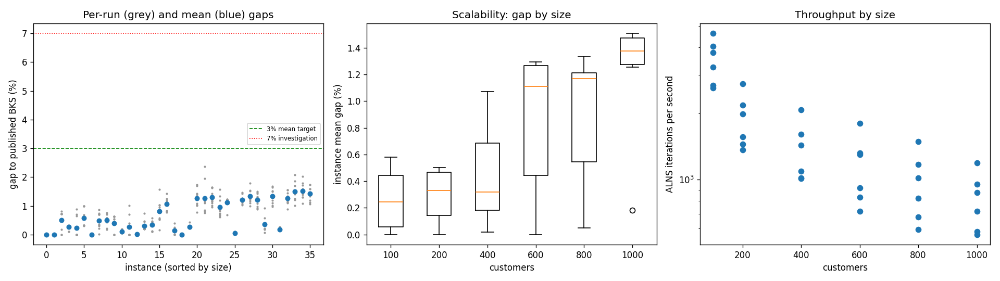
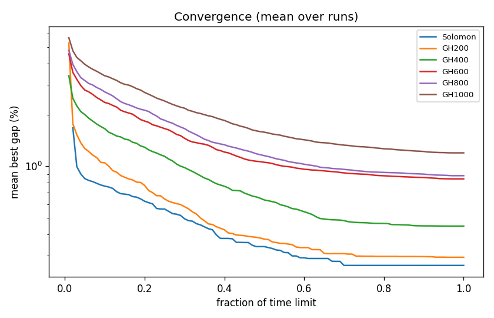

# ALNS + VND — campaigns and results

All campaigns were run with [`scripts/run_alns.py`](../../scripts/run_alns.py); every attempt was executed in an isolated worker under a hard wall-clock limit and independently re-validated and re-scored by `scripts.benchmark` (DIMACS one-decimal truncation). Gaps are to the published CVRPLIB best-known solutions bundled with the dataset — **not proven optima**. Hardware: Apple M2 Max (8P+4E cores, 64 GB), 6 concurrent single-threaded workers, Python 3.9.6, NumPy 2.0.2, Numba 0.60.0.

## Split

[`split.json`](split.json) (seed 20261110, committed before any tuning): within each of the 36 (size family × class) groups one instance was drawn for **test**, one for **development**; the other 284 form an untouched **reserve**.

## Tuning (development split only, 0.1 s/customer, seeds 0–1)

| Campaign | Change | Mean gap % | Worst run % |
| --- | --- | ---: | ---: |
| dev-001-baseline | initial defaults | 1.137 | 3.744 |
| dev-002-coolT | SA 0.15 → 0.005 | 1.328 | 3.938 |
| dev-003-hotT | SA 1.5 → 0.02 | 0.993 | 3.533 |
| dev-004-hot2 | SA 4.0 → 0.05 | 1.052 | 3.040 |
| dev-005-hotT-g20 | + 20 VND neighbours | 0.941 | 3.439 |
| dev-006-q20 | + destroy max 20 | 0.972 | 3.006 |
| **dev-007-noworst** | + worst removal off (**frozen**) | **0.892** | 3.172 |

All 504 development attempts were feasible and within budget. The frozen configuration is the `ALNSConfig` default at commit `ff83404`.

## Held-out test — [`test-001`](test-001/alns_report.md)

36 test instances × 10 seeds (0–9), `time_limit = max(10, 0.3 × customers)` s, code commit `95fbd3d` (clean tree).

| Metric | Value |
| --- | ---: |
| Attempts (planned) | 360 (360) |
| Independently feasible | **360 / 360** |
| Within hard time limit | 360 / 360 (minimum slack 1.6 s) |
| **Mean gap, equal weight per instance** | **0.654 %** |
| Median instance mean gap | 0.496 % |
| P90 run gap | 1.448 % |
| Worst run gap | 2.364 % (GH600/R2_6_3) |
| Mean of per-instance best-of-10 gaps | 0.389 % |
| Mean within-instance SD across seeds | 0.200 pp |
| Runs above 7 % | none |
| Negative gaps (claimed improvements on BKS) | none |
| Shared evaluator assessment | **PASS** (runtime/memory targets unresolved, no runtime PASS claimed) |

| Size | Time limit | Mean gap % | Worst run % | | Class | Mean gap % | Worst run % |
| --- | ---: | ---: | ---: | --- | --- | ---: | ---: |
| 100 (Solomon) | 30 s | 0.262 | 0.998 | | C1 | 0.413 | 1.679 |
| 200 | 60 s | 0.293 | 1.014 | | C2 | 0.216 | 0.861 |
| 400 | 120 s | 0.446 | 1.567 | | R1 | 0.845 | 1.731 |
| 600 | 180 s | 0.844 | 2.364 | | R2 | 0.928 | 2.364 |
| 800 | 240 s | 0.881 | 1.793 | | RC1 | 0.902 | 2.026 |
| 1000 | 300 s | 1.198 | 2.079 | | RC2 | 0.619 | 1.737 |

Per-instance statistics: [`test-001/alns_report.md`](test-001/alns_report.md), [`alns_instances.csv`](test-001/alns_instances.csv); shared-evaluator tables: [`summary.csv`](test-001/summary.csv), [`comparison.csv`](test-001/comparison.csv).

### Interpretation

* **Strengths.** Every run is feasible; the BKS is reached exactly on several clustered instances (C109, C202, C1_2_5) and nearly on C1_4_2, C1_6_7, C2_8_6. Seed-to-seed variation is small (≈0.2 pp), so results are not seed-dependent.
* **Scalability.** Mean gap grows from ~0.3 % (100–200 customers) to ~1.2 % (1000), while iterations per second fall roughly linearly with size (≈3,500/s at 100, ≈800/s at 1000). The convergence curves are still descending at the deadline for 600–1000 customers: these sizes are time-limited, not stuck.
* **Weakest cases.** Random / mixed geography (R1, R2, RC1) at 600–1000 customers, 1.2–1.5 % mean. Long R2 routes make intra-route moves and repairs more expensive and the landscape flatter.
* **Possible improvements** (not implemented): cross-exchange of short strings between routes, SWAP* (Vidal 2022) adapted to time windows, penalised time-warp search to cross infeasible regions, multi-core cooperative search, or longer budgets for large instances.

### Limitations

* BKS are published best-knowns, not optima; no lower bound was computed.
* Timings share a 12-core machine with 5 other workers; budgets were respected under that contention.
* No PyVRP baseline has been run (separate, pinned-version comparison still to do).
* Static, Euclidean, ≤1,000 customers only; several-thousand-customer scalability is untested.

## Storage

Summaries, ledgers (`runs.jsonl`/`runs.csv`), reports and plots are versioned. Raw per-attempt directories (`*/shards/`: routes, schedules, traces, logs, configs) are git-ignored and archived locally in `archives/<campaign>-shards.tar.gz`, with the archive SHA256 stored next to each campaign in `shards.tar.gz.sha256`. **These archives exist only on this machine; an off-device location still has to be chosen.**
