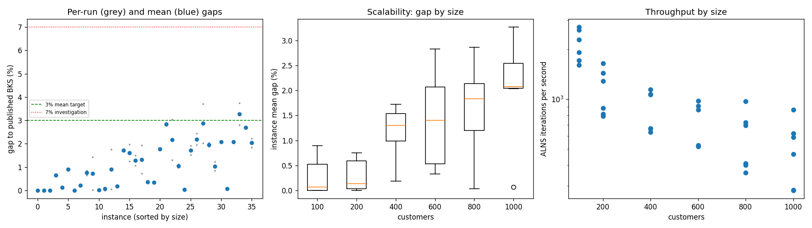
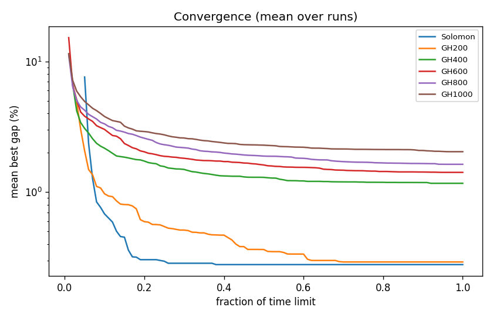

# ALNS + VND campaign `dev-001-baseline`

Split: **development**; 36 instances x 2 seeds; budget: time_limit = max(10.0, 0.1 * customers) seconds. Gaps are to published BKS (not proven optima), recomputed by the independent evaluator.

| Metric | Value |
| --- | ---: |
| planned attempts | 72 |
| attempts | 72 |
| feasible attempts | 72 |
| budget respected | 72 |
| mean gap equal weight | 1.137 |
| median instance gap | 0.963 |
| p90 run gap | 2.662 |
| worst run gap | 3.744 |
| best of seeds mean gap | 0.962 |
| mean within instance sd | 0.249 |
| negative gap runs | 0 |

Instances with any run above 7%: none

## By size family

| Family | n | time limit (s) | mean gap % | worst run gap % | mean seed SD | iterations |
| --- | ---: | ---: | ---: | ---: | ---: | ---: |
| Solomon | 6 | 10 | 0.279 | 0.893 | 0.000 | 21461 |
| GH200 | 6 | 20 | 0.292 | 1.427 | 0.212 | 22865 |
| GH400 | 6 | 40 | 1.168 | 1.961 | 0.478 | 34996 |
| GH600 | 6 | 60 | 1.416 | 3.039 | 0.259 | 43204 |
| GH800 | 6 | 80 | 1.632 | 3.704 | 0.367 | 47453 |
| GH1000 | 6 | 100 | 2.039 | 3.744 | 0.176 | 51777 |

## By instance class

| Class | instances | mean gap % | worst run gap % |
| --- | ---: | ---: | ---: |
| C1 | 6 | 0.561 | 2.093 |
| C2 | 6 | 0.416 | 1.914 |
| R1 | 6 | 1.418 | 2.442 |
| R2 | 6 | 1.991 | 3.744 |
| RC1 | 6 | 1.374 | 3.039 |
| RC2 | 6 | 1.065 | 2.227 |

## Per instance

| Instance | n | BKS | best | mean gap % | best % | worst % | SD | feasible | vehicles | iterations | time-to-best s |
| --- | ---: | ---: | ---: | ---: | ---: | ---: | ---: | ---: | ---: | ---: | ---: |
| Solomon/C107.vrp | 100 | 827.3 | 827.3 | 0.000 | 0.000 | 0.000 | 0.000 | 2/2 | 10.0 | 27240 | 0.5 |
| Solomon/C204.vrp | 100 | 588.1 | 588.1 | 0.000 | 0.000 | 0.000 | 0.000 | 2/2 | 3.0 | 17202 | 0.7 |
| Solomon/R102.vrp | 100 | 1466.6 | 1466.6 | 0.000 | 0.000 | 0.000 | 0.000 | 2/2 | 18.0 | 26126 | 1.2 |
| Solomon/R203.vrp | 100 | 870.8 | 876.5 | 0.655 | 0.655 | 0.655 | 0.000 | 2/2 | 5.0 | 19188 | 2.4 |
| Solomon/RC107.vrp | 100 | 1207.8 | 1209.3 | 0.124 | 0.124 | 0.124 | 0.000 | 2/2 | 12.0 | 22884 | 1.5 |
| Solomon/RC204.vrp | 100 | 783.5 | 790.5 | 0.893 | 0.893 | 0.893 | 0.000 | 2/2 | 4.0 | 16124 | 1.7 |
| GH200/C1_2_8.vrp | 200 | 2684.0 | 2684.0 | 0.000 | 0.000 | 0.000 | 0.000 | 2/2 | 20.0 | 32844 | 1.6 |
| GH200/C2_2_8.vrp | 200 | 1813.7 | 1816.9 | 0.204 | 0.176 | 0.232 | 0.039 | 2/2 | 6.5 | 17710 | 0.9 |
| GH200/R1_2_6.vrp | 200 | 3559.1 | 3582.3 | 0.750 | 0.652 | 0.849 | 0.139 | 2/2 | 19.5 | 25793 | 11.5 |
| GH200/R2_2_8.vrp | 200 | 1842.4 | 1842.5 | 0.716 | 0.005 | 1.427 | 1.006 | 2/2 | 4.5 | 16260 | 5.5 |
| GH200/RC1_2_2.vrp | 200 | 3221.6 | 3222.2 | 0.019 | 0.019 | 0.019 | 0.000 | 2/2 | 19.0 | 28796 | 10.9 |
| GH200/RC2_2_8.vrp | 200 | 2151.2 | 2151.2 | 0.063 | 0.000 | 0.126 | 0.089 | 2/2 | 6.0 | 15788 | 10.5 |
| GH400/C1_4_3.vrp | 400 | 6929.9 | 6933.1 | 0.895 | 0.046 | 1.745 | 1.201 | 2/2 | 38.5 | 45849 | 26.6 |
| GH400/C2_4_8.vrp | 400 | 3773.7 | 3780.5 | 0.180 | 0.180 | 0.180 | 0.000 | 2/2 | 12.0 | 26659 | 19.7 |
| GH400/R1_4_10.vrp | 400 | 8077.8 | 8216.6 | 1.722 | 1.718 | 1.726 | 0.005 | 2/2 | 37.0 | 42690 | 33.8 |
| GH400/R2_4_4.vrp | 400 | 4211.2 | 4263.9 | 1.606 | 1.251 | 1.961 | 0.502 | 2/2 | 9.0 | 26597 | 29.3 |
| GH400/RC1_4_8.vrp | 400 | 7757.2 | 7840.0 | 1.280 | 1.067 | 1.493 | 0.301 | 2/2 | 37.0 | 42870 | 28.7 |
| GH400/RC2_4_3.vrp | 400 | 4573.0 | 4605.7 | 1.323 | 0.715 | 1.931 | 0.860 | 2/2 | 12.0 | 25312 | 30.0 |
| GH600/C1_6_9.vrp | 600 | 13664.5 | 13704.9 | 0.357 | 0.296 | 0.419 | 0.087 | 2/2 | 57.0 | 58778 | 50.9 |
| GH600/C2_6_9.vrp | 600 | 7303.2 | 7326.4 | 0.331 | 0.318 | 0.345 | 0.019 | 2/2 | 19.0 | 31316 | 51.5 |
| GH600/R1_6_4.vrp | 600 | 15721.4 | 15997.9 | 1.765 | 1.759 | 1.771 | 0.009 | 2/2 | 55.0 | 51822 | 50.4 |
| GH600/R2_6_10.vrp | 600 | 11837.0 | 12163.8 | 2.831 | 2.761 | 2.900 | 0.099 | 2/2 | 13.5 | 31594 | 50.6 |
| GH600/RC1_6_2.vrp | 600 | 15890.6 | 16096.7 | 2.168 | 1.297 | 3.039 | 1.232 | 2/2 | 56.5 | 54586 | 51.4 |
| GH600/RC2_6_2.vrp | 600 | 10336.9 | 10436.9 | 1.042 | 0.967 | 1.117 | 0.106 | 2/2 | 18.0 | 31125 | 43.6 |
| GH800/C1_8_6.vrp | 800 | 25133.3 | 25140.9 | 0.030 | 0.030 | 0.030 | 0.000 | 2/2 | 80.0 | 77574 | 61.4 |
| GH800/C2_8_10.vrp | 800 | 10946.0 | 11111.8 | 1.714 | 1.515 | 1.914 | 0.282 | 2/2 | 25.0 | 32048 | 66.1 |
| GH800/R1_8_3.vrp | 800 | 29304.5 | 29874.5 | 2.193 | 1.945 | 2.442 | 0.351 | 2/2 | 72.5 | 58052 | 67.8 |
| GH800/R2_8_10.vrp | 800 | 19984.8 | 20390.2 | 2.866 | 2.029 | 3.704 | 1.185 | 2/2 | 17.5 | 28774 | 45.3 |
| GH800/RC1_8_9.vrp | 800 | 28347.1 | 28879.3 | 1.958 | 1.877 | 2.038 | 0.113 | 2/2 | 74.0 | 55478 | 72.3 |
| GH800/RC2_8_1.vrp | 800 | 19201.3 | 19362.7 | 1.030 | 0.841 | 1.220 | 0.268 | 2/2 | 25.5 | 32792 | 76.8 |
| GH1000/C1_10_2.vrp | 1000 | 41337.8 | 42196.1 | 2.085 | 2.076 | 2.093 | 0.012 | 2/2 | 99.0 | 86360 | 88.8 |
| GH1000/C2_10_2.vrp | 1000 | 16462.6 | 16471.1 | 0.065 | 0.052 | 0.079 | 0.019 | 2/2 | 30.0 | 46692 | 82.8 |
| GH1000/R1_10_5.vrp | 1000 | 50406.7 | 51428.4 | 2.077 | 2.027 | 2.127 | 0.071 | 2/2 | 93.5 | 62155 | 89.7 |
| GH1000/R2_10_7.vrp | 1000 | 23102.2 | 23748.1 | 3.270 | 2.796 | 3.744 | 0.671 | 2/2 | 21.5 | 28404 | 95.0 |
| GH1000/RC1_10_5.vrp | 1000 | 45028.1 | 46237.8 | 2.698 | 2.687 | 2.709 | 0.016 | 2/2 | 91.5 | 58828 | 81.0 |
| GH1000/RC2_10_10.vrp | 1000 | 21731.2 | 22132.4 | 2.036 | 1.846 | 2.227 | 0.269 | 2/2 | 19.5 | 28224 | 93.4 |

