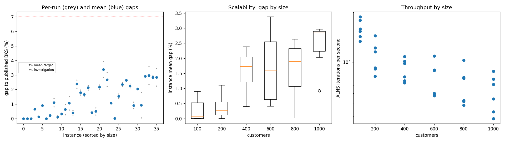
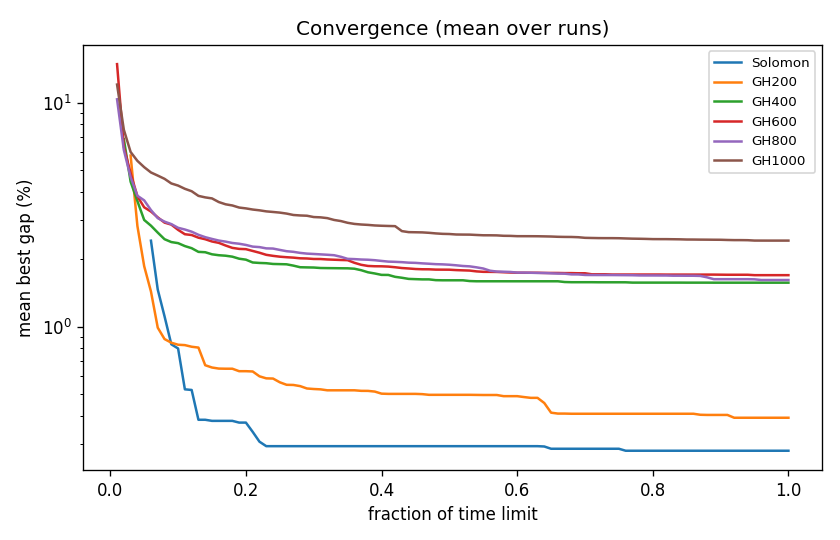

# ALNS + VND campaign `dev-002-coolT`

Split: **development**; 36 instances x 2 seeds; budget: time_limit = max(10.0, 0.1 * customers) seconds. Gaps are to published BKS (not proven optima), recomputed by the independent evaluator.

| Metric | Value |
| --- | ---: |
| planned attempts | 72 |
| attempts | 72 |
| feasible attempts | 72 |
| budget respected | 72 |
| mean gap equal weight | 1.328 |
| median instance gap | 1.059 |
| p90 run gap | 2.807 |
| worst run gap | 3.938 |
| best of seeds mean gap | 1.146 |
| mean within instance sd | 0.257 |
| negative gap runs | 0 |

Instances with any run above 7%: none

## By size family

| Family | n | time limit (s) | mean gap % | worst run gap % | mean seed SD | iterations |
| --- | ---: | ---: | ---: | ---: | ---: | ---: |
| Solomon | 6 | 10 | 0.279 | 0.893 | 0.000 | 21026 |
| GH200 | 6 | 20 | 0.391 | 1.396 | 0.194 | 22890 |
| GH400 | 6 | 40 | 1.570 | 2.657 | 0.312 | 34249 |
| GH600 | 6 | 60 | 1.696 | 3.938 | 0.344 | 42751 |
| GH800 | 6 | 80 | 1.613 | 2.694 | 0.174 | 49153 |
| GH1000 | 6 | 100 | 2.420 | 3.582 | 0.518 | 52976 |

## By instance class

| Class | instances | mean gap % | worst run gap % |
| --- | ---: | ---: | ---: |
| C1 | 6 | 0.587 | 2.040 |
| C2 | 6 | 0.592 | 1.793 |
| R1 | 6 | 1.817 | 2.911 |
| R2 | 6 | 1.920 | 3.938 |
| RC1 | 6 | 1.644 | 3.165 |
| RC2 | 6 | 1.409 | 3.451 |

## Per instance

| Instance | n | BKS | best | mean gap % | best % | worst % | SD | feasible | vehicles | iterations | time-to-best s |
| --- | ---: | ---: | ---: | ---: | ---: | ---: | ---: | ---: | ---: | ---: | ---: |
| Solomon/C107.vrp | 100 | 827.3 | 827.3 | 0.000 | 0.000 | 0.000 | 0.000 | 2/2 | 10.0 | 27126 | 0.5 |
| Solomon/C204.vrp | 100 | 588.1 | 588.1 | 0.000 | 0.000 | 0.000 | 0.000 | 2/2 | 3.0 | 17567 | 0.7 |
| Solomon/R102.vrp | 100 | 1466.6 | 1466.6 | 0.000 | 0.000 | 0.000 | 0.000 | 2/2 | 18.0 | 25122 | 0.8 |
| Solomon/R203.vrp | 100 | 870.8 | 876.5 | 0.655 | 0.655 | 0.655 | 0.000 | 2/2 | 5.0 | 19753 | 7.0 |
| Solomon/RC107.vrp | 100 | 1207.8 | 1209.3 | 0.124 | 0.124 | 0.124 | 0.000 | 2/2 | 12.0 | 20786 | 1.6 |
| Solomon/RC204.vrp | 100 | 783.5 | 790.5 | 0.893 | 0.893 | 0.893 | 0.000 | 2/2 | 4.0 | 15802 | 1.1 |
| GH200/C1_2_8.vrp | 200 | 2684.0 | 2684.0 | 0.000 | 0.000 | 0.000 | 0.000 | 2/2 | 20.0 | 35654 | 0.8 |
| GH200/C2_2_8.vrp | 200 | 1813.7 | 1816.9 | 0.204 | 0.176 | 0.232 | 0.039 | 2/2 | 6.5 | 17558 | 1.4 |
| GH200/R1_2_6.vrp | 200 | 3559.1 | 3588.0 | 1.104 | 0.812 | 1.396 | 0.413 | 2/2 | 19.5 | 25014 | 17.9 |
| GH200/R2_2_8.vrp | 200 | 1842.4 | 1842.4 | 0.098 | 0.000 | 0.195 | 0.138 | 2/2 | 4.0 | 14632 | 8.2 |
| GH200/RC1_2_2.vrp | 200 | 3221.6 | 3230.1 | 0.317 | 0.264 | 0.369 | 0.075 | 2/2 | 19.0 | 27298 | 11.2 |
| GH200/RC2_2_8.vrp | 200 | 2151.2 | 2157.1 | 0.625 | 0.274 | 0.976 | 0.496 | 2/2 | 6.0 | 17186 | 3.5 |
| GH400/C1_4_3.vrp | 400 | 6929.9 | 6971.6 | 1.064 | 0.602 | 1.525 | 0.653 | 2/2 | 38.5 | 45267 | 20.6 |
| GH400/C2_4_8.vrp | 400 | 3773.7 | 3782.9 | 0.401 | 0.244 | 0.559 | 0.223 | 2/2 | 12.0 | 28946 | 17.1 |
| GH400/R1_4_10.vrp | 400 | 8077.8 | 8247.4 | 2.378 | 2.100 | 2.657 | 0.394 | 2/2 | 37.0 | 38778 | 34.5 |
| GH400/R2_4_4.vrp | 400 | 4211.2 | 4279.5 | 1.793 | 1.622 | 1.964 | 0.242 | 2/2 | 9.0 | 25337 | 16.9 |
| GH400/RC1_4_8.vrp | 400 | 7757.2 | 7877.7 | 1.653 | 1.553 | 1.753 | 0.141 | 2/2 | 37.0 | 40712 | 19.7 |
| GH400/RC2_4_3.vrp | 400 | 4573.0 | 4663.3 | 2.129 | 1.975 | 2.283 | 0.218 | 2/2 | 12.0 | 26452 | 20.4 |
| GH600/C1_6_9.vrp | 600 | 13664.5 | 13719.7 | 0.407 | 0.404 | 0.410 | 0.004 | 2/2 | 57.0 | 68534 | 25.6 |
| GH600/C2_6_9.vrp | 600 | 7303.2 | 7321.3 | 0.494 | 0.248 | 0.739 | 0.348 | 2/2 | 19.0 | 30150 | 48.5 |
| GH600/R1_6_4.vrp | 600 | 15721.4 | 16037.6 | 2.162 | 2.011 | 2.313 | 0.214 | 2/2 | 55.0 | 49829 | 52.1 |
| GH600/R2_6_10.vrp | 600 | 11837.0 | 12170.1 | 3.376 | 2.814 | 3.938 | 0.795 | 2/2 | 14.0 | 28494 | 40.0 |
| GH600/RC1_6_2.vrp | 600 | 15890.6 | 16239.6 | 2.681 | 2.196 | 3.165 | 0.685 | 2/2 | 56.5 | 50480 | 55.8 |
| GH600/RC2_6_2.vrp | 600 | 10336.9 | 10444.7 | 1.055 | 1.043 | 1.067 | 0.017 | 2/2 | 19.0 | 29016 | 49.6 |
| GH800/C1_8_6.vrp | 800 | 25133.3 | 25134.0 | 0.017 | 0.003 | 0.030 | 0.019 | 2/2 | 80.0 | 83504 | 45.5 |
| GH800/C2_8_10.vrp | 800 | 10946.0 | 11095.8 | 1.531 | 1.369 | 1.693 | 0.229 | 2/2 | 24.5 | 34273 | 56.1 |
| GH800/R1_8_3.vrp | 800 | 29304.5 | 29949.9 | 2.346 | 2.202 | 2.490 | 0.203 | 2/2 | 73.0 | 57068 | 72.0 |
| GH800/R2_8_10.vrp | 800 | 19984.8 | 20498.8 | 2.633 | 2.572 | 2.694 | 0.086 | 2/2 | 17.5 | 30913 | 64.3 |
| GH800/RC1_8_9.vrp | 800 | 28347.1 | 28945.9 | 2.247 | 2.112 | 2.382 | 0.190 | 2/2 | 74.0 | 55678 | 71.5 |
| GH800/RC2_8_1.vrp | 800 | 19201.3 | 19332.1 | 0.906 | 0.681 | 1.131 | 0.318 | 2/2 | 25.5 | 33482 | 73.9 |
| GH1000/C1_10_2.vrp | 1000 | 41337.8 | 42176.1 | 2.034 | 2.028 | 2.040 | 0.008 | 2/2 | 99.0 | 81522 | 94.6 |
| GH1000/C2_10_2.vrp | 1000 | 16462.6 | 16470.7 | 0.921 | 0.049 | 1.793 | 1.233 | 2/2 | 30.5 | 44434 | 86.2 |
| GH1000/R1_10_5.vrp | 1000 | 50406.7 | 51873.6 | 2.910 | 2.910 | 2.911 | 0.000 | 2/2 | 93.0 | 68756 | 84.7 |
| GH1000/R2_10_7.vrp | 1000 | 23102.2 | 23644.7 | 2.965 | 2.348 | 3.582 | 0.873 | 2/2 | 21.5 | 33343 | 91.5 |
| GH1000/RC1_10_5.vrp | 1000 | 45028.1 | 46263.0 | 2.841 | 2.743 | 2.940 | 0.140 | 2/2 | 92.0 | 61048 | 90.3 |
| GH1000/RC2_10_10.vrp | 1000 | 21731.2 | 22218.1 | 2.846 | 2.241 | 3.451 | 0.856 | 2/2 | 20.0 | 28752 | 84.3 |

