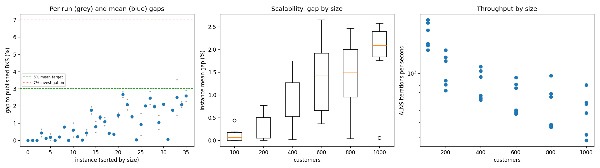
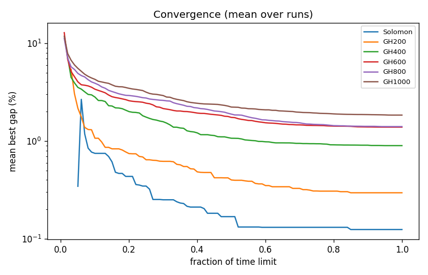

# ALNS + VND campaign `dev-003-hotT`

Split: **development**; 36 instances x 2 seeds; budget: time_limit = max(10.0, 0.1 * customers) seconds. Gaps are to published BKS (not proven optima), recomputed by the independent evaluator.

| Metric | Value |
| --- | ---: |
| planned attempts | 72 |
| attempts | 72 |
| feasible attempts | 72 |
| budget respected | 72 |
| mean gap equal weight | 0.993 |
| median instance gap | 0.775 |
| p90 run gap | 2.230 |
| worst run gap | 3.533 |
| best of seeds mean gap | 0.831 |
| mean within instance sd | 0.229 |
| negative gap runs | 0 |

Instances with any run above 7%: none

## By size family

| Family | n | time limit (s) | mean gap % | worst run gap % | mean seed SD | iterations |
| --- | ---: | ---: | ---: | ---: | ---: | ---: |
| Solomon | 6 | 10 | 0.124 | 0.655 | 0.095 | 20942 |
| GH200 | 6 | 20 | 0.296 | 1.006 | 0.125 | 21949 |
| GH400 | 6 | 40 | 0.898 | 1.958 | 0.253 | 33514 |
| GH600 | 6 | 60 | 1.388 | 2.812 | 0.170 | 39628 |
| GH800 | 6 | 80 | 1.406 | 2.834 | 0.358 | 45571 |
| GH1000 | 6 | 100 | 1.844 | 3.533 | 0.372 | 50384 |

## By instance class

| Class | instances | mean gap % | worst run gap % |
| --- | ---: | ---: | ---: |
| C1 | 6 | 0.425 | 2.091 |
| C2 | 6 | 0.329 | 1.565 |
| R1 | 6 | 1.288 | 2.039 |
| R2 | 6 | 1.473 | 3.533 |
| RC1 | 6 | 1.363 | 2.382 |
| RC2 | 6 | 1.078 | 2.888 |

## Per instance

| Instance | n | BKS | best | mean gap % | best % | worst % | SD | feasible | vehicles | iterations | time-to-best s |
| --- | ---: | ---: | ---: | ---: | ---: | ---: | ---: | ---: | ---: | ---: | ---: |
| Solomon/C107.vrp | 100 | 827.3 | 827.3 | 0.000 | 0.000 | 0.000 | 0.000 | 2/2 | 10.0 | 27322 | 0.5 |
| Solomon/C204.vrp | 100 | 588.1 | 588.1 | 0.000 | 0.000 | 0.000 | 0.000 | 2/2 | 3.0 | 16918 | 0.6 |
| Solomon/R102.vrp | 100 | 1466.6 | 1466.6 | 0.000 | 0.000 | 0.000 | 0.000 | 2/2 | 18.0 | 25912 | 2.0 |
| Solomon/R203.vrp | 100 | 870.8 | 872.7 | 0.436 | 0.218 | 0.655 | 0.309 | 2/2 | 5.5 | 17511 | 7.2 |
| Solomon/RC107.vrp | 100 | 1207.8 | 1209.3 | 0.124 | 0.124 | 0.124 | 0.000 | 2/2 | 12.0 | 22501 | 4.4 |
| Solomon/RC204.vrp | 100 | 783.5 | 783.5 | 0.185 | 0.000 | 0.370 | 0.262 | 2/2 | 4.0 | 15487 | 3.3 |
| GH200/C1_2_8.vrp | 200 | 2684.0 | 2684.0 | 0.000 | 0.000 | 0.000 | 0.000 | 2/2 | 20.0 | 31104 | 1.2 |
| GH200/C2_2_8.vrp | 200 | 1813.7 | 1816.9 | 0.198 | 0.176 | 0.221 | 0.031 | 2/2 | 6.0 | 17470 | 4.0 |
| GH200/R1_2_6.vrp | 200 | 3559.1 | 3585.0 | 0.766 | 0.728 | 0.804 | 0.054 | 2/2 | 20.0 | 25238 | 15.5 |
| GH200/R2_2_8.vrp | 200 | 1842.4 | 1842.4 | 0.000 | 0.000 | 0.000 | 0.000 | 2/2 | 4.0 | 14546 | 10.1 |
| GH200/RC1_2_2.vrp | 200 | 3221.6 | 3227.6 | 0.596 | 0.186 | 1.006 | 0.579 | 2/2 | 19.0 | 27104 | 14.0 |
| GH200/RC2_2_8.vrp | 200 | 2151.2 | 2154.5 | 0.214 | 0.153 | 0.274 | 0.085 | 2/2 | 6.0 | 16232 | 13.4 |
| GH400/C1_4_3.vrp | 400 | 6929.9 | 6930.5 | 0.014 | 0.009 | 0.020 | 0.008 | 2/2 | 38.0 | 45582 | 36.7 |
| GH400/C2_4_8.vrp | 400 | 3773.7 | 3783.5 | 0.435 | 0.260 | 0.609 | 0.247 | 2/2 | 12.0 | 26525 | 15.9 |
| GH400/R1_4_10.vrp | 400 | 8077.8 | 8201.6 | 1.746 | 1.533 | 1.958 | 0.301 | 2/2 | 37.0 | 37530 | 32.3 |
| GH400/R2_4_4.vrp | 400 | 4211.2 | 4230.8 | 0.785 | 0.465 | 1.104 | 0.452 | 2/2 | 9.0 | 24345 | 23.9 |
| GH400/RC1_4_8.vrp | 400 | 7757.2 | 7851.3 | 1.331 | 1.213 | 1.449 | 0.167 | 2/2 | 37.0 | 41894 | 37.2 |
| GH400/RC2_4_3.vrp | 400 | 4573.0 | 4611.3 | 1.078 | 0.838 | 1.319 | 0.340 | 2/2 | 12.0 | 25210 | 24.2 |
| GH600/C1_6_9.vrp | 600 | 13664.5 | 13719.9 | 0.413 | 0.405 | 0.421 | 0.011 | 2/2 | 57.0 | 55777 | 48.5 |
| GH600/C2_6_9.vrp | 600 | 7303.2 | 7328.4 | 0.361 | 0.345 | 0.378 | 0.023 | 2/2 | 19.0 | 30089 | 56.1 |
| GH600/R1_6_4.vrp | 600 | 15721.4 | 15927.6 | 1.453 | 1.312 | 1.595 | 0.201 | 2/2 | 55.0 | 45616 | 52.3 |
| GH600/R2_6_10.vrp | 600 | 11837.0 | 12132.2 | 2.653 | 2.494 | 2.812 | 0.225 | 2/2 | 13.0 | 28174 | 46.8 |
| GH600/RC1_6_2.vrp | 600 | 15890.6 | 16170.6 | 2.072 | 1.762 | 2.382 | 0.438 | 2/2 | 57.0 | 49024 | 53.3 |
| GH600/RC2_6_2.vrp | 600 | 10336.9 | 10470.5 | 1.378 | 1.292 | 1.464 | 0.121 | 2/2 | 18.0 | 29088 | 50.7 |
| GH800/C1_8_6.vrp | 800 | 25133.3 | 25140.9 | 0.031 | 0.030 | 0.033 | 0.002 | 2/2 | 80.0 | 77080 | 71.4 |
| GH800/C2_8_10.vrp | 800 | 10946.0 | 10977.2 | 0.925 | 0.285 | 1.565 | 0.905 | 2/2 | 24.5 | 30637 | 72.2 |
| GH800/R1_8_3.vrp | 800 | 29304.5 | 29887.1 | 2.014 | 1.988 | 2.039 | 0.036 | 2/2 | 73.0 | 51730 | 75.4 |
| GH800/R2_8_10.vrp | 800 | 19984.8 | 20402.4 | 2.462 | 2.090 | 2.834 | 0.526 | 2/2 | 18.0 | 30088 | 60.8 |
| GH800/RC1_8_9.vrp | 800 | 28347.1 | 28882.8 | 1.970 | 1.890 | 2.049 | 0.113 | 2/2 | 74.0 | 54665 | 69.5 |
| GH800/RC2_8_1.vrp | 800 | 19201.3 | 19323.0 | 1.036 | 0.634 | 1.438 | 0.569 | 2/2 | 24.5 | 29227 | 76.4 |
| GH1000/C1_10_2.vrp | 1000 | 41337.8 | 42201.8 | 2.091 | 2.090 | 2.091 | 0.001 | 2/2 | 99.0 | 80440 | 92.3 |
| GH1000/C2_10_2.vrp | 1000 | 16462.6 | 16469.2 | 0.056 | 0.040 | 0.071 | 0.022 | 2/2 | 30.0 | 47584 | 87.6 |
| GH1000/R1_10_5.vrp | 1000 | 50406.7 | 51259.1 | 1.753 | 1.691 | 1.814 | 0.087 | 2/2 | 93.0 | 57789 | 85.9 |
| GH1000/R2_10_7.vrp | 1000 | 23102.2 | 23442.0 | 2.502 | 1.471 | 3.533 | 1.458 | 2/2 | 21.5 | 31595 | 92.1 |
| GH1000/RC1_10_5.vrp | 1000 | 45028.1 | 45894.9 | 2.085 | 1.925 | 2.246 | 0.227 | 2/2 | 92.0 | 56340 | 93.9 |
| GH1000/RC2_10_10.vrp | 1000 | 21731.2 | 22224.4 | 2.579 | 2.270 | 2.888 | 0.437 | 2/2 | 20.0 | 28554 | 74.6 |

