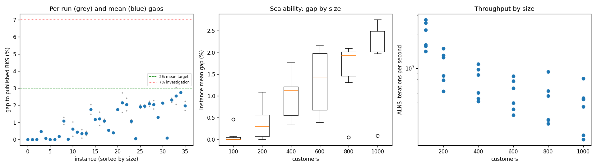
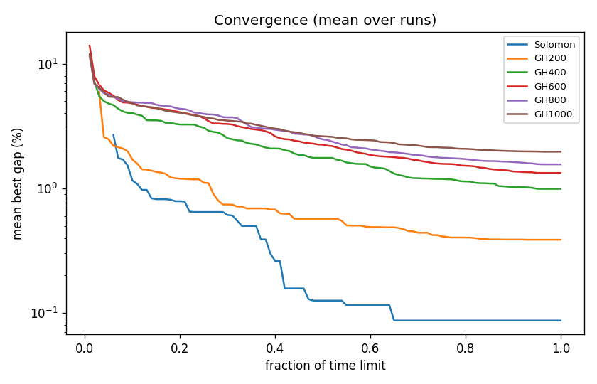

# ALNS + VND campaign `dev-004-hot2`

Split: **development**; 36 instances x 2 seeds; budget: time_limit = max(10.0, 0.1 * customers) seconds. Gaps are to published BKS (not proven optima), recomputed by the independent evaluator.

| Metric | Value |
| --- | ---: |
| planned attempts | 72 |
| attempts | 72 |
| feasible attempts | 72 |
| budget respected | 72 |
| mean gap equal weight | 1.052 |
| median instance gap | 1.076 |
| p90 run gap | 2.241 |
| worst run gap | 3.040 |
| best of seeds mean gap | 0.927 |
| mean within instance sd | 0.177 |
| negative gap runs | 0 |

Instances with any run above 7%: none

## By size family

| Family | n | time limit (s) | mean gap % | worst run gap % | mean seed SD | iterations |
| --- | ---: | ---: | ---: | ---: | ---: | ---: |
| Solomon | 6 | 10 | 0.087 | 0.471 | 0.017 | 20174 |
| GH200 | 6 | 20 | 0.387 | 1.298 | 0.154 | 21122 |
| GH400 | 6 | 40 | 0.990 | 2.035 | 0.276 | 30697 |
| GH600 | 6 | 60 | 1.328 | 2.735 | 0.259 | 35962 |
| GH800 | 6 | 80 | 1.557 | 2.282 | 0.150 | 41865 |
| GH1000 | 6 | 100 | 1.964 | 3.040 | 0.208 | 47067 |

## By instance class

| Class | instances | mean gap % | worst run gap % |
| --- | ---: | ---: | ---: |
| C1 | 6 | 0.509 | 2.134 |
| C2 | 6 | 0.489 | 2.023 |
| R1 | 6 | 1.477 | 2.423 |
| R2 | 6 | 1.410 | 3.040 |
| RC1 | 6 | 1.452 | 2.751 |
| RC2 | 6 | 0.975 | 2.237 |

## Per instance

| Instance | n | BKS | best | mean gap % | best % | worst % | SD | feasible | vehicles | iterations | time-to-best s |
| --- | ---: | ---: | ---: | ---: | ---: | ---: | ---: | ---: | ---: | ---: | ---: |
| Solomon/C107.vrp | 100 | 827.3 | 827.3 | 0.000 | 0.000 | 0.000 | 0.000 | 2/2 | 10.0 | 27202 | 0.5 |
| Solomon/C204.vrp | 100 | 588.1 | 588.1 | 0.000 | 0.000 | 0.000 | 0.000 | 2/2 | 3.0 | 15836 | 0.8 |
| Solomon/R102.vrp | 100 | 1466.6 | 1466.6 | 0.000 | 0.000 | 0.000 | 0.000 | 2/2 | 18.0 | 25488 | 4.7 |
| Solomon/R203.vrp | 100 | 870.8 | 874.7 | 0.459 | 0.448 | 0.471 | 0.016 | 2/2 | 6.0 | 16202 | 2.3 |
| Solomon/RC107.vrp | 100 | 1207.8 | 1207.8 | 0.062 | 0.000 | 0.124 | 0.088 | 2/2 | 12.0 | 22098 | 6.0 |
| Solomon/RC204.vrp | 100 | 783.5 | 783.5 | 0.000 | 0.000 | 0.000 | 0.000 | 2/2 | 4.0 | 14218 | 3.4 |
| GH200/C1_2_8.vrp | 200 | 2684.0 | 2684.0 | 0.000 | 0.000 | 0.000 | 0.000 | 2/2 | 20.0 | 30074 | 3.5 |
| GH200/C2_2_8.vrp | 200 | 1813.7 | 1816.9 | 0.176 | 0.176 | 0.176 | 0.000 | 2/2 | 6.0 | 17191 | 4.8 |
| GH200/R1_2_6.vrp | 200 | 3559.1 | 3590.5 | 1.090 | 0.882 | 1.298 | 0.294 | 2/2 | 19.0 | 25102 | 17.2 |
| GH200/R2_2_8.vrp | 200 | 1842.4 | 1842.4 | 0.022 | 0.000 | 0.043 | 0.031 | 2/2 | 4.0 | 12520 | 14.4 |
| GH200/RC1_2_2.vrp | 200 | 3221.6 | 3227.7 | 0.608 | 0.189 | 1.027 | 0.593 | 2/2 | 19.0 | 26140 | 17.5 |
| GH200/RC2_2_8.vrp | 200 | 2151.2 | 2160.2 | 0.423 | 0.418 | 0.428 | 0.007 | 2/2 | 6.0 | 15706 | 8.3 |
| GH400/C1_4_3.vrp | 400 | 6929.9 | 6936.4 | 0.335 | 0.094 | 0.576 | 0.341 | 2/2 | 38.0 | 43870 | 29.0 |
| GH400/C2_4_8.vrp | 400 | 3773.7 | 3782.7 | 0.366 | 0.238 | 0.493 | 0.180 | 2/2 | 12.0 | 24301 | 33.9 |
| GH400/R1_4_10.vrp | 400 | 8077.8 | 8197.6 | 1.759 | 1.483 | 2.035 | 0.390 | 2/2 | 37.0 | 35094 | 36.4 |
| GH400/R2_4_4.vrp | 400 | 4211.2 | 4259.3 | 1.179 | 1.142 | 1.216 | 0.052 | 2/2 | 9.5 | 20322 | 38.0 |
| GH400/RC1_4_8.vrp | 400 | 7757.2 | 7821.1 | 1.214 | 0.824 | 1.605 | 0.552 | 2/2 | 37.0 | 39114 | 37.1 |
| GH400/RC2_4_3.vrp | 400 | 4573.0 | 4618.2 | 1.086 | 0.988 | 1.183 | 0.138 | 2/2 | 11.0 | 21478 | 37.2 |
| GH600/C1_6_9.vrp | 600 | 13664.5 | 13733.8 | 0.546 | 0.507 | 0.585 | 0.055 | 2/2 | 57.5 | 51328 | 51.4 |
| GH600/C2_6_9.vrp | 600 | 7303.2 | 7331.5 | 0.393 | 0.388 | 0.398 | 0.008 | 2/2 | 19.0 | 29375 | 55.8 |
| GH600/R1_6_4.vrp | 600 | 15721.4 | 15995.8 | 1.757 | 1.745 | 1.768 | 0.016 | 2/2 | 55.0 | 40048 | 54.8 |
| GH600/R2_6_10.vrp | 600 | 11837.0 | 12024.0 | 2.157 | 1.580 | 2.735 | 0.817 | 2/2 | 13.5 | 22990 | 55.5 |
| GH600/RC1_6_2.vrp | 600 | 15890.6 | 16156.9 | 2.047 | 1.676 | 2.418 | 0.525 | 2/2 | 56.5 | 46158 | 57.4 |
| GH600/RC2_6_2.vrp | 600 | 10336.9 | 10437.2 | 1.066 | 0.970 | 1.161 | 0.135 | 2/2 | 18.0 | 25872 | 52.5 |
| GH800/C1_8_6.vrp | 800 | 25133.3 | 25143.6 | 0.045 | 0.041 | 0.050 | 0.006 | 2/2 | 80.0 | 74619 | 69.4 |
| GH800/C2_8_10.vrp | 800 | 10946.0 | 11145.0 | 1.920 | 1.818 | 2.023 | 0.145 | 2/2 | 25.0 | 27666 | 76.4 |
| GH800/R1_8_3.vrp | 800 | 29304.5 | 29851.4 | 1.948 | 1.866 | 2.030 | 0.116 | 2/2 | 73.0 | 45355 | 76.7 |
| GH800/R2_8_10.vrp | 800 | 19984.8 | 20372.0 | 2.089 | 1.937 | 2.241 | 0.215 | 2/2 | 18.0 | 25573 | 75.1 |
| GH800/RC1_8_9.vrp | 800 | 28347.1 | 28852.6 | 2.033 | 1.783 | 2.282 | 0.353 | 2/2 | 73.5 | 50206 | 75.7 |
| GH800/RC2_8_1.vrp | 800 | 19201.3 | 19442.8 | 1.305 | 1.258 | 1.351 | 0.066 | 2/2 | 24.5 | 27772 | 75.5 |
| GH1000/C1_10_2.vrp | 1000 | 41337.8 | 42213.5 | 2.126 | 2.118 | 2.134 | 0.011 | 2/2 | 99.0 | 81240 | 89.2 |
| GH1000/C2_10_2.vrp | 1000 | 16462.6 | 16475.5 | 0.081 | 0.078 | 0.083 | 0.003 | 2/2 | 30.0 | 45362 | 83.7 |
| GH1000/R1_10_5.vrp | 1000 | 50406.7 | 51509.1 | 2.305 | 2.187 | 2.423 | 0.167 | 2/2 | 93.5 | 54476 | 93.7 |
| GH1000/R2_10_7.vrp | 1000 | 23102.2 | 23579.6 | 2.553 | 2.066 | 3.040 | 0.688 | 2/2 | 21.5 | 25282 | 95.7 |
| GH1000/RC1_10_5.vrp | 1000 | 45028.1 | 46266.5 | 2.751 | 2.750 | 2.751 | 0.000 | 2/2 | 92.0 | 52853 | 95.9 |
| GH1000/RC2_10_10.vrp | 1000 | 21731.2 | 22101.3 | 1.970 | 1.703 | 2.237 | 0.377 | 2/2 | 19.5 | 23192 | 86.7 |

