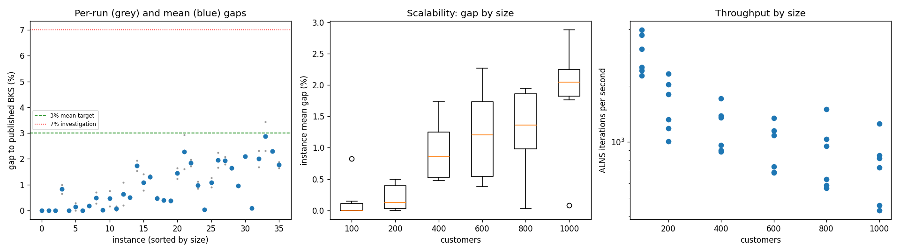
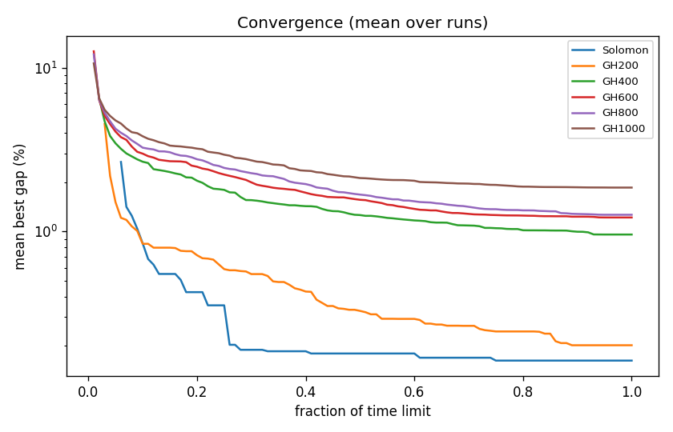

# ALNS + VND campaign `dev-005-hotT-g20`

Split: **development**; 36 instances x 2 seeds; budget: time_limit = max(10.0, 0.1 * customers) seconds. Gaps are to published BKS (not proven optima), recomputed by the independent evaluator.

| Metric | Value |
| --- | ---: |
| planned attempts | 72 |
| attempts | 72 |
| feasible attempts | 72 |
| budget respected | 72 |
| mean gap equal weight | 0.941 |
| median instance gap | 0.732 |
| p90 run gap | 2.094 |
| worst run gap | 3.439 |
| best of seeds mean gap | 0.804 |
| mean within instance sd | 0.194 |
| negative gap runs | 0 |

Instances with any run above 7%: none

## By size family

| Family | n | time limit (s) | mean gap % | worst run gap % | mean seed SD | iterations |
| --- | ---: | ---: | ---: | ---: | ---: | ---: |
| Solomon | 6 | 10 | 0.162 | 0.999 | 0.075 | 30092 |
| GH200 | 6 | 20 | 0.201 | 0.764 | 0.142 | 32170 |
| GH400 | 6 | 40 | 0.956 | 1.937 | 0.256 | 47938 |
| GH600 | 6 | 60 | 1.215 | 2.937 | 0.285 | 56870 |
| GH800 | 6 | 80 | 1.263 | 2.232 | 0.161 | 70161 |
| GH1000 | 6 | 100 | 1.851 | 3.439 | 0.244 | 75510 |

## By instance class

| Class | instances | mean gap % | worst run gap % |
| --- | ---: | ---: | ---: |
| C1 | 6 | 0.525 | 2.094 |
| C2 | 6 | 0.368 | 1.265 |
| R1 | 6 | 1.268 | 2.313 |
| R2 | 6 | 1.501 | 3.439 |
| RC1 | 6 | 1.256 | 2.328 |
| RC2 | 6 | 0.730 | 1.887 |

## Per instance

| Instance | n | BKS | best | mean gap % | best % | worst % | SD | feasible | vehicles | iterations | time-to-best s |
| --- | ---: | ---: | ---: | ---: | ---: | ---: | ---: | ---: | ---: | ---: | ---: |
| Solomon/C107.vrp | 100 | 827.3 | 827.3 | 0.000 | 0.000 | 0.000 | 0.000 | 2/2 | 10.0 | 39803 | 0.6 |
| Solomon/C204.vrp | 100 | 588.1 | 588.1 | 0.000 | 0.000 | 0.000 | 0.000 | 2/2 | 3.0 | 24112 | 1.0 |
| Solomon/R102.vrp | 100 | 1466.6 | 1466.6 | 0.000 | 0.000 | 0.000 | 0.000 | 2/2 | 18.0 | 37344 | 1.4 |
| Solomon/R203.vrp | 100 | 870.8 | 876.5 | 0.827 | 0.655 | 0.999 | 0.244 | 2/2 | 5.0 | 25160 | 4.6 |
| Solomon/RC107.vrp | 100 | 1207.8 | 1207.8 | 0.000 | 0.000 | 0.000 | 0.000 | 2/2 | 12.0 | 31426 | 4.1 |
| Solomon/RC204.vrp | 100 | 783.5 | 783.5 | 0.147 | 0.000 | 0.294 | 0.208 | 2/2 | 4.0 | 22706 | 1.4 |
| GH200/C1_2_8.vrp | 200 | 2684.0 | 2684.0 | 0.000 | 0.000 | 0.000 | 0.000 | 2/2 | 20.0 | 46329 | 1.7 |
| GH200/C2_2_8.vrp | 200 | 1813.7 | 1816.9 | 0.176 | 0.176 | 0.176 | 0.000 | 2/2 | 6.0 | 26402 | 2.7 |
| GH200/R1_2_6.vrp | 200 | 3559.1 | 3568.5 | 0.486 | 0.264 | 0.708 | 0.314 | 2/2 | 20.0 | 35889 | 13.1 |
| GH200/R2_2_8.vrp | 200 | 1842.4 | 1842.5 | 0.008 | 0.005 | 0.011 | 0.004 | 2/2 | 4.0 | 20121 | 5.0 |
| GH200/RC1_2_2.vrp | 200 | 3221.6 | 3226.7 | 0.461 | 0.158 | 0.764 | 0.428 | 2/2 | 19.0 | 40636 | 17.0 |
| GH200/RC2_2_8.vrp | 200 | 2151.2 | 2151.2 | 0.077 | 0.000 | 0.153 | 0.108 | 2/2 | 6.0 | 23641 | 13.0 |
| GH400/C1_4_3.vrp | 400 | 6929.9 | 6943.4 | 0.636 | 0.195 | 1.078 | 0.624 | 2/2 | 38.0 | 68527 | 18.2 |
| GH400/C2_4_8.vrp | 400 | 3773.7 | 3792.0 | 0.494 | 0.485 | 0.503 | 0.013 | 2/2 | 12.0 | 38410 | 26.7 |
| GH400/R1_4_10.vrp | 400 | 8077.8 | 8202.3 | 1.739 | 1.541 | 1.937 | 0.280 | 2/2 | 37.0 | 53950 | 37.1 |
| GH400/R2_4_4.vrp | 400 | 4211.2 | 4244.0 | 1.090 | 0.779 | 1.401 | 0.440 | 2/2 | 9.0 | 36127 | 31.7 |
| GH400/RC1_4_8.vrp | 400 | 7757.2 | 7853.3 | 1.304 | 1.239 | 1.369 | 0.092 | 2/2 | 37.0 | 55170 | 37.3 |
| GH400/RC2_4_3.vrp | 400 | 4573.0 | 4591.8 | 0.472 | 0.411 | 0.534 | 0.087 | 2/2 | 11.5 | 35445 | 33.9 |
| GH600/C1_6_9.vrp | 600 | 13664.5 | 13717.0 | 0.396 | 0.384 | 0.408 | 0.017 | 2/2 | 57.0 | 80572 | 54.1 |
| GH600/C2_6_9.vrp | 600 | 7303.2 | 7326.9 | 0.376 | 0.325 | 0.427 | 0.073 | 2/2 | 19.0 | 44168 | 53.2 |
| GH600/R1_6_4.vrp | 600 | 15721.4 | 15914.4 | 1.437 | 1.228 | 1.647 | 0.296 | 2/2 | 55.0 | 65086 | 57.0 |
| GH600/R2_6_10.vrp | 600 | 11837.0 | 12026.5 | 2.269 | 1.601 | 2.937 | 0.944 | 2/2 | 13.5 | 41322 | 51.6 |
| GH600/RC1_6_2.vrp | 600 | 15890.6 | 16161.9 | 1.838 | 1.707 | 1.968 | 0.184 | 2/2 | 56.5 | 69094 | 48.2 |
| GH600/RC2_6_2.vrp | 600 | 10336.9 | 10423.7 | 0.977 | 0.840 | 1.113 | 0.194 | 2/2 | 18.5 | 40980 | 56.7 |
| GH800/C1_8_6.vrp | 800 | 25133.3 | 25138.9 | 0.026 | 0.022 | 0.030 | 0.006 | 2/2 | 80.0 | 119876 | 64.0 |
| GH800/C2_8_10.vrp | 800 | 10946.0 | 11044.8 | 1.084 | 0.903 | 1.265 | 0.256 | 2/2 | 24.0 | 50610 | 64.2 |
| GH800/R1_8_3.vrp | 800 | 29304.5 | 29790.6 | 1.945 | 1.659 | 2.232 | 0.405 | 2/2 | 73.0 | 75786 | 75.9 |
| GH800/R2_8_10.vrp | 800 | 19984.8 | 20343.6 | 1.934 | 1.795 | 2.073 | 0.196 | 2/2 | 18.0 | 45151 | 66.2 |
| GH800/RC1_8_9.vrp | 800 | 28347.1 | 28797.8 | 1.639 | 1.590 | 1.689 | 0.070 | 2/2 | 74.0 | 82714 | 74.3 |
| GH800/RC2_8_1.vrp | 800 | 19201.3 | 19378.8 | 0.947 | 0.924 | 0.969 | 0.031 | 2/2 | 24.5 | 46827 | 74.1 |
| GH1000/C1_10_2.vrp | 1000 | 41337.8 | 42201.2 | 2.091 | 2.089 | 2.094 | 0.004 | 2/2 | 99.0 | 125134 | 92.9 |
| GH1000/C2_10_2.vrp | 1000 | 16462.6 | 16475.3 | 0.078 | 0.077 | 0.080 | 0.002 | 2/2 | 30.0 | 73065 | 93.2 |
| GH1000/R1_10_5.vrp | 1000 | 50406.7 | 51255.3 | 1.998 | 1.684 | 2.313 | 0.445 | 2/2 | 93.0 | 81791 | 91.0 |
| GH1000/R2_10_7.vrp | 1000 | 23102.2 | 23638.5 | 2.880 | 2.321 | 3.439 | 0.790 | 2/2 | 21.0 | 42976 | 91.8 |
| GH1000/RC1_10_5.vrp | 1000 | 45028.1 | 46047.5 | 2.296 | 2.264 | 2.328 | 0.046 | 2/2 | 92.0 | 84407 | 95.8 |
| GH1000/RC2_10_10.vrp | 1000 | 21731.2 | 22086.7 | 1.762 | 1.636 | 1.887 | 0.178 | 2/2 | 19.5 | 45686 | 85.5 |

