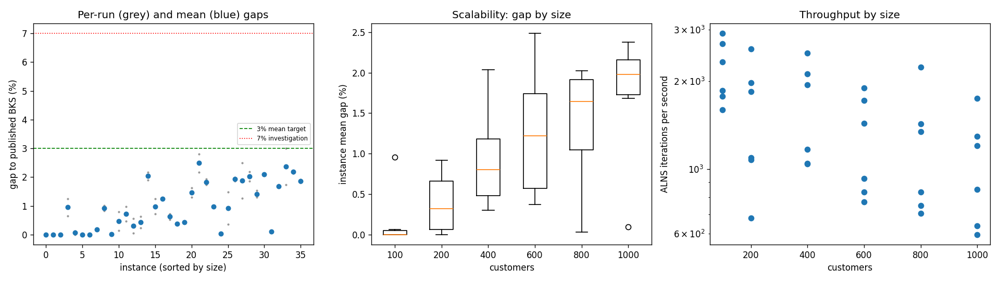
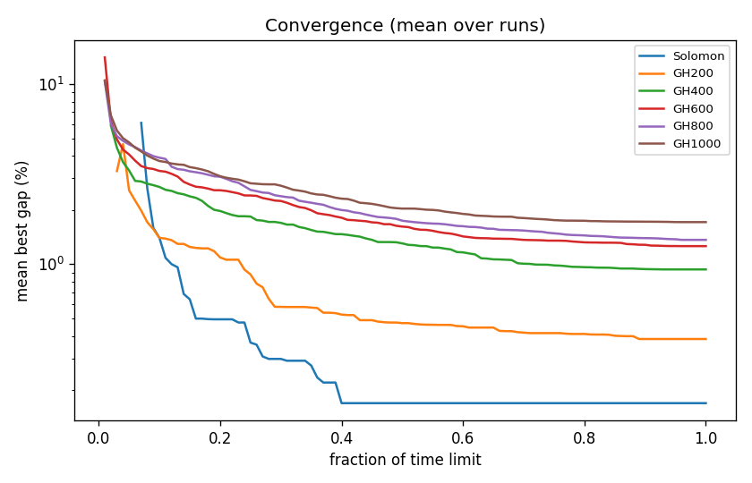

# ALNS + VND campaign `dev-006-q20`

Split: **development**; 36 instances x 2 seeds; budget: time_limit = max(10.0, 0.1 * customers) seconds. Gaps are to published BKS (not proven optima), recomputed by the independent evaluator.

| Metric | Value |
| --- | ---: |
| planned attempts | 72 |
| attempts | 72 |
| feasible attempts | 72 |
| budget respected | 72 |
| mean gap equal weight | 0.972 |
| median instance gap | 0.922 |
| p90 run gap | 2.131 |
| worst run gap | 3.006 |
| best of seeds mean gap | 0.832 |
| mean within instance sd | 0.198 |
| negative gap runs | 0 |

Instances with any run above 7%: none

## By size family

| Family | n | time limit (s) | mean gap % | worst run gap % | mean seed SD | iterations |
| --- | ---: | ---: | ---: | ---: | ---: | ---: |
| Solomon | 6 | 10 | 0.169 | 1.252 | 0.085 | 21927 |
| GH200 | 6 | 20 | 0.384 | 1.000 | 0.160 | 30803 |
| GH400 | 6 | 40 | 0.936 | 2.176 | 0.237 | 65382 |
| GH600 | 6 | 60 | 1.261 | 2.804 | 0.158 | 75749 |
| GH800 | 6 | 80 | 1.366 | 2.490 | 0.358 | 97108 |
| GH1000 | 6 | 100 | 1.714 | 3.006 | 0.188 | 105424 |

## By instance class

| Class | instances | mean gap % | worst run gap % |
| --- | ---: | ---: | ---: |
| C1 | 6 | 0.466 | 2.093 |
| C2 | 6 | 0.345 | 1.486 |
| R1 | 6 | 1.337 | 2.176 |
| R2 | 6 | 1.449 | 3.006 |
| RC1 | 6 | 1.301 | 2.225 |
| RC2 | 6 | 0.933 | 1.922 |

## Per instance

| Instance | n | BKS | best | mean gap % | best % | worst % | SD | feasible | vehicles | iterations | time-to-best s |
| --- | ---: | ---: | ---: | ---: | ---: | ---: | ---: | ---: | ---: | ---: | ---: |
| Solomon/C107.vrp | 100 | 827.3 | 827.3 | 0.000 | 0.000 | 0.000 | 0.000 | 2/2 | 10.0 | 29148 | 0.7 |
| Solomon/C204.vrp | 100 | 588.1 | 588.1 | 0.000 | 0.000 | 0.000 | 0.000 | 2/2 | 3.0 | 17748 | 1.0 |
| Solomon/R102.vrp | 100 | 1466.6 | 1466.6 | 0.000 | 0.000 | 0.000 | 0.000 | 2/2 | 18.0 | 26899 | 1.5 |
| Solomon/R203.vrp | 100 | 870.8 | 876.5 | 0.953 | 0.655 | 1.252 | 0.422 | 2/2 | 5.0 | 18576 | 2.3 |
| Solomon/RC107.vrp | 100 | 1207.8 | 1207.8 | 0.062 | 0.000 | 0.124 | 0.088 | 2/2 | 12.0 | 23248 | 3.8 |
| Solomon/RC204.vrp | 100 | 783.5 | 783.5 | 0.000 | 0.000 | 0.000 | 0.000 | 2/2 | 4.0 | 15944 | 2.6 |
| GH200/C1_2_8.vrp | 200 | 2684.0 | 2684.0 | 0.000 | 0.000 | 0.000 | 0.000 | 2/2 | 20.0 | 51509 | 0.9 |
| GH200/C2_2_8.vrp | 200 | 1813.7 | 1816.9 | 0.176 | 0.176 | 0.176 | 0.000 | 2/2 | 6.0 | 21872 | 1.8 |
| GH200/R1_2_6.vrp | 200 | 3559.1 | 3588.8 | 0.917 | 0.834 | 1.000 | 0.117 | 2/2 | 20.0 | 36831 | 15.6 |
| GH200/R2_2_8.vrp | 200 | 1842.4 | 1842.4 | 0.022 | 0.000 | 0.043 | 0.031 | 2/2 | 4.0 | 13574 | 17.2 |
| GH200/RC1_2_2.vrp | 200 | 3221.6 | 3226.2 | 0.466 | 0.143 | 0.788 | 0.457 | 2/2 | 19.0 | 39517 | 17.0 |
| GH200/RC2_2_8.vrp | 200 | 2151.2 | 2161.4 | 0.725 | 0.474 | 0.976 | 0.355 | 2/2 | 6.0 | 21516 | 9.5 |
| GH400/C1_4_3.vrp | 400 | 6929.9 | 6933.1 | 0.300 | 0.046 | 0.554 | 0.359 | 2/2 | 38.0 | 99860 | 34.9 |
| GH400/C2_4_8.vrp | 400 | 3773.7 | 3782.3 | 0.431 | 0.228 | 0.633 | 0.287 | 2/2 | 12.0 | 46696 | 29.1 |
| GH400/R1_4_10.vrp | 400 | 8077.8 | 8231.4 | 2.039 | 1.902 | 2.176 | 0.194 | 2/2 | 37.0 | 77578 | 32.3 |
| GH400/R2_4_4.vrp | 400 | 4211.2 | 4241.2 | 0.981 | 0.712 | 1.249 | 0.379 | 2/2 | 9.0 | 41575 | 29.9 |
| GH400/RC1_4_8.vrp | 400 | 7757.2 | 7850.6 | 1.244 | 1.204 | 1.284 | 0.057 | 2/2 | 37.0 | 84790 | 34.9 |
| GH400/RC2_4_3.vrp | 400 | 4573.0 | 4596.7 | 0.622 | 0.518 | 0.726 | 0.147 | 2/2 | 12.0 | 41796 | 33.3 |
| GH600/C1_6_9.vrp | 600 | 13664.5 | 13710.8 | 0.374 | 0.339 | 0.408 | 0.049 | 2/2 | 57.0 | 113508 | 45.4 |
| GH600/C2_6_9.vrp | 600 | 7303.2 | 7333.8 | 0.437 | 0.419 | 0.455 | 0.025 | 2/2 | 19.0 | 46202 | 49.7 |
| GH600/R1_6_4.vrp | 600 | 15721.4 | 15924.9 | 1.462 | 1.294 | 1.629 | 0.237 | 2/2 | 55.0 | 85924 | 55.2 |
| GH600/R2_6_10.vrp | 600 | 11837.0 | 12093.5 | 2.485 | 2.167 | 2.804 | 0.450 | 2/2 | 14.0 | 55748 | 42.8 |
| GH600/RC1_6_2.vrp | 600 | 15890.6 | 16165.5 | 1.833 | 1.730 | 1.935 | 0.145 | 2/2 | 56.5 | 103065 | 51.2 |
| GH600/RC2_6_2.vrp | 600 | 10336.9 | 10434.7 | 0.976 | 0.946 | 1.006 | 0.042 | 2/2 | 18.5 | 50044 | 56.9 |
| GH800/C1_8_6.vrp | 800 | 25133.3 | 25140.9 | 0.031 | 0.030 | 0.033 | 0.002 | 2/2 | 80.0 | 178531 | 64.0 |
| GH800/C2_8_10.vrp | 800 | 10946.0 | 10986.1 | 0.926 | 0.366 | 1.486 | 0.792 | 2/2 | 24.5 | 59871 | 72.5 |
| GH800/R1_8_3.vrp | 800 | 29304.5 | 29849.0 | 1.924 | 1.858 | 1.990 | 0.094 | 2/2 | 73.0 | 107284 | 73.4 |
| GH800/R2_8_10.vrp | 800 | 19984.8 | 20237.3 | 1.877 | 1.263 | 2.490 | 0.867 | 2/2 | 18.5 | 66578 | 68.1 |
| GH800/RC1_8_9.vrp | 800 | 28347.1 | 28874.7 | 2.022 | 1.861 | 2.183 | 0.227 | 2/2 | 74.0 | 113998 | 75.2 |
| GH800/RC2_8_1.vrp | 800 | 19201.3 | 19450.6 | 1.416 | 1.298 | 1.533 | 0.166 | 2/2 | 24.0 | 56388 | 71.7 |
| GH1000/C1_10_2.vrp | 1000 | 41337.8 | 42201.7 | 2.092 | 2.090 | 2.093 | 0.003 | 2/2 | 99.0 | 174523 | 93.6 |
| GH1000/C2_10_2.vrp | 1000 | 16462.6 | 16476.0 | 0.097 | 0.081 | 0.112 | 0.022 | 2/2 | 30.0 | 84987 | 77.9 |
| GH1000/R1_10_5.vrp | 1000 | 50406.7 | 51232.2 | 1.683 | 1.638 | 1.728 | 0.064 | 2/2 | 93.0 | 120322 | 95.3 |
| GH1000/R2_10_7.vrp | 1000 | 23102.2 | 23504.6 | 2.374 | 1.742 | 3.006 | 0.894 | 2/2 | 21.5 | 63898 | 95.2 |
| GH1000/RC1_10_5.vrp | 1000 | 45028.1 | 45989.3 | 2.180 | 2.135 | 2.225 | 0.064 | 2/2 | 92.0 | 129186 | 95.2 |
| GH1000/RC2_10_10.vrp | 1000 | 21731.2 | 22122.7 | 1.862 | 1.802 | 1.922 | 0.085 | 2/2 | 19.5 | 59624 | 82.3 |

