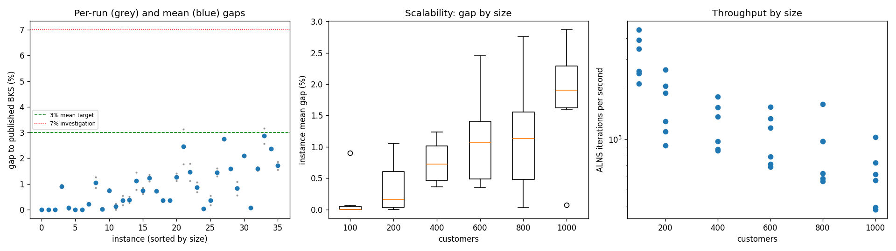
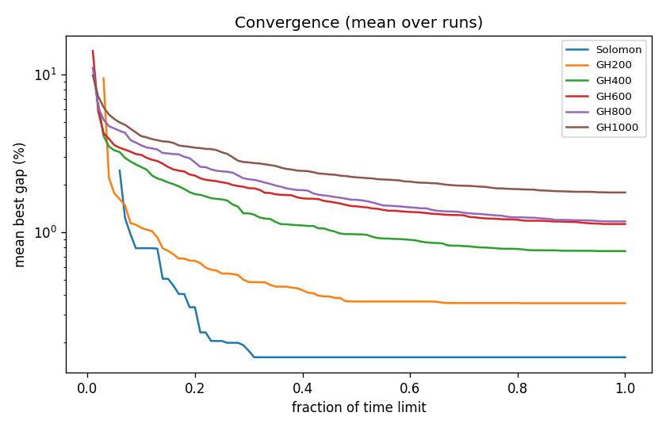

# ALNS + VND campaign `dev-007-noworst`

Split: **development**; 36 instances x 2 seeds; budget: time_limit = max(10.0, 0.1 * customers) seconds. Gaps are to published BKS (not proven optima), recomputed by the independent evaluator.

| Metric | Value |
| --- | ---: |
| planned attempts | 72 |
| attempts | 72 |
| feasible attempts | 72 |
| budget respected | 72 |
| mean gap equal weight | 0.892 |
| median instance gap | 0.738 |
| p90 run gap | 2.095 |
| worst run gap | 3.172 |
| best of seeds mean gap | 0.778 |
| mean within instance sd | 0.161 |
| negative gap runs | 0 |

Instances with any run above 7%: none

## By size family

| Family | n | time limit (s) | mean gap % | worst run gap % | mean seed SD | iterations |
| --- | ---: | ---: | ---: | ---: | ---: | ---: |
| Solomon | 6 | 10 | 0.161 | 0.965 | 0.030 | 31681 |
| GH200 | 6 | 20 | 0.354 | 1.256 | 0.096 | 32913 |
| GH400 | 6 | 40 | 0.758 | 1.448 | 0.208 | 49388 |
| GH600 | 6 | 60 | 1.126 | 3.133 | 0.339 | 62386 |
| GH800 | 6 | 80 | 1.169 | 2.806 | 0.161 | 71130 |
| GH1000 | 6 | 100 | 1.783 | 3.172 | 0.131 | 61922 |

## By instance class

| Class | instances | mean gap % | worst run gap % |
| --- | ---: | ---: | ---: |
| C1 | 6 | 0.474 | 2.096 |
| C2 | 6 | 0.232 | 0.546 |
| R1 | 6 | 1.079 | 1.668 |
| R2 | 6 | 1.619 | 3.172 |
| RC1 | 6 | 1.240 | 2.375 |
| RC2 | 6 | 0.706 | 1.865 |

## Per instance

| Instance | n | BKS | best | mean gap % | best % | worst % | SD | feasible | vehicles | iterations | time-to-best s |
| --- | ---: | ---: | ---: | ---: | ---: | ---: | ---: | ---: | ---: | ---: | ---: |
| Solomon/C107.vrp | 100 | 827.3 | 827.3 | 0.000 | 0.000 | 0.000 | 0.000 | 2/2 | 10.0 | 44906 | 0.5 |
| Solomon/C204.vrp | 100 | 588.1 | 588.1 | 0.000 | 0.000 | 0.000 | 0.000 | 2/2 | 3.0 | 24694 | 1.6 |
| Solomon/R102.vrp | 100 | 1466.6 | 1466.6 | 0.000 | 0.000 | 0.000 | 0.000 | 2/2 | 18.0 | 39038 | 1.9 |
| Solomon/R203.vrp | 100 | 870.8 | 878.1 | 0.901 | 0.838 | 0.965 | 0.089 | 2/2 | 5.0 | 25481 | 1.8 |
| Solomon/RC107.vrp | 100 | 1207.8 | 1207.8 | 0.062 | 0.000 | 0.124 | 0.088 | 2/2 | 12.0 | 34572 | 2.4 |
| Solomon/RC204.vrp | 100 | 783.5 | 783.5 | 0.000 | 0.000 | 0.000 | 0.000 | 2/2 | 4.0 | 21396 | 1.9 |
| GH200/C1_2_8.vrp | 200 | 2684.0 | 2684.0 | 0.000 | 0.000 | 0.000 | 0.000 | 2/2 | 20.0 | 52024 | 1.5 |
| GH200/C2_2_8.vrp | 200 | 1813.7 | 1816.9 | 0.204 | 0.176 | 0.232 | 0.039 | 2/2 | 6.5 | 25601 | 3.9 |
| GH200/R1_2_6.vrp | 200 | 3559.1 | 3589.4 | 1.054 | 0.851 | 1.256 | 0.286 | 2/2 | 19.5 | 37677 | 11.1 |
| GH200/R2_2_8.vrp | 200 | 1842.4 | 1842.4 | 0.005 | 0.000 | 0.011 | 0.008 | 2/2 | 4.0 | 18329 | 7.1 |
| GH200/RC1_2_2.vrp | 200 | 3221.6 | 3243.7 | 0.745 | 0.686 | 0.804 | 0.083 | 2/2 | 19.0 | 41666 | 9.2 |
| GH200/RC2_2_8.vrp | 200 | 2151.2 | 2151.2 | 0.114 | 0.000 | 0.228 | 0.161 | 2/2 | 6.0 | 22182 | 6.9 |
| GH400/C1_4_3.vrp | 400 | 6929.9 | 6942.6 | 0.362 | 0.183 | 0.541 | 0.253 | 2/2 | 38.0 | 71928 | 37.8 |
| GH400/C2_4_8.vrp | 400 | 3773.7 | 3783.6 | 0.383 | 0.262 | 0.503 | 0.171 | 2/2 | 12.0 | 38836 | 27.4 |
| GH400/R1_4_10.vrp | 400 | 8077.8 | 8140.5 | 1.112 | 0.776 | 1.448 | 0.475 | 2/2 | 37.0 | 54356 | 33.9 |
| GH400/R2_4_4.vrp | 400 | 4211.2 | 4236.9 | 0.730 | 0.610 | 0.850 | 0.170 | 2/2 | 9.5 | 34940 | 19.5 |
| GH400/RC1_4_8.vrp | 400 | 7757.2 | 7843.2 | 1.234 | 1.109 | 1.359 | 0.177 | 2/2 | 37.0 | 62010 | 36.3 |
| GH400/RC2_4_3.vrp | 400 | 4573.0 | 4606.2 | 0.726 | 0.726 | 0.726 | 0.000 | 2/2 | 12.0 | 34257 | 31.3 |
| GH600/C1_6_9.vrp | 600 | 13664.5 | 13705.7 | 0.352 | 0.302 | 0.403 | 0.071 | 2/2 | 57.0 | 93323 | 42.8 |
| GH600/C2_6_9.vrp | 600 | 7303.2 | 7326.9 | 0.362 | 0.325 | 0.400 | 0.053 | 2/2 | 19.0 | 47162 | 43.6 |
| GH600/R1_6_4.vrp | 600 | 15721.4 | 15897.2 | 1.265 | 1.118 | 1.412 | 0.208 | 2/2 | 55.0 | 70181 | 55.2 |
| GH600/R2_6_10.vrp | 600 | 11837.0 | 12047.3 | 2.455 | 1.777 | 3.133 | 0.959 | 2/2 | 13.5 | 41190 | 55.0 |
| GH600/RC1_6_2.vrp | 600 | 15890.6 | 16068.7 | 1.454 | 1.121 | 1.787 | 0.471 | 2/2 | 56.5 | 79848 | 54.3 |
| GH600/RC2_6_2.vrp | 600 | 10336.9 | 10406.7 | 0.866 | 0.675 | 1.056 | 0.270 | 2/2 | 18.5 | 42615 | 50.2 |
| GH800/C1_8_6.vrp | 800 | 25133.3 | 25141.5 | 0.036 | 0.033 | 0.039 | 0.004 | 2/2 | 80.0 | 129439 | 65.3 |
| GH800/C2_8_10.vrp | 800 | 10946.0 | 10966.1 | 0.365 | 0.184 | 0.546 | 0.256 | 2/2 | 24.0 | 50128 | 61.1 |
| GH800/R1_8_3.vrp | 800 | 29304.5 | 29684.9 | 1.449 | 1.298 | 1.600 | 0.214 | 2/2 | 73.0 | 77743 | 74.7 |
| GH800/R2_8_10.vrp | 800 | 19984.8 | 20524.9 | 2.754 | 2.703 | 2.806 | 0.073 | 2/2 | 17.5 | 44908 | 72.8 |
| GH800/RC1_8_9.vrp | 800 | 28347.1 | 28786.8 | 1.588 | 1.551 | 1.624 | 0.052 | 2/2 | 74.0 | 77828 | 72.7 |
| GH800/RC2_8_1.vrp | 800 | 19201.3 | 19309.5 | 0.823 | 0.564 | 1.083 | 0.367 | 2/2 | 24.5 | 46733 | 76.1 |
| GH1000/C1_10_2.vrp | 1000 | 41337.8 | 42202.6 | 2.094 | 2.092 | 2.096 | 0.003 | 2/2 | 99.0 | 102951 | 90.6 |
| GH1000/C2_10_2.vrp | 1000 | 16462.6 | 16474.7 | 0.076 | 0.073 | 0.078 | 0.003 | 2/2 | 30.0 | 56812 | 79.2 |
| GH1000/R1_10_5.vrp | 1000 | 50406.7 | 51175.0 | 1.596 | 1.524 | 1.668 | 0.102 | 2/2 | 94.0 | 61772 | 92.1 |
| GH1000/R2_10_7.vrp | 1000 | 23102.2 | 23693.8 | 2.867 | 2.561 | 3.172 | 0.432 | 2/2 | 21.5 | 38120 | 91.5 |
| GH1000/RC1_10_5.vrp | 1000 | 45028.1 | 46083.2 | 2.359 | 2.343 | 2.375 | 0.022 | 2/2 | 91.5 | 72472 | 93.0 |
| GH1000/RC2_10_10.vrp | 1000 | 21731.2 | 22068.0 | 1.707 | 1.550 | 1.865 | 0.223 | 2/2 | 19.5 | 39406 | 90.8 |

