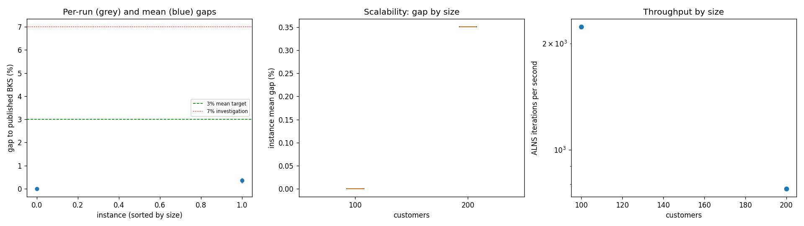
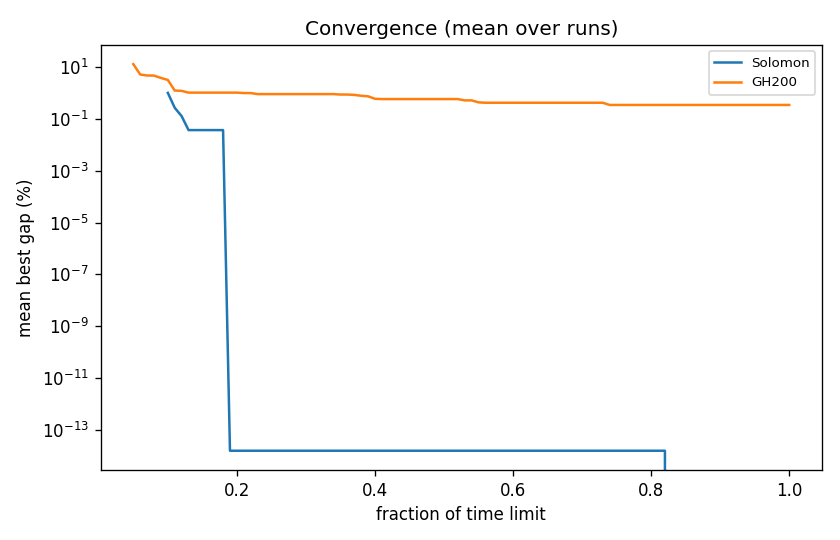

# ALNS + VND campaign `smoke-001`

Split: **development**; 2 instances x 2 seeds; budget: time_limit = max(5.0, 0.05 * customers) seconds. Gaps are to published BKS (not proven optima), recomputed by the independent evaluator.

| Metric | Value |
| --- | ---: |
| planned attempts | 4 |
| attempts | 4 |
| feasible attempts | 4 |
| budget respected | 4 |
| mean gap equal weight | 0.175 |
| median instance gap | 0.175 |
| p90 run gap | 0.382 |
| worst run gap | 0.428 |
| best of seeds mean gap | 0.137 |
| mean within instance sd | 0.054 |
| negative gap runs | 0 |

Instances with any run above 7%: none

## By size family

| Family | n | time limit (s) | mean gap % | worst run gap % | mean seed SD | iterations |
| --- | ---: | ---: | ---: | ---: | ---: | ---: |
| Solomon | 1 | 5 | 0.000 | 0.000 | 0.000 | 11141 |
| GH200 | 1 | 10 | 0.351 | 0.428 | 0.108 | 7768 |

## By instance class

| Class | instances | mean gap % | worst run gap % |
| --- | ---: | ---: | ---: |
| R1 | 1 | 0.000 | 0.000 |
| RC2 | 1 | 0.351 | 0.428 |

## Per instance

| Instance | n | BKS | best | mean gap % | best % | worst % | SD | feasible | vehicles | iterations | time-to-best s |
| --- | ---: | ---: | ---: | ---: | ---: | ---: | ---: | ---: | ---: | ---: | ---: |
| Solomon/R102.vrp | 100 | 1466.6 | 1466.6 | 0.000 | 0.000 | 0.000 | 0.000 | 2/2 | 18.0 | 11141 | 0.8 |
| GH200/RC2_2_8.vrp | 200 | 2151.2 | 2157.1 | 0.351 | 0.274 | 0.428 | 0.108 | 2/2 | 6.0 | 7768 | 5.7 |

