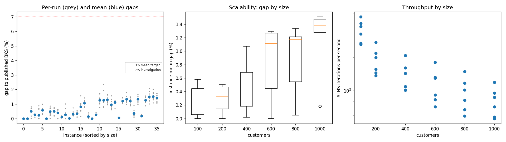
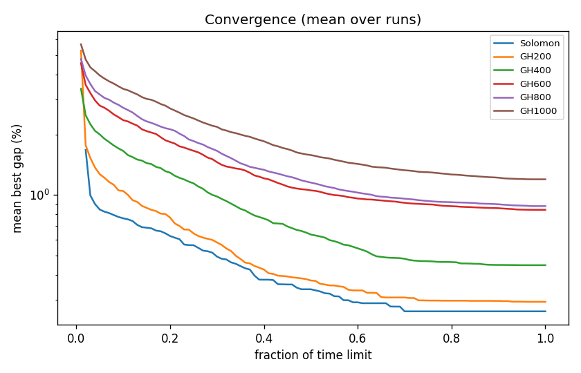

# ALNS + VND campaign `test-001`

Split: **test**; 36 instances x 10 seeds; budget: time_limit = max(10.0, 0.3 * customers) seconds. Gaps are to published BKS (not proven optima), recomputed by the independent evaluator.

| Metric | Value |
| --- | ---: |
| planned attempts | 360 |
| attempts | 360 |
| feasible attempts | 360 |
| budget respected | 360 |
| mean gap equal weight | 0.654 |
| median instance gap | 0.496 |
| p90 run gap | 1.448 |
| worst run gap | 2.364 |
| best of seeds mean gap | 0.389 |
| mean within instance sd | 0.200 |
| negative gap runs | 0 |

Instances with any run above 7%: none

## By size family

| Family | n | time limit (s) | mean gap % | worst run gap % | mean seed SD | iterations |
| --- | ---: | ---: | ---: | ---: | ---: | ---: |
| Solomon | 6 | 30 | 0.262 | 0.998 | 0.182 | 105232 |
| GH200 | 6 | 60 | 0.293 | 1.014 | 0.190 | 112802 |
| GH400 | 6 | 120 | 0.446 | 1.567 | 0.180 | 165007 |
| GH600 | 6 | 180 | 0.844 | 2.364 | 0.245 | 207086 |
| GH800 | 6 | 240 | 0.881 | 1.793 | 0.174 | 231213 |
| GH1000 | 6 | 300 | 1.198 | 2.079 | 0.225 | 244192 |

## By instance class

| Class | instances | mean gap % | worst run gap % |
| --- | ---: | ---: | ---: |
| C1 | 6 | 0.413 | 1.679 |
| C2 | 6 | 0.216 | 0.861 |
| R1 | 6 | 0.845 | 1.731 |
| R2 | 6 | 0.928 | 2.364 |
| RC1 | 6 | 0.902 | 2.026 |
| RC2 | 6 | 0.619 | 1.737 |

## Per instance

| Instance | n | BKS | best | mean gap % | best % | worst % | SD | feasible | vehicles | iterations | time-to-best s |
| --- | ---: | ---: | ---: | ---: | ---: | ---: | ---: | ---: | ---: | ---: | ---: |
| Solomon/C109.vrp | 100 | 827.3 | 827.3 | 0.000 | 0.000 | 0.000 | 0.000 | 10/10 | 10.0 | 139120 | 0.5 |
| Solomon/C202.vrp | 100 | 589.1 | 589.1 | 0.000 | 0.000 | 0.000 | 0.000 | 10/10 | 3.0 | 97604 | 0.5 |
| Solomon/R108.vrp | 100 | 932.1 | 932.1 | 0.506 | 0.000 | 0.805 | 0.323 | 10/10 | 10.0 | 113721 | 12.2 |
| Solomon/R202.vrp | 100 | 1029.6 | 1030.6 | 0.262 | 0.097 | 0.321 | 0.087 | 10/10 | 6.8 | 78651 | 13.8 |
| Solomon/RC101.vrp | 100 | 1619.8 | 1619.8 | 0.224 | 0.000 | 0.889 | 0.366 | 10/10 | 15.2 | 121533 | 16.2 |
| Solomon/RC202.vrp | 100 | 1092.3 | 1095.6 | 0.581 | 0.302 | 0.998 | 0.313 | 10/10 | 7.5 | 80761 | 8.1 |
| GH200/C1_2_5.vrp | 200 | 2694.9 | 2694.9 | 0.000 | 0.000 | 0.000 | 0.000 | 10/10 | 20.0 | 163655 | 0.7 |
| GH200/C2_2_4.vrp | 200 | 1695.0 | 1695.3 | 0.489 | 0.018 | 0.861 | 0.280 | 10/10 | 7.5 | 81832 | 12.9 |
| GH200/R1_2_3.vrp | 200 | 3373.9 | 3379.7 | 0.504 | 0.172 | 0.747 | 0.188 | 10/10 | 19.0 | 119415 | 36.8 |
| GH200/R2_2_3.vrp | 200 | 2537.5 | 2537.5 | 0.400 | 0.000 | 0.631 | 0.285 | 10/10 | 8.3 | 86946 | 28.3 |
| GH200/RC1_2_5.vrp | 200 | 3325.6 | 3327.5 | 0.103 | 0.057 | 0.186 | 0.036 | 10/10 | 19.0 | 131075 | 30.6 |
| GH200/RC2_2_4.vrp | 200 | 1854.8 | 1854.8 | 0.260 | 0.000 | 1.014 | 0.352 | 10/10 | 7.0 | 93892 | 24.1 |
| GH400/C1_4_2.vrp | 400 | 7113.3 | 7114.4 | 0.020 | 0.015 | 0.032 | 0.006 | 10/10 | 40.0 | 250177 | 103.1 |
| GH400/C2_4_10.vrp | 400 | 3665.1 | 3672.5 | 0.305 | 0.202 | 0.734 | 0.183 | 10/10 | 12.0 | 122019 | 75.5 |
| GH400/R1_4_1.vrp | 400 | 10305.8 | 10315.7 | 0.334 | 0.096 | 0.577 | 0.171 | 10/10 | 41.6 | 171880 | 91.8 |
| GH400/R2_4_6.vrp | 400 | 5813.5 | 5822.9 | 0.805 | 0.162 | 1.567 | 0.384 | 10/10 | 11.6 | 121416 | 73.5 |
| GH400/RC1_4_6.vrp | 400 | 8148.0 | 8210.5 | 1.070 | 0.767 | 1.429 | 0.214 | 10/10 | 37.0 | 193291 | 98.2 |
| GH400/RC2_4_1.vrp | 400 | 6147.3 | 6147.3 | 0.143 | 0.000 | 0.399 | 0.124 | 10/10 | 16.2 | 131260 | 83.3 |
| GH600/C1_6_7.vrp | 600 | 14066.8 | 14066.9 | 0.001 | 0.001 | 0.001 | 0.000 | 10/10 | 60.0 | 324904 | 138.6 |
| GH600/C2_6_8.vrp | 600 | 7303.7 | 7319.6 | 0.272 | 0.218 | 0.427 | 0.066 | 10/10 | 18.0 | 165393 | 131.3 |
| GH600/R1_6_7.vrp | 600 | 16496.2 | 16624.4 | 1.262 | 0.777 | 1.731 | 0.306 | 10/10 | 55.0 | 234466 | 166.8 |
| GH600/R2_6_3.vrp | 600 | 10455.3 | 10533.4 | 1.271 | 0.747 | 2.364 | 0.515 | 10/10 | 16.7 | 149993 | 133.1 |
| GH600/RC1_6_6.vrp | 600 | 16473.3 | 16629.4 | 1.295 | 0.948 | 1.652 | 0.270 | 10/10 | 56.2 | 238252 | 153.9 |
| GH600/RC2_6_10.vrp | 600 | 8974.7 | 9030.0 | 0.962 | 0.616 | 1.568 | 0.314 | 10/10 | 12.5 | 129505 | 145.8 |
| GH800/C1_8_3.vrp | 800 | 24156.1 | 24321.4 | 1.125 | 0.684 | 1.230 | 0.161 | 10/10 | 75.0 | 358346 | 222.0 |
| GH800/C2_8_6.vrp | 800 | 11316.3 | 11319.3 | 0.051 | 0.027 | 0.101 | 0.023 | 10/10 | 24.0 | 197678 | 162.0 |
| GH800/R1_8_2.vrp | 800 | 32277.6 | 32608.5 | 1.210 | 1.025 | 1.465 | 0.143 | 10/10 | 73.6 | 243853 | 226.7 |
| GH800/R2_8_7.vrp | 800 | 16357.5 | 16518.5 | 1.333 | 0.984 | 1.793 | 0.237 | 10/10 | 17.8 | 142564 | 220.4 |
| GH800/RC1_8_1.vrp | 800 | 29978.9 | 30241.7 | 1.214 | 0.877 | 1.497 | 0.232 | 10/10 | 74.8 | 282208 | 209.2 |
| GH800/RC2_8_2.vrp | 800 | 16709.5 | 16720.3 | 0.350 | 0.065 | 0.925 | 0.250 | 10/10 | 23.0 | 162630 | 219.2 |
| GH1000/C1_10_3.vrp | 1000 | 40060.0 | 40446.2 | 1.334 | 0.964 | 1.679 | 0.259 | 10/10 | 92.8 | 358591 | 282.1 |
| GH1000/C2_10_8.vrp | 1000 | 16029.1 | 16054.6 | 0.181 | 0.159 | 0.268 | 0.041 | 10/10 | 30.0 | 215865 | 247.7 |
| GH1000/R1_10_2.vrp | 1000 | 48261.6 | 48685.3 | 1.256 | 0.878 | 1.554 | 0.218 | 10/10 | 93.3 | 262497 | 280.0 |
| GH1000/R2_10_9.vrp | 1000 | 31990.6 | 32313.8 | 1.494 | 1.010 | 2.079 | 0.317 | 10/10 | 23.4 | 168672 | 261.9 |
| GH1000/RC1_10_3.vrp | 1000 | 42121.9 | 42577.2 | 1.508 | 1.081 | 2.026 | 0.276 | 10/10 | 91.1 | 285953 | 286.2 |
| GH1000/RC2_10_6.vrp | 1000 | 25782.5 | 26057.4 | 1.417 | 1.066 | 1.737 | 0.242 | 10/10 | 23.1 | 173576 | 275.5 |

