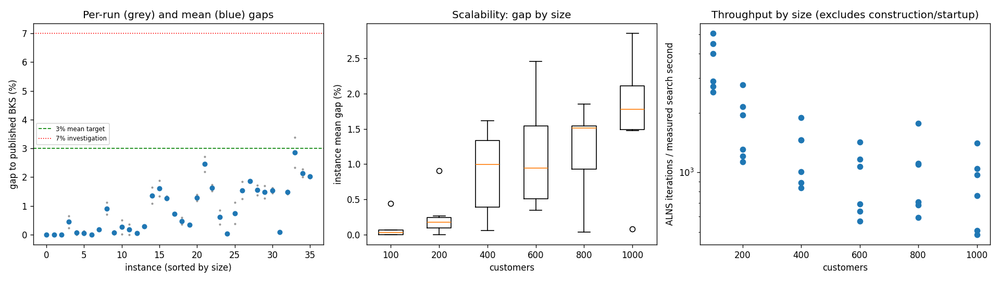
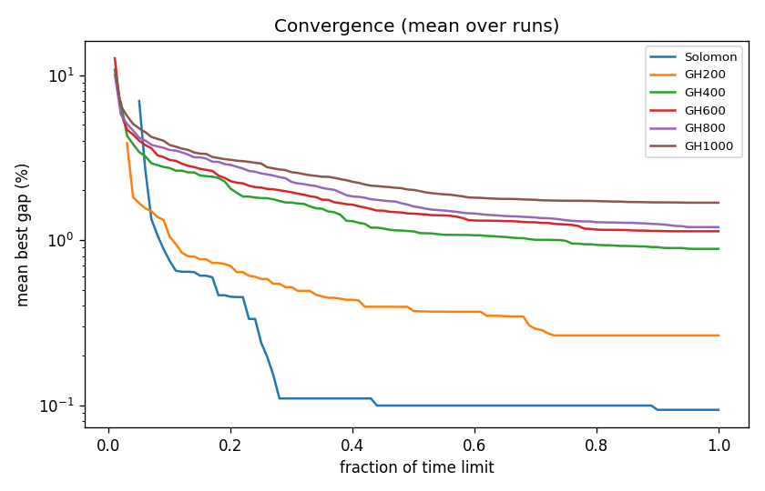

# ALNS + VND campaign `abl-no-blink`

Split: **development**; 36 instances x 2 seeds; budget: time_limit = max(10.0, 0.1 * customers) seconds. Gaps are to published BKS (not proven optima), recomputed by the independent evaluator.

Throughput = total iterations / total measured solver search seconds over valid paired runs; construction and worker startup are excluded. Missing/nonpositive times are excluded, not replaced by the time budget. `throughput_runs` records the included run count; zero rates remain in CSV but are omitted from the log-scale throughput plot.

| Metric | Value |
| --- | ---: |
| planned attempts | 72 |
| attempts | 72 |
| feasible attempts | 72 |
| budget respected | 72 |
| mean gap equal weight | 0.876 |
| median instance gap | 0.666 |
| p90 run gap | 1.964 |
| worst run gap | 3.383 |
| best of seeds mean gap | 0.752 |
| mean within instance sd | 0.175 |
| negative gap runs | 0 |

Instances with any run above 7%: none

## By size family

| Family | n | time limit (s) | mean gap % | worst run gap % | mean seed SD | iterations |
| --- | ---: | ---: | ---: | ---: | ---: | ---: |
| Solomon | 6 | 10 | 0.094 | 0.655 | 0.078 | 30521 |
| GH200 | 6 | 20 | 0.264 | 1.113 | 0.162 | 31752 |
| GH400 | 6 | 40 | 0.885 | 1.881 | 0.152 | 47113 |
| GH600 | 6 | 60 | 1.130 | 2.719 | 0.208 | 52683 |
| GH800 | 6 | 80 | 1.198 | 1.855 | 0.248 | 75735 |
| GH1000 | 6 | 100 | 1.684 | 3.383 | 0.204 | 82464 |

## By instance class

| Class | instances | mean gap % | worst run gap % |
| --- | ---: | ---: | ---: |
| C1 | 6 | 0.350 | 1.624 |
| C2 | 6 | 0.271 | 1.110 |
| R1 | 6 | 1.093 | 1.833 |
| R2 | 6 | 1.546 | 3.383 |
| RC1 | 6 | 1.150 | 2.273 |
| RC2 | 6 | 0.846 | 2.068 |

## Per instance

| Instance | n | BKS | best | mean gap % | best % | worst % | SD | feasible | vehicles | iterations | time-to-best s |
| --- | ---: | ---: | ---: | ---: | ---: | ---: | ---: | ---: | ---: | ---: | ---: |
| Solomon/C107.vrp | 100 | 827.3 | 827.3 | 0.000 | 0.000 | 0.000 | 0.000 | 2/2 | 10.0 | 42678 | 0.5 |
| Solomon/C204.vrp | 100 | 588.1 | 588.1 | 0.000 | 0.000 | 0.000 | 0.000 | 2/2 | 3.0 | 23054 | 0.7 |
| Solomon/R102.vrp | 100 | 1466.6 | 1466.6 | 0.000 | 0.000 | 0.000 | 0.000 | 2/2 | 18.0 | 38021 | 1.5 |
| Solomon/R203.vrp | 100 | 870.8 | 872.8 | 0.442 | 0.230 | 0.655 | 0.300 | 2/2 | 5.5 | 24480 | 5.9 |
| Solomon/RC107.vrp | 100 | 1207.8 | 1207.8 | 0.062 | 0.000 | 0.124 | 0.088 | 2/2 | 12.0 | 33538 | 3.3 |
| Solomon/RC204.vrp | 100 | 783.5 | 783.5 | 0.057 | 0.000 | 0.115 | 0.081 | 2/2 | 4.0 | 21353 | 1.5 |
| GH200/C1_2_8.vrp | 200 | 2684.0 | 2684.0 | 0.000 | 0.000 | 0.000 | 0.000 | 2/2 | 20.0 | 50242 | 0.9 |
| GH200/C2_2_8.vrp | 200 | 1813.7 | 1816.9 | 0.176 | 0.176 | 0.176 | 0.000 | 2/2 | 6.0 | 23698 | 2.2 |
| GH200/R1_2_6.vrp | 200 | 3559.1 | 3583.8 | 0.903 | 0.694 | 1.113 | 0.296 | 2/2 | 20.0 | 35064 | 8.1 |
| GH200/R2_2_8.vrp | 200 | 1842.4 | 1842.6 | 0.062 | 0.011 | 0.114 | 0.073 | 2/2 | 4.0 | 20447 | 5.0 |
| GH200/RC1_2_2.vrp | 200 | 3221.6 | 3222.2 | 0.262 | 0.019 | 0.506 | 0.345 | 2/2 | 19.0 | 39072 | 14.5 |
| GH200/RC2_2_8.vrp | 200 | 2151.2 | 2151.2 | 0.181 | 0.000 | 0.363 | 0.256 | 2/2 | 6.0 | 21993 | 9.4 |
| GH400/C1_4_3.vrp | 400 | 6929.9 | 6933.7 | 0.058 | 0.055 | 0.062 | 0.005 | 2/2 | 38.0 | 70980 | 35.6 |
| GH400/C2_4_8.vrp | 400 | 3773.7 | 3783.2 | 0.281 | 0.252 | 0.310 | 0.041 | 2/2 | 12.0 | 37784 | 34.2 |
| GH400/R1_4_10.vrp | 400 | 8077.8 | 8165.2 | 1.361 | 1.082 | 1.639 | 0.394 | 2/2 | 37.0 | 54916 | 35.4 |
| GH400/R2_4_4.vrp | 400 | 4211.2 | 4267.8 | 1.612 | 1.344 | 1.881 | 0.379 | 2/2 | 9.0 | 33310 | 29.1 |
| GH400/RC1_4_8.vrp | 400 | 7757.2 | 7850.7 | 1.269 | 1.205 | 1.333 | 0.090 | 2/2 | 37.0 | 54455 | 29.0 |
| GH400/RC2_4_3.vrp | 400 | 4573.0 | 4606.2 | 0.726 | 0.726 | 0.726 | 0.000 | 2/2 | 12.0 | 31234 | 35.7 |
| GH600/C1_6_9.vrp | 600 | 13664.5 | 13713.7 | 0.472 | 0.360 | 0.584 | 0.158 | 2/2 | 57.5 | 81214 | 46.8 |
| GH600/C2_6_9.vrp | 600 | 7303.2 | 7326.3 | 0.348 | 0.316 | 0.379 | 0.045 | 2/2 | 19.0 | 39305 | 47.5 |
| GH600/R1_6_4.vrp | 600 | 15721.4 | 15905.0 | 1.278 | 1.168 | 1.388 | 0.156 | 2/2 | 55.0 | 60945 | 55.2 |
| GH600/R2_6_10.vrp | 600 | 11837.0 | 12095.9 | 2.453 | 2.187 | 2.719 | 0.376 | 2/2 | 13.5 | 32270 | 51.7 |
| GH600/RC1_6_2.vrp | 600 | 15890.6 | 16130.6 | 1.625 | 1.510 | 1.739 | 0.162 | 2/2 | 56.5 | 66292 | 55.6 |
| GH600/RC2_6_2.vrp | 600 | 10336.9 | 10374.1 | 0.607 | 0.360 | 0.853 | 0.349 | 2/2 | 18.0 | 36070 | 54.2 |
| GH800/C1_8_6.vrp | 800 | 25133.3 | 25140.9 | 0.031 | 0.030 | 0.033 | 0.002 | 2/2 | 80.0 | 134766 | 64.3 |
| GH800/C2_8_10.vrp | 800 | 10946.0 | 10986.8 | 0.741 | 0.373 | 1.110 | 0.521 | 2/2 | 24.0 | 54064 | 75.3 |
| GH800/R1_8_3.vrp | 800 | 29304.5 | 29668.2 | 1.537 | 1.241 | 1.833 | 0.419 | 2/2 | 72.5 | 83718 | 73.7 |
| GH800/R2_8_10.vrp | 800 | 19984.8 | 20355.4 | 1.855 | 1.854 | 1.855 | 0.000 | 2/2 | 18.0 | 52121 | 63.7 |
| GH800/RC1_8_9.vrp | 800 | 28347.1 | 28737.7 | 1.544 | 1.378 | 1.710 | 0.235 | 2/2 | 74.0 | 84548 | 76.1 |
| GH800/RC2_8_1.vrp | 800 | 19201.3 | 19443.3 | 1.481 | 1.260 | 1.702 | 0.312 | 2/2 | 23.5 | 45194 | 74.4 |
| GH1000/C1_10_2.vrp | 1000 | 41337.8 | 41936.3 | 1.536 | 1.448 | 1.624 | 0.124 | 2/2 | 98.0 | 134500 | 50.6 |
| GH1000/C2_10_2.vrp | 1000 | 16462.6 | 16474.8 | 0.080 | 0.074 | 0.086 | 0.008 | 2/2 | 30.0 | 72663 | 84.4 |
| GH1000/R1_10_5.vrp | 1000 | 50406.7 | 51120.0 | 1.476 | 1.415 | 1.538 | 0.087 | 2/2 | 93.0 | 100144 | 93.5 |
| GH1000/R2_10_7.vrp | 1000 | 23102.2 | 23639.5 | 2.854 | 2.326 | 3.383 | 0.747 | 2/2 | 21.5 | 48544 | 92.2 |
| GH1000/RC1_10_5.vrp | 1000 | 45028.1 | 45929.0 | 2.137 | 2.001 | 2.273 | 0.192 | 2/2 | 92.0 | 92628 | 94.5 |
| GH1000/RC2_10_10.vrp | 1000 | 21731.2 | 22160.1 | 2.021 | 1.974 | 2.068 | 0.067 | 2/2 | 19.5 | 46306 | 93.7 |

