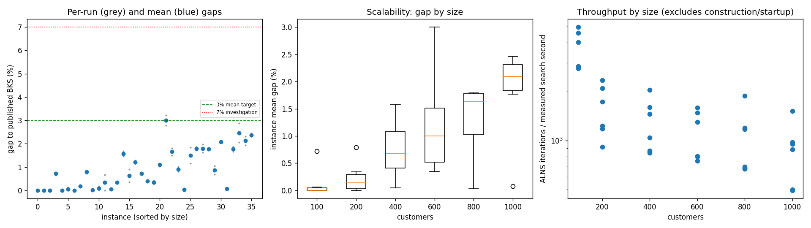
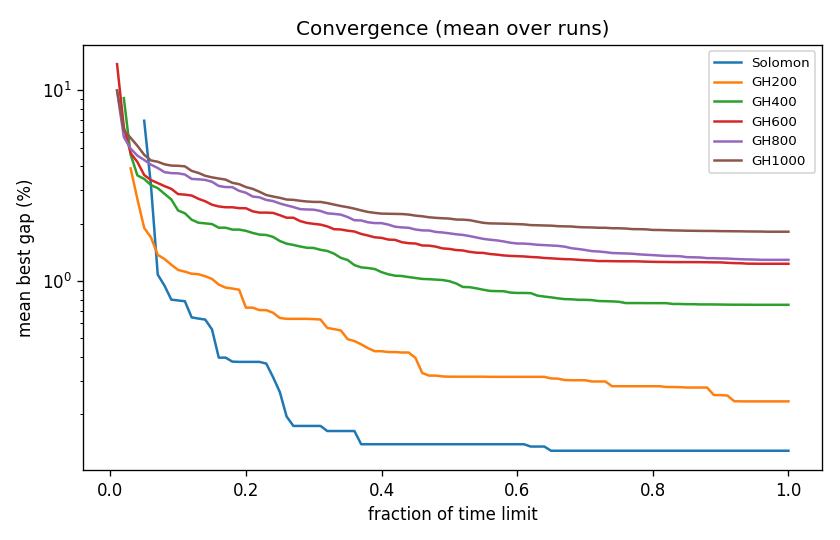

# ALNS + VND campaign `abl-no-greedy`

Split: **development**; 36 instances x 2 seeds; budget: time_limit = max(10.0, 0.1 * customers) seconds. Gaps are to published BKS (not proven optima), recomputed by the independent evaluator.

Throughput = total iterations / total measured solver search seconds over valid paired runs; construction and worker startup are excluded. Missing/nonpositive times are excluded, not replaced by the time budget. `throughput_runs` records the included run count; zero rates remain in CSV but are omitted from the log-scale throughput plot.

| Metric | Value |
| --- | ---: |
| planned attempts | 72 |
| attempts | 72 |
| feasible attempts | 72 |
| budget respected | 72 |
| mean gap equal weight | 0.908 |
| median instance gap | 0.721 |
| p90 run gap | 2.066 |
| worst run gap | 3.223 |
| best of seeds mean gap | 0.817 |
| mean within instance sd | 0.129 |
| negative gap runs | 0 |

Instances with any run above 7%: none

## By size family

| Family | n | time limit (s) | mean gap % | worst run gap % | mean seed SD | iterations |
| --- | ---: | ---: | ---: | ---: | ---: | ---: |
| Solomon | 6 | 10 | 0.129 | 0.781 | 0.028 | 30911 |
| GH200 | 6 | 20 | 0.234 | 0.854 | 0.113 | 28631 |
| GH400 | 6 | 40 | 0.751 | 1.672 | 0.118 | 48982 |
| GH600 | 6 | 60 | 1.231 | 3.223 | 0.145 | 63620 |
| GH800 | 6 | 80 | 1.291 | 1.961 | 0.186 | 80084 |
| GH1000 | 6 | 100 | 1.812 | 2.866 | 0.182 | 84769 |

## By instance class

| Class | instances | mean gap % | worst run gap % |
| --- | ---: | ---: | ---: |
| C1 | 6 | 0.421 | 2.073 |
| C2 | 6 | 0.405 | 1.845 |
| R1 | 6 | 1.168 | 1.872 |
| R2 | 6 | 1.435 | 3.223 |
| RC1 | 6 | 1.143 | 2.315 |
| RC2 | 6 | 0.877 | 2.437 |

## Per instance

| Instance | n | BKS | best | mean gap % | best % | worst % | SD | feasible | vehicles | iterations | time-to-best s |
| --- | ---: | ---: | ---: | ---: | ---: | ---: | ---: | ---: | ---: | ---: | ---: |
| Solomon/C107.vrp | 100 | 827.3 | 827.3 | 0.000 | 0.000 | 0.000 | 0.000 | 2/2 | 10.0 | 42042 | 0.5 |
| Solomon/C204.vrp | 100 | 588.1 | 588.1 | 0.000 | 0.000 | 0.000 | 0.000 | 2/2 | 3.0 | 23908 | 0.8 |
| Solomon/R102.vrp | 100 | 1466.6 | 1466.6 | 0.000 | 0.000 | 0.000 | 0.000 | 2/2 | 18.0 | 38260 | 1.7 |
| Solomon/R203.vrp | 100 | 870.8 | 876.5 | 0.718 | 0.655 | 0.781 | 0.089 | 2/2 | 5.5 | 23938 | 4.4 |
| Solomon/RC107.vrp | 100 | 1207.8 | 1207.8 | 0.000 | 0.000 | 0.000 | 0.000 | 2/2 | 12.0 | 33838 | 3.4 |
| Solomon/RC204.vrp | 100 | 783.5 | 783.5 | 0.057 | 0.000 | 0.115 | 0.081 | 2/2 | 4.0 | 23479 | 0.6 |
| GH200/C1_2_8.vrp | 200 | 2684.0 | 2684.0 | 0.000 | 0.000 | 0.000 | 0.000 | 2/2 | 20.0 | 42635 | 0.8 |
| GH200/C2_2_8.vrp | 200 | 1813.7 | 1816.9 | 0.176 | 0.176 | 0.176 | 0.000 | 2/2 | 6.0 | 22396 | 1.2 |
| GH200/R1_2_6.vrp | 200 | 3559.1 | 3585.0 | 0.791 | 0.728 | 0.854 | 0.089 | 2/2 | 20.0 | 31354 | 9.0 |
| GH200/R2_2_8.vrp | 200 | 1842.4 | 1842.5 | 0.008 | 0.005 | 0.011 | 0.004 | 2/2 | 4.0 | 16570 | 2.7 |
| GH200/RC1_2_2.vrp | 200 | 3221.6 | 3222.2 | 0.093 | 0.019 | 0.168 | 0.105 | 2/2 | 19.0 | 37618 | 14.8 |
| GH200/RC2_2_8.vrp | 200 | 2151.2 | 2151.2 | 0.337 | 0.000 | 0.674 | 0.477 | 2/2 | 6.0 | 21214 | 13.8 |
| GH400/C1_4_3.vrp | 400 | 6929.9 | 6932.2 | 0.041 | 0.033 | 0.049 | 0.011 | 2/2 | 38.0 | 76487 | 35.4 |
| GH400/C2_4_8.vrp | 400 | 3773.7 | 3785.1 | 0.334 | 0.302 | 0.366 | 0.045 | 2/2 | 12.0 | 39024 | 23.0 |
| GH400/R1_4_10.vrp | 400 | 8077.8 | 8196.6 | 1.572 | 1.471 | 1.672 | 0.143 | 2/2 | 37.0 | 54398 | 34.1 |
| GH400/R2_4_4.vrp | 400 | 4211.2 | 4225.9 | 0.626 | 0.349 | 0.902 | 0.391 | 2/2 | 9.0 | 31450 | 26.2 |
| GH400/RC1_4_8.vrp | 400 | 7757.2 | 7845.5 | 1.208 | 1.138 | 1.278 | 0.098 | 2/2 | 37.0 | 60040 | 37.6 |
| GH400/RC2_4_3.vrp | 400 | 4573.0 | 4605.4 | 0.724 | 0.709 | 0.739 | 0.022 | 2/2 | 12.0 | 32492 | 27.2 |
| GH600/C1_6_9.vrp | 600 | 13664.5 | 13717.8 | 0.390 | 0.390 | 0.390 | 0.000 | 2/2 | 57.0 | 90410 | 41.5 |
| GH600/C2_6_9.vrp | 600 | 7303.2 | 7323.4 | 0.344 | 0.277 | 0.411 | 0.095 | 2/2 | 19.0 | 45274 | 55.7 |
| GH600/R1_6_4.vrp | 600 | 15721.4 | 15882.0 | 1.091 | 1.022 | 1.161 | 0.099 | 2/2 | 55.0 | 73628 | 49.4 |
| GH600/R2_6_10.vrp | 600 | 11837.0 | 12166.3 | 3.002 | 2.782 | 3.223 | 0.312 | 2/2 | 13.5 | 45394 | 46.2 |
| GH600/RC1_6_2.vrp | 600 | 15890.6 | 16129.2 | 1.655 | 1.502 | 1.809 | 0.218 | 2/2 | 56.0 | 84272 | 55.7 |
| GH600/RC2_6_2.vrp | 600 | 10336.9 | 10419.7 | 0.905 | 0.801 | 1.009 | 0.147 | 2/2 | 18.0 | 42744 | 51.0 |
| GH800/C1_8_6.vrp | 800 | 25133.3 | 25135.8 | 0.026 | 0.010 | 0.043 | 0.023 | 2/2 | 80.0 | 143682 | 75.0 |
| GH800/C2_8_10.vrp | 800 | 10946.0 | 11072.5 | 1.500 | 1.156 | 1.845 | 0.487 | 2/2 | 24.5 | 52858 | 76.7 |
| GH800/R1_8_3.vrp | 800 | 29304.5 | 29809.0 | 1.788 | 1.722 | 1.855 | 0.094 | 2/2 | 73.0 | 91397 | 76.0 |
| GH800/R2_8_10.vrp | 800 | 19984.8 | 20308.4 | 1.790 | 1.619 | 1.961 | 0.242 | 2/2 | 17.5 | 51854 | 61.0 |
| GH800/RC1_8_9.vrp | 800 | 28347.1 | 28845.2 | 1.776 | 1.757 | 1.795 | 0.027 | 2/2 | 74.0 | 89490 | 76.7 |
| GH800/RC2_8_1.vrp | 800 | 19201.3 | 19333.8 | 0.864 | 0.690 | 1.037 | 0.246 | 2/2 | 25.0 | 51224 | 72.4 |
| GH1000/C1_10_2.vrp | 1000 | 41337.8 | 42192.0 | 2.070 | 2.066 | 2.073 | 0.005 | 2/2 | 99.0 | 145002 | 94.8 |
| GH1000/C2_10_2.vrp | 1000 | 16462.6 | 16474.1 | 0.075 | 0.070 | 0.080 | 0.007 | 2/2 | 30.0 | 84101 | 92.2 |
| GH1000/R1_10_5.vrp | 1000 | 50406.7 | 51243.1 | 1.765 | 1.659 | 1.872 | 0.150 | 2/2 | 93.0 | 91064 | 89.3 |
| GH1000/R2_10_7.vrp | 1000 | 23102.2 | 23577.9 | 2.463 | 2.059 | 2.866 | 0.571 | 2/2 | 21.5 | 47926 | 94.0 |
| GH1000/RC1_10_5.vrp | 1000 | 45028.1 | 45900.4 | 2.126 | 1.937 | 2.315 | 0.267 | 2/2 | 92.0 | 93169 | 91.1 |
| GH1000/RC2_10_10.vrp | 1000 | 21731.2 | 22232.7 | 2.372 | 2.308 | 2.437 | 0.091 | 2/2 | 19.5 | 47354 | 90.4 |

