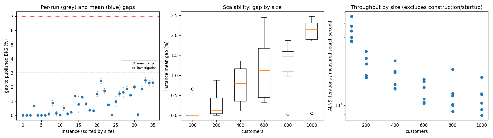
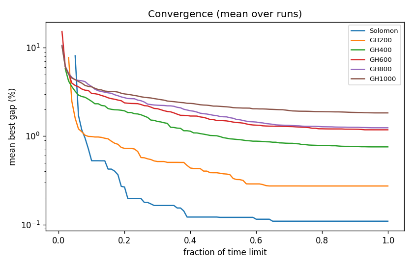

# ALNS + VND campaign `abl-no-oropt`

Split: **development**; 36 instances x 2 seeds; budget: time_limit = max(10.0, 0.1 * customers) seconds. Gaps are to published BKS (not proven optima), recomputed by the independent evaluator.

Throughput = total iterations / total measured solver search seconds over valid paired runs; construction and worker startup are excluded. Missing/nonpositive times are excluded, not replaced by the time budget. `throughput_runs` records the included run count; zero rates remain in CSV but are omitted from the log-scale throughput plot.

| Metric | Value |
| --- | ---: |
| planned attempts | 72 |
| attempts | 72 |
| feasible attempts | 72 |
| budget respected | 72 |
| mean gap equal weight | 0.899 |
| median instance gap | 0.751 |
| p90 run gap | 2.088 |
| worst run gap | 2.661 |
| best of seeds mean gap | 0.783 |
| mean within instance sd | 0.165 |
| negative gap runs | 0 |

Instances with any run above 7%: none

## By size family

| Family | n | time limit (s) | mean gap % | worst run gap % | mean seed SD | iterations |
| --- | ---: | ---: | ---: | ---: | ---: | ---: |
| Solomon | 6 | 10 | 0.109 | 0.655 | 0.000 | 49051 |
| GH200 | 6 | 20 | 0.273 | 1.045 | 0.130 | 45733 |
| GH400 | 6 | 40 | 0.756 | 1.779 | 0.276 | 74235 |
| GH600 | 6 | 60 | 1.180 | 2.618 | 0.148 | 79835 |
| GH800 | 6 | 80 | 1.244 | 2.044 | 0.232 | 98802 |
| GH1000 | 6 | 100 | 1.833 | 2.661 | 0.204 | 116025 |

## By instance class

| Class | instances | mean gap % | worst run gap % |
| --- | ---: | ---: | ---: |
| C1 | 6 | 0.414 | 2.091 |
| C2 | 6 | 0.274 | 1.310 |
| R1 | 6 | 1.188 | 2.021 |
| R2 | 6 | 1.352 | 2.661 |
| RC1 | 6 | 1.199 | 2.448 |
| RC2 | 6 | 0.969 | 2.572 |

## Per instance

| Instance | n | BKS | best | mean gap % | best % | worst % | SD | feasible | vehicles | iterations | time-to-best s |
| --- | ---: | ---: | ---: | ---: | ---: | ---: | ---: | ---: | ---: | ---: | ---: |
| Solomon/C107.vrp | 100 | 827.3 | 827.3 | 0.000 | 0.000 | 0.000 | 0.000 | 2/2 | 10.0 | 69647 | 0.5 |
| Solomon/C204.vrp | 100 | 588.1 | 588.1 | 0.000 | 0.000 | 0.000 | 0.000 | 2/2 | 3.0 | 38554 | 1.1 |
| Solomon/R102.vrp | 100 | 1466.6 | 1466.6 | 0.000 | 0.000 | 0.000 | 0.000 | 2/2 | 18.0 | 55480 | 0.7 |
| Solomon/R203.vrp | 100 | 870.8 | 876.5 | 0.655 | 0.655 | 0.655 | 0.000 | 2/2 | 5.0 | 42452 | 6.2 |
| Solomon/RC107.vrp | 100 | 1207.8 | 1207.8 | 0.000 | 0.000 | 0.000 | 0.000 | 2/2 | 12.0 | 49146 | 3.7 |
| Solomon/RC204.vrp | 100 | 783.5 | 783.5 | 0.000 | 0.000 | 0.000 | 0.000 | 2/2 | 4.0 | 39024 | 1.6 |
| GH200/C1_2_8.vrp | 200 | 2684.0 | 2684.0 | 0.000 | 0.000 | 0.000 | 0.000 | 2/2 | 20.0 | 64499 | 1.0 |
| GH200/C2_2_8.vrp | 200 | 1813.7 | 1813.7 | 0.088 | 0.000 | 0.176 | 0.125 | 2/2 | 6.0 | 35118 | 3.4 |
| GH200/R1_2_6.vrp | 200 | 3559.1 | 3584.0 | 0.872 | 0.700 | 1.045 | 0.244 | 2/2 | 20.0 | 48175 | 11.5 |
| GH200/R2_2_8.vrp | 200 | 1842.4 | 1842.6 | 0.144 | 0.011 | 0.277 | 0.188 | 2/2 | 4.0 | 34654 | 1.9 |
| GH200/RC1_2_2.vrp | 200 | 3221.6 | 3222.1 | 0.016 | 0.016 | 0.016 | 0.000 | 2/2 | 19.0 | 55178 | 13.6 |
| GH200/RC2_2_8.vrp | 200 | 2151.2 | 2159.0 | 0.518 | 0.363 | 0.674 | 0.220 | 2/2 | 6.0 | 36774 | 11.0 |
| GH400/C1_4_3.vrp | 400 | 6929.9 | 6932.2 | 0.105 | 0.033 | 0.177 | 0.102 | 2/2 | 38.0 | 107456 | 36.4 |
| GH400/C2_4_8.vrp | 400 | 3773.7 | 3780.5 | 0.209 | 0.180 | 0.238 | 0.041 | 2/2 | 12.0 | 56088 | 29.2 |
| GH400/R1_4_10.vrp | 400 | 8077.8 | 8153.5 | 1.358 | 0.937 | 1.779 | 0.595 | 2/2 | 37.0 | 81276 | 29.9 |
| GH400/R2_4_4.vrp | 400 | 4211.2 | 4220.7 | 0.768 | 0.226 | 1.311 | 0.767 | 2/2 | 9.0 | 61334 | 30.8 |
| GH400/RC1_4_8.vrp | 400 | 7757.2 | 7855.2 | 1.280 | 1.263 | 1.297 | 0.024 | 2/2 | 37.0 | 84083 | 36.7 |
| GH400/RC2_4_3.vrp | 400 | 4573.0 | 4606.2 | 0.817 | 0.726 | 0.908 | 0.128 | 2/2 | 12.0 | 55172 | 33.5 |
| GH600/C1_6_9.vrp | 600 | 13664.5 | 13706.3 | 0.350 | 0.306 | 0.394 | 0.062 | 2/2 | 57.0 | 105264 | 53.7 |
| GH600/C2_6_9.vrp | 600 | 7303.2 | 7323.7 | 0.315 | 0.281 | 0.349 | 0.048 | 2/2 | 19.0 | 59420 | 52.0 |
| GH600/R1_6_4.vrp | 600 | 15721.4 | 15930.6 | 1.504 | 1.331 | 1.677 | 0.245 | 2/2 | 55.0 | 87267 | 55.2 |
| GH600/R2_6_10.vrp | 600 | 11837.0 | 12105.2 | 2.442 | 2.266 | 2.618 | 0.249 | 2/2 | 13.5 | 61192 | 51.5 |
| GH600/RC1_6_2.vrp | 600 | 15890.6 | 16142.8 | 1.733 | 1.587 | 1.880 | 0.207 | 2/2 | 56.0 | 99972 | 55.5 |
| GH600/RC2_6_2.vrp | 600 | 10336.9 | 10407.3 | 0.735 | 0.681 | 0.788 | 0.076 | 2/2 | 19.0 | 65898 | 49.6 |
| GH800/C1_8_6.vrp | 800 | 25133.3 | 25141.5 | 0.033 | 0.033 | 0.033 | 0.000 | 2/2 | 80.0 | 178222 | 69.0 |
| GH800/C2_8_10.vrp | 800 | 10946.0 | 11016.5 | 0.977 | 0.644 | 1.310 | 0.471 | 2/2 | 24.0 | 76064 | 56.0 |
| GH800/R1_8_3.vrp | 800 | 29304.5 | 29705.2 | 1.528 | 1.367 | 1.688 | 0.227 | 2/2 | 73.0 | 100360 | 76.4 |
| GH800/R2_8_10.vrp | 800 | 19984.8 | 20245.1 | 1.626 | 1.302 | 1.949 | 0.457 | 2/2 | 18.5 | 77258 | 70.1 |
| GH800/RC1_8_9.vrp | 800 | 28347.1 | 28831.5 | 1.876 | 1.709 | 2.044 | 0.237 | 2/2 | 74.0 | 95130 | 74.6 |
| GH800/RC2_8_1.vrp | 800 | 19201.3 | 19474.8 | 1.425 | 1.424 | 1.426 | 0.001 | 2/2 | 24.0 | 65776 | 72.2 |
| GH1000/C1_10_2.vrp | 1000 | 41337.8 | 42125.1 | 1.998 | 1.905 | 2.091 | 0.132 | 2/2 | 99.0 | 185819 | 46.5 |
| GH1000/C2_10_2.vrp | 1000 | 16462.6 | 16468.9 | 0.052 | 0.038 | 0.066 | 0.020 | 2/2 | 30.0 | 100342 | 92.6 |
| GH1000/R1_10_5.vrp | 1000 | 50406.7 | 51266.9 | 1.864 | 1.707 | 2.021 | 0.222 | 2/2 | 93.0 | 123225 | 93.0 |
| GH1000/R2_10_7.vrp | 1000 | 23102.2 | 23631.1 | 2.475 | 2.289 | 2.661 | 0.263 | 2/2 | 22.0 | 75246 | 92.5 |
| GH1000/RC1_10_5.vrp | 1000 | 45028.1 | 45985.2 | 2.287 | 2.126 | 2.448 | 0.228 | 2/2 | 92.0 | 125381 | 93.4 |
| GH1000/RC2_10_10.vrp | 1000 | 21731.2 | 22180.4 | 2.320 | 2.067 | 2.572 | 0.357 | 2/2 | 19.0 | 86134 | 95.5 |

