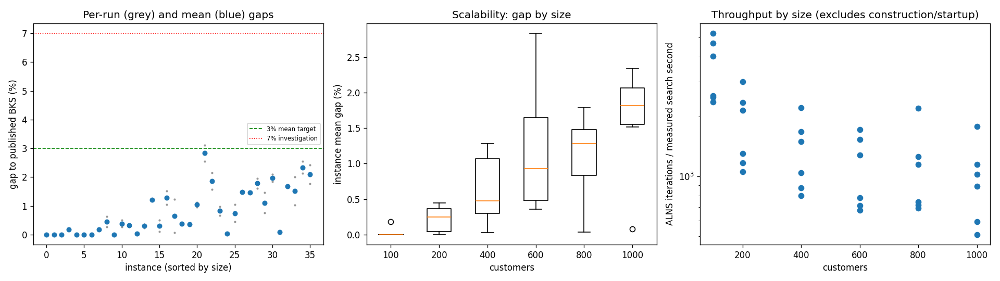
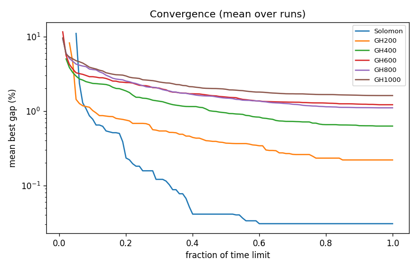

# ALNS + VND campaign `abl-no-random`

Split: **development**; 36 instances x 2 seeds; budget: time_limit = max(10.0, 0.1 * customers) seconds. Gaps are to published BKS (not proven optima), recomputed by the independent evaluator.

Throughput = total iterations / total measured solver search seconds over valid paired runs; construction and worker startup are excluded. Missing/nonpositive times are excluded, not replaced by the time budget. `throughput_runs` records the included run count; zero rates remain in CSV but are omitted from the log-scale throughput plot.

| Metric | Value |
| --- | ---: |
| planned attempts | 72 |
| attempts | 72 |
| feasible attempts | 72 |
| budget respected | 72 |
| mean gap equal weight | 0.801 |
| median instance gap | 0.412 |
| p90 run gap | 2.004 |
| worst run gap | 3.118 |
| best of seeds mean gap | 0.681 |
| mean within instance sd | 0.169 |
| negative gap runs | 0 |

Instances with any run above 7%: none

## By size family

| Family | n | time limit (s) | mean gap % | worst run gap % | mean seed SD | iterations |
| --- | ---: | ---: | ---: | ---: | ---: | ---: |
| Solomon | 6 | 10 | 0.031 | 0.184 | 0.000 | 30063 |
| GH200 | 6 | 20 | 0.220 | 0.621 | 0.080 | 33100 |
| GH400 | 6 | 40 | 0.627 | 1.510 | 0.259 | 50643 |
| GH600 | 6 | 60 | 1.213 | 3.118 | 0.196 | 63389 |
| GH800 | 6 | 80 | 1.102 | 1.958 | 0.205 | 85867 |
| GH1000 | 6 | 100 | 1.611 | 2.540 | 0.275 | 94708 |

## By instance class

| Class | instances | mean gap % | worst run gap % |
| --- | ---: | ---: | ---: |
| C1 | 6 | 0.399 | 2.093 |
| C2 | 6 | 0.276 | 1.042 |
| R1 | 6 | 0.974 | 1.689 |
| R2 | 6 | 1.050 | 3.118 |
| RC1 | 6 | 1.273 | 2.540 |
| RC2 | 6 | 0.832 | 2.420 |

## Per instance

| Instance | n | BKS | best | mean gap % | best % | worst % | SD | feasible | vehicles | iterations | time-to-best s |
| --- | ---: | ---: | ---: | ---: | ---: | ---: | ---: | ---: | ---: | ---: | ---: |
| Solomon/C107.vrp | 100 | 827.3 | 827.3 | 0.000 | 0.000 | 0.000 | 0.000 | 2/2 | 10.0 | 44162 | 0.5 |
| Solomon/C204.vrp | 100 | 588.1 | 588.1 | 0.000 | 0.000 | 0.000 | 0.000 | 2/2 | 3.0 | 20006 | 0.7 |
| Solomon/R102.vrp | 100 | 1466.6 | 1466.6 | 0.000 | 0.000 | 0.000 | 0.000 | 2/2 | 18.0 | 39532 | 0.7 |
| Solomon/R203.vrp | 100 | 870.8 | 872.4 | 0.184 | 0.184 | 0.184 | 0.000 | 2/2 | 6.0 | 21456 | 5.8 |
| Solomon/RC107.vrp | 100 | 1207.8 | 1207.8 | 0.000 | 0.000 | 0.000 | 0.000 | 2/2 | 12.0 | 34034 | 3.8 |
| Solomon/RC204.vrp | 100 | 783.5 | 783.5 | 0.000 | 0.000 | 0.000 | 0.000 | 2/2 | 4.0 | 21189 | 1.5 |
| GH200/C1_2_8.vrp | 200 | 2684.0 | 2684.0 | 0.000 | 0.000 | 0.000 | 0.000 | 2/2 | 20.0 | 53468 | 1.4 |
| GH200/C2_2_8.vrp | 200 | 1813.7 | 1816.9 | 0.176 | 0.176 | 0.176 | 0.000 | 2/2 | 6.0 | 23216 | 3.6 |
| GH200/R1_2_6.vrp | 200 | 3559.1 | 3568.6 | 0.444 | 0.267 | 0.621 | 0.250 | 2/2 | 20.0 | 38956 | 11.5 |
| GH200/R2_2_8.vrp | 200 | 1842.4 | 1842.4 | 0.000 | 0.000 | 0.000 | 0.000 | 2/2 | 4.0 | 19080 | 9.2 |
| GH200/RC1_2_2.vrp | 200 | 3221.6 | 3230.1 | 0.380 | 0.264 | 0.497 | 0.165 | 2/2 | 19.0 | 42702 | 10.0 |
| GH200/RC2_2_8.vrp | 200 | 2151.2 | 2157.1 | 0.318 | 0.274 | 0.363 | 0.062 | 2/2 | 6.0 | 21180 | 14.7 |
| GH400/C1_4_3.vrp | 400 | 6929.9 | 6930.3 | 0.026 | 0.006 | 0.046 | 0.029 | 2/2 | 38.0 | 82820 | 36.2 |
| GH400/C2_4_8.vrp | 400 | 3773.7 | 3782.5 | 0.299 | 0.233 | 0.366 | 0.094 | 2/2 | 12.0 | 39070 | 29.3 |
| GH400/R1_4_10.vrp | 400 | 8077.8 | 8173.9 | 1.205 | 1.190 | 1.221 | 0.022 | 2/2 | 37.0 | 56136 | 36.4 |
| GH400/R2_4_4.vrp | 400 | 4211.2 | 4215.6 | 0.303 | 0.104 | 0.501 | 0.280 | 2/2 | 9.0 | 32874 | 30.8 |
| GH400/RC1_4_8.vrp | 400 | 7757.2 | 7838.9 | 1.281 | 1.053 | 1.510 | 0.323 | 2/2 | 37.0 | 62947 | 35.9 |
| GH400/RC2_4_3.vrp | 400 | 4573.0 | 4576.5 | 0.647 | 0.077 | 1.218 | 0.807 | 2/2 | 11.5 | 30011 | 35.7 |
| GH600/C1_6_9.vrp | 600 | 13664.5 | 13714.6 | 0.368 | 0.367 | 0.370 | 0.002 | 2/2 | 57.0 | 97534 | 37.1 |
| GH600/C2_6_9.vrp | 600 | 7303.2 | 7326.9 | 0.354 | 0.325 | 0.383 | 0.042 | 2/2 | 19.0 | 44220 | 53.5 |
| GH600/R1_6_4.vrp | 600 | 15721.4 | 15872.6 | 1.042 | 0.962 | 1.123 | 0.114 | 2/2 | 55.0 | 72600 | 55.3 |
| GH600/R2_6_10.vrp | 600 | 11837.0 | 12139.3 | 2.836 | 2.554 | 3.118 | 0.399 | 2/2 | 13.5 | 40607 | 50.5 |
| GH600/RC1_6_2.vrp | 600 | 15890.6 | 16139.6 | 1.855 | 1.567 | 2.142 | 0.407 | 2/2 | 56.5 | 87009 | 55.6 |
| GH600/RC2_6_2.vrp | 600 | 10336.9 | 10406.1 | 0.822 | 0.669 | 0.974 | 0.215 | 2/2 | 19.0 | 38364 | 57.2 |
| GH800/C1_8_6.vrp | 800 | 25133.3 | 25140.9 | 0.031 | 0.030 | 0.033 | 0.002 | 2/2 | 80.0 | 167940 | 66.3 |
| GH800/C2_8_10.vrp | 800 | 10946.0 | 10995.0 | 0.745 | 0.448 | 1.042 | 0.421 | 2/2 | 24.0 | 52635 | 74.1 |
| GH800/R1_8_3.vrp | 800 | 29304.5 | 29733.7 | 1.485 | 1.465 | 1.505 | 0.028 | 2/2 | 73.0 | 87306 | 75.9 |
| GH800/R2_8_10.vrp | 800 | 19984.8 | 20271.6 | 1.463 | 1.435 | 1.491 | 0.039 | 2/2 | 19.0 | 56807 | 68.4 |
| GH800/RC1_8_9.vrp | 800 | 28347.1 | 28804.4 | 1.786 | 1.613 | 1.958 | 0.244 | 2/2 | 74.0 | 95864 | 76.7 |
| GH800/RC2_8_1.vrp | 800 | 19201.3 | 19345.9 | 1.105 | 0.753 | 1.457 | 0.498 | 2/2 | 24.0 | 54649 | 74.7 |
| GH1000/C1_10_2.vrp | 1000 | 41337.8 | 42097.7 | 1.966 | 1.838 | 2.093 | 0.180 | 2/2 | 99.0 | 170617 | 48.9 |
| GH1000/C2_10_2.vrp | 1000 | 16462.6 | 16475.6 | 0.080 | 0.079 | 0.081 | 0.002 | 2/2 | 30.0 | 85354 | 68.4 |
| GH1000/R1_10_5.vrp | 1000 | 50406.7 | 51239.6 | 1.671 | 1.652 | 1.689 | 0.026 | 2/2 | 93.0 | 109364 | 93.1 |
| GH1000/R2_10_7.vrp | 1000 | 23102.2 | 23338.7 | 1.516 | 1.024 | 2.009 | 0.697 | 2/2 | 21.5 | 48653 | 91.5 |
| GH1000/RC1_10_5.vrp | 1000 | 45028.1 | 45988.6 | 2.337 | 2.133 | 2.540 | 0.288 | 2/2 | 92.0 | 97859 | 95.9 |
| GH1000/RC2_10_10.vrp | 1000 | 21731.2 | 22117.1 | 2.098 | 1.776 | 2.420 | 0.456 | 2/2 | 20.0 | 56402 | 91.2 |

