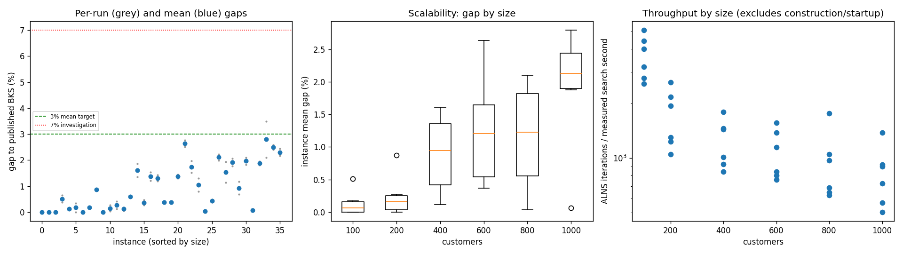
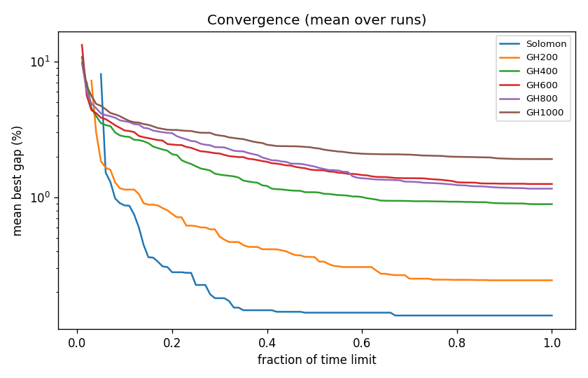

# ALNS + VND campaign `abl-no-regret2`

Split: **development**; 36 instances x 2 seeds; budget: time_limit = max(10.0, 0.1 * customers) seconds. Gaps are to published BKS (not proven optima), recomputed by the independent evaluator.

Throughput = total iterations / total measured solver search seconds over valid paired runs; construction and worker startup are excluded. Missing/nonpositive times are excluded, not replaced by the time budget. `throughput_runs` records the included run count; zero rates remain in CSV but are omitted from the log-scale throughput plot.

| Metric | Value |
| --- | ---: |
| planned attempts | 72 |
| attempts | 72 |
| feasible attempts | 72 |
| budget respected | 72 |
| mean gap equal weight | 0.933 |
| median instance gap | 0.548 |
| p90 run gap | 2.158 |
| worst run gap | 3.489 |
| best of seeds mean gap | 0.819 |
| mean within instance sd | 0.161 |
| negative gap runs | 0 |

Instances with any run above 7%: none

## By size family

| Family | n | time limit (s) | mean gap % | worst run gap % | mean seed SD | iterations |
| --- | ---: | ---: | ---: | ---: | ---: | ---: |
| Solomon | 6 | 10 | 0.135 | 0.655 | 0.074 | 31126 |
| GH200 | 6 | 20 | 0.245 | 0.871 | 0.062 | 31101 |
| GH400 | 6 | 40 | 0.891 | 1.853 | 0.170 | 46700 |
| GH600 | 6 | 60 | 1.255 | 2.772 | 0.172 | 61563 |
| GH800 | 6 | 80 | 1.159 | 2.219 | 0.224 | 72989 |
| GH1000 | 6 | 100 | 1.915 | 3.489 | 0.267 | 79459 |

## By instance class

| Class | instances | mean gap % | worst run gap % |
| --- | ---: | ---: | ---: |
| C1 | 6 | 0.413 | 2.100 |
| C2 | 6 | 0.272 | 0.612 |
| R1 | 6 | 1.304 | 2.219 |
| R2 | 6 | 1.308 | 3.489 |
| RC1 | 6 | 1.299 | 2.583 |
| RC2 | 6 | 1.003 | 2.439 |

## Per instance

| Instance | n | BKS | best | mean gap % | best % | worst % | SD | feasible | vehicles | iterations | time-to-best s |
| --- | ---: | ---: | ---: | ---: | ---: | ---: | ---: | ---: | ---: | ---: | ---: |
| Solomon/C107.vrp | 100 | 827.3 | 827.3 | 0.000 | 0.000 | 0.000 | 0.000 | 2/2 | 10.0 | 43070 | 0.5 |
| Solomon/C204.vrp | 100 | 588.1 | 588.1 | 0.000 | 0.000 | 0.000 | 0.000 | 2/2 | 3.0 | 23380 | 0.6 |
| Solomon/R102.vrp | 100 | 1466.6 | 1466.6 | 0.000 | 0.000 | 0.000 | 0.000 | 2/2 | 18.0 | 37460 | 1.9 |
| Solomon/R203.vrp | 100 | 870.8 | 874.0 | 0.511 | 0.367 | 0.655 | 0.203 | 2/2 | 5.5 | 27110 | 4.6 |
| Solomon/RC107.vrp | 100 | 1207.8 | 1209.3 | 0.124 | 0.124 | 0.124 | 0.000 | 2/2 | 12.0 | 33962 | 2.2 |
| Solomon/RC204.vrp | 100 | 783.5 | 783.5 | 0.172 | 0.000 | 0.345 | 0.244 | 2/2 | 4.0 | 21772 | 3.0 |
| GH200/C1_2_8.vrp | 200 | 2684.0 | 2684.0 | 0.000 | 0.000 | 0.000 | 0.000 | 2/2 | 20.0 | 47038 | 1.2 |
| GH200/C2_2_8.vrp | 200 | 1813.7 | 1816.9 | 0.176 | 0.176 | 0.176 | 0.000 | 2/2 | 6.0 | 23422 | 4.8 |
| GH200/R1_2_6.vrp | 200 | 3559.1 | 3590.1 | 0.871 | 0.871 | 0.871 | 0.000 | 2/2 | 20.0 | 35254 | 16.9 |
| GH200/R2_2_8.vrp | 200 | 1842.4 | 1842.4 | 0.000 | 0.000 | 0.000 | 0.000 | 2/2 | 4.0 | 19061 | 8.6 |
| GH200/RC1_2_2.vrp | 200 | 3221.6 | 3222.7 | 0.149 | 0.034 | 0.264 | 0.162 | 2/2 | 19.0 | 39458 | 11.7 |
| GH200/RC2_2_8.vrp | 200 | 2151.2 | 2153.9 | 0.272 | 0.126 | 0.418 | 0.207 | 2/2 | 6.0 | 22370 | 15.2 |
| GH400/C1_4_3.vrp | 400 | 6929.9 | 6933.5 | 0.115 | 0.052 | 0.177 | 0.089 | 2/2 | 38.0 | 67324 | 35.6 |
| GH400/C2_4_8.vrp | 400 | 3773.7 | 3794.8 | 0.586 | 0.559 | 0.612 | 0.037 | 2/2 | 12.0 | 37998 | 23.1 |
| GH400/R1_4_10.vrp | 400 | 8077.8 | 8186.8 | 1.601 | 1.349 | 1.853 | 0.356 | 2/2 | 37.0 | 54626 | 36.2 |
| GH400/R2_4_4.vrp | 400 | 4211.2 | 4222.1 | 0.365 | 0.259 | 0.470 | 0.149 | 2/2 | 9.0 | 34656 | 32.8 |
| GH400/RC1_4_8.vrp | 400 | 7757.2 | 7851.5 | 1.374 | 1.216 | 1.531 | 0.223 | 2/2 | 37.0 | 54012 | 35.2 |
| GH400/RC2_4_3.vrp | 400 | 4573.0 | 4627.4 | 1.305 | 1.190 | 1.421 | 0.164 | 2/2 | 12.0 | 31581 | 34.6 |
| GH600/C1_6_9.vrp | 600 | 13664.5 | 13710.8 | 0.368 | 0.339 | 0.398 | 0.042 | 2/2 | 57.0 | 89072 | 53.1 |
| GH600/C2_6_9.vrp | 600 | 7303.2 | 7329.0 | 0.370 | 0.353 | 0.388 | 0.024 | 2/2 | 19.0 | 47898 | 42.4 |
| GH600/R1_6_4.vrp | 600 | 15721.4 | 15926.6 | 1.371 | 1.305 | 1.438 | 0.094 | 2/2 | 55.0 | 65132 | 54.2 |
| GH600/R2_6_10.vrp | 600 | 11837.0 | 12133.6 | 2.639 | 2.506 | 2.772 | 0.188 | 2/2 | 13.5 | 45516 | 53.3 |
| GH600/RC1_6_2.vrp | 600 | 15890.6 | 16130.5 | 1.737 | 1.510 | 1.965 | 0.322 | 2/2 | 56.5 | 78674 | 53.4 |
| GH600/RC2_6_2.vrp | 600 | 10336.9 | 10418.0 | 1.043 | 0.785 | 1.301 | 0.365 | 2/2 | 18.0 | 43088 | 52.7 |
| GH800/C1_8_6.vrp | 800 | 25133.3 | 25141.5 | 0.033 | 0.033 | 0.033 | 0.000 | 2/2 | 80.0 | 134764 | 74.2 |
| GH800/C2_8_10.vrp | 800 | 10946.0 | 10988.0 | 0.435 | 0.384 | 0.486 | 0.072 | 2/2 | 24.0 | 47502 | 70.0 |
| GH800/R1_8_3.vrp | 800 | 29304.5 | 29888.2 | 2.105 | 1.992 | 2.219 | 0.161 | 2/2 | 73.0 | 74030 | 72.0 |
| GH800/R2_8_10.vrp | 800 | 19984.8 | 20212.0 | 1.538 | 1.137 | 1.938 | 0.567 | 2/2 | 18.0 | 52194 | 52.7 |
| GH800/RC1_8_9.vrp | 800 | 28347.1 | 28851.2 | 1.919 | 1.778 | 2.059 | 0.199 | 2/2 | 74.0 | 80126 | 76.1 |
| GH800/RC2_8_1.vrp | 800 | 19201.3 | 19332.1 | 0.924 | 0.681 | 1.167 | 0.343 | 2/2 | 24.5 | 49318 | 75.4 |
| GH1000/C1_10_2.vrp | 1000 | 41337.8 | 42091.1 | 1.961 | 1.822 | 2.100 | 0.196 | 2/2 | 99.0 | 131861 | 49.2 |
| GH1000/C2_10_2.vrp | 1000 | 16462.6 | 16472.9 | 0.064 | 0.063 | 0.066 | 0.003 | 2/2 | 30.0 | 69089 | 83.5 |
| GH1000/R1_10_5.vrp | 1000 | 50406.7 | 51318.4 | 1.877 | 1.809 | 1.945 | 0.096 | 2/2 | 93.5 | 85684 | 88.8 |
| GH1000/R2_10_7.vrp | 1000 | 23102.2 | 23588.1 | 2.796 | 2.103 | 3.489 | 0.980 | 2/2 | 22.0 | 48087 | 89.2 |
| GH1000/RC1_10_5.vrp | 1000 | 45028.1 | 46108.6 | 2.492 | 2.400 | 2.583 | 0.130 | 2/2 | 92.0 | 87894 | 94.4 |
| GH1000/RC2_10_10.vrp | 1000 | 21731.2 | 22201.4 | 2.301 | 2.164 | 2.439 | 0.195 | 2/2 | 20.5 | 54140 | 94.7 |

