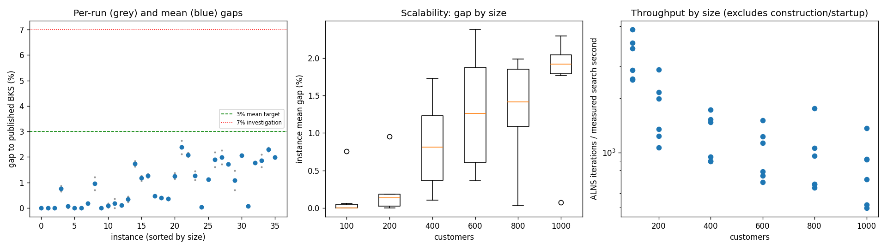
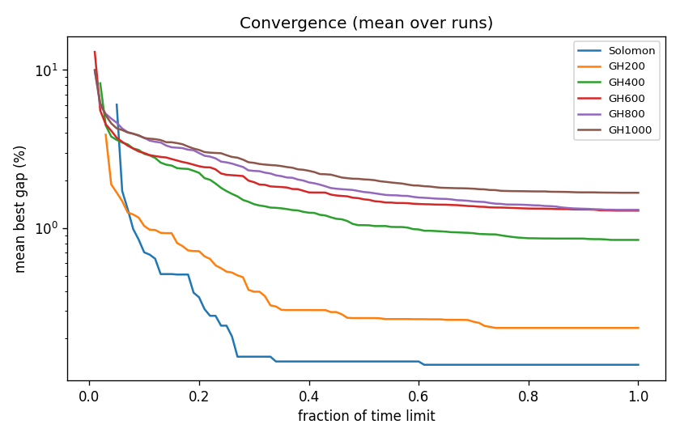

# ALNS + VND campaign `abl-no-regret3`

Split: **development**; 36 instances x 2 seeds; budget: time_limit = max(10.0, 0.1 * customers) seconds. Gaps are to published BKS (not proven optima), recomputed by the independent evaluator.

Throughput = total iterations / total measured solver search seconds over valid paired runs; construction and worker startup are excluded. Missing/nonpositive times are excluded, not replaced by the time budget. `throughput_runs` records the included run count; zero rates remain in CSV but are omitted from the log-scale throughput plot.

| Metric | Value |
| --- | ---: |
| planned attempts | 72 |
| attempts | 72 |
| feasible attempts | 72 |
| budget respected | 72 |
| mean gap equal weight | 0.913 |
| median instance gap | 0.854 |
| p90 run gap | 2.096 |
| worst run gap | 2.646 |
| best of seeds mean gap | 0.823 |
| mean within instance sd | 0.127 |
| negative gap runs | 0 |

Instances with any run above 7%: none

## By size family

| Family | n | time limit (s) | mean gap % | worst run gap % | mean seed SD | iterations |
| --- | ---: | ---: | ---: | ---: | ---: | ---: |
| Solomon | 6 | 10 | 0.137 | 0.861 | 0.039 | 29024 |
| GH200 | 6 | 20 | 0.234 | 1.200 | 0.120 | 32345 |
| GH400 | 6 | 40 | 0.842 | 1.843 | 0.109 | 46755 |
| GH600 | 6 | 60 | 1.289 | 2.646 | 0.165 | 57727 |
| GH800 | 6 | 80 | 1.304 | 2.260 | 0.230 | 73260 |
| GH1000 | 6 | 100 | 1.673 | 2.369 | 0.101 | 78609 |

## By instance class

| Class | instances | mean gap % | worst run gap % |
| --- | ---: | ---: | ---: |
| C1 | 6 | 0.432 | 2.077 |
| C2 | 6 | 0.345 | 1.160 |
| R1 | 6 | 1.266 | 2.186 |
| R2 | 6 | 1.358 | 2.646 |
| RC1 | 6 | 1.250 | 2.369 |
| RC2 | 6 | 0.827 | 2.037 |

## Per instance

| Instance | n | BKS | best | mean gap % | best % | worst % | SD | feasible | vehicles | iterations | time-to-best s |
| --- | ---: | ---: | ---: | ---: | ---: | ---: | ---: | ---: | ---: | ---: | ---: |
| Solomon/C107.vrp | 100 | 827.3 | 827.3 | 0.000 | 0.000 | 0.000 | 0.000 | 2/2 | 10.0 | 40590 | 0.5 |
| Solomon/C204.vrp | 100 | 588.1 | 588.1 | 0.000 | 0.000 | 0.000 | 0.000 | 2/2 | 3.0 | 21720 | 0.6 |
| Solomon/R102.vrp | 100 | 1466.6 | 1466.6 | 0.000 | 0.000 | 0.000 | 0.000 | 2/2 | 18.0 | 34358 | 2.0 |
| Solomon/R203.vrp | 100 | 870.8 | 876.5 | 0.758 | 0.655 | 0.861 | 0.146 | 2/2 | 5.0 | 24253 | 3.4 |
| Solomon/RC107.vrp | 100 | 1207.8 | 1207.8 | 0.062 | 0.000 | 0.124 | 0.088 | 2/2 | 12.0 | 31851 | 3.0 |
| Solomon/RC204.vrp | 100 | 783.5 | 783.5 | 0.000 | 0.000 | 0.000 | 0.000 | 2/2 | 4.0 | 21375 | 0.7 |
| GH200/C1_2_8.vrp | 200 | 2684.0 | 2684.0 | 0.000 | 0.000 | 0.000 | 0.000 | 2/2 | 20.0 | 52379 | 1.0 |
| GH200/C2_2_8.vrp | 200 | 1813.7 | 1816.9 | 0.176 | 0.176 | 0.176 | 0.000 | 2/2 | 6.0 | 24524 | 3.7 |
| GH200/R1_2_6.vrp | 200 | 3559.1 | 3584.0 | 0.950 | 0.700 | 1.200 | 0.354 | 2/2 | 20.0 | 36080 | 12.2 |
| GH200/R2_2_8.vrp | 200 | 1842.4 | 1842.4 | 0.000 | 0.000 | 0.000 | 0.000 | 2/2 | 4.0 | 19352 | 9.4 |
| GH200/RC1_2_2.vrp | 200 | 3221.6 | 3222.2 | 0.095 | 0.019 | 0.171 | 0.108 | 2/2 | 19.0 | 39238 | 13.5 |
| GH200/RC2_2_8.vrp | 200 | 2151.2 | 2151.2 | 0.181 | 0.000 | 0.363 | 0.256 | 2/2 | 6.0 | 22496 | 10.4 |
| GH400/C1_4_3.vrp | 400 | 6929.9 | 6933.9 | 0.104 | 0.058 | 0.150 | 0.065 | 2/2 | 38.0 | 65014 | 20.3 |
| GH400/C2_4_8.vrp | 400 | 3773.7 | 3782.3 | 0.335 | 0.228 | 0.443 | 0.152 | 2/2 | 12.0 | 35702 | 28.0 |
| GH400/R1_4_10.vrp | 400 | 8077.8 | 8208.5 | 1.731 | 1.618 | 1.843 | 0.159 | 2/2 | 37.0 | 55424 | 31.8 |
| GH400/R2_4_4.vrp | 400 | 4211.2 | 4256.3 | 1.166 | 1.071 | 1.261 | 0.134 | 2/2 | 9.0 | 33698 | 31.4 |
| GH400/RC1_4_8.vrp | 400 | 7757.2 | 7849.0 | 1.255 | 1.183 | 1.327 | 0.101 | 2/2 | 37.0 | 57212 | 37.9 |
| GH400/RC2_4_3.vrp | 400 | 4573.0 | 4592.7 | 0.460 | 0.431 | 0.490 | 0.042 | 2/2 | 12.0 | 33482 | 35.3 |
| GH600/C1_6_9.vrp | 600 | 13664.5 | 13716.7 | 0.392 | 0.382 | 0.401 | 0.013 | 2/2 | 57.0 | 85736 | 49.6 |
| GH600/C2_6_9.vrp | 600 | 7303.2 | 7325.6 | 0.364 | 0.307 | 0.420 | 0.080 | 2/2 | 19.0 | 44928 | 44.1 |
| GH600/R1_6_4.vrp | 600 | 15721.4 | 15899.7 | 1.252 | 1.134 | 1.369 | 0.166 | 2/2 | 55.0 | 64308 | 56.3 |
| GH600/R2_6_10.vrp | 600 | 11837.0 | 12087.3 | 2.380 | 2.115 | 2.646 | 0.376 | 2/2 | 13.5 | 42414 | 53.9 |
| GH600/RC1_6_2.vrp | 600 | 15890.6 | 16209.2 | 2.082 | 2.005 | 2.159 | 0.109 | 2/2 | 57.0 | 69884 | 56.3 |
| GH600/RC2_6_2.vrp | 600 | 10336.9 | 10450.1 | 1.266 | 1.095 | 1.438 | 0.242 | 2/2 | 18.0 | 39092 | 51.4 |
| GH800/C1_8_6.vrp | 800 | 25133.3 | 25140.9 | 0.030 | 0.030 | 0.030 | 0.000 | 2/2 | 80.0 | 134047 | 71.0 |
| GH800/C2_8_10.vrp | 800 | 10946.0 | 11065.0 | 1.124 | 1.087 | 1.160 | 0.052 | 2/2 | 24.0 | 50918 | 75.0 |
| GH800/R1_8_3.vrp | 800 | 29304.5 | 29777.5 | 1.900 | 1.614 | 2.186 | 0.404 | 2/2 | 73.0 | 73312 | 74.2 |
| GH800/R2_8_10.vrp | 800 | 19984.8 | 20327.7 | 1.988 | 1.716 | 2.260 | 0.385 | 2/2 | 18.5 | 51176 | 68.8 |
| GH800/RC1_8_9.vrp | 800 | 28347.1 | 28830.4 | 1.707 | 1.705 | 1.709 | 0.003 | 2/2 | 74.0 | 81136 | 76.2 |
| GH800/RC2_8_1.vrp | 800 | 19201.3 | 19334.8 | 1.075 | 0.695 | 1.456 | 0.538 | 2/2 | 24.5 | 48970 | 75.1 |
| GH1000/C1_10_2.vrp | 1000 | 41337.8 | 42187.9 | 2.067 | 2.056 | 2.077 | 0.014 | 2/2 | 99.0 | 130718 | 93.9 |
| GH1000/C2_10_2.vrp | 1000 | 16462.6 | 16472.8 | 0.073 | 0.062 | 0.083 | 0.015 | 2/2 | 30.0 | 68273 | 84.8 |
| GH1000/R1_10_5.vrp | 1000 | 50406.7 | 51277.2 | 1.764 | 1.727 | 1.801 | 0.052 | 2/2 | 93.0 | 88148 | 88.0 |
| GH1000/R2_10_7.vrp | 1000 | 23102.2 | 23475.0 | 1.856 | 1.614 | 2.098 | 0.343 | 2/2 | 22.0 | 47419 | 92.5 |
| GH1000/RC1_10_5.vrp | 1000 | 45028.1 | 46030.0 | 2.297 | 2.225 | 2.369 | 0.101 | 2/2 | 92.5 | 87726 | 95.0 |
| GH1000/RC2_10_10.vrp | 1000 | 21731.2 | 22149.5 | 1.981 | 1.925 | 2.037 | 0.079 | 2/2 | 19.5 | 49368 | 79.1 |

