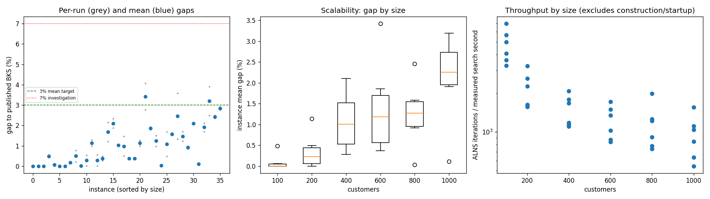
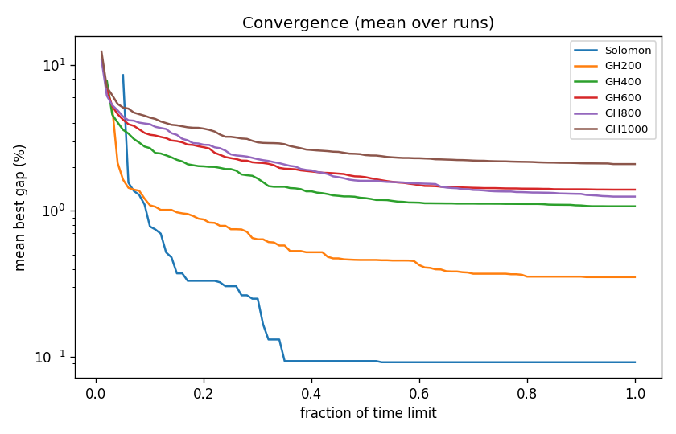

# ALNS + VND campaign `abl-no-relocate`

Split: **development**; 36 instances x 2 seeds; budget: time_limit = max(10.0, 0.1 * customers) seconds. Gaps are to published BKS (not proven optima), recomputed by the independent evaluator.

Throughput = total iterations / total measured solver search seconds over valid paired runs; construction and worker startup are excluded. Missing/nonpositive times are excluded, not replaced by the time budget. `throughput_runs` records the included run count; zero rates remain in CSV but are omitted from the log-scale throughput plot.

| Metric | Value |
| --- | ---: |
| planned attempts | 72 |
| attempts | 72 |
| feasible attempts | 72 |
| budget respected | 72 |
| mean gap equal weight | 1.044 |
| median instance gap | 0.948 |
| p90 run gap | 2.475 |
| worst run gap | 4.072 |
| best of seeds mean gap | 0.856 |
| mean within instance sd | 0.265 |
| negative gap runs | 0 |

Instances with any run above 7%: none

## By size family

| Family | n | time limit (s) | mean gap % | worst run gap % | mean seed SD | iterations |
| --- | ---: | ---: | ---: | ---: | ---: | ---: |
| Solomon | 6 | 10 | 0.092 | 0.551 | 0.030 | 40212 |
| GH200 | 6 | 20 | 0.352 | 1.288 | 0.167 | 39034 |
| GH400 | 6 | 40 | 1.075 | 2.332 | 0.374 | 55996 |
| GH600 | 6 | 60 | 1.397 | 4.072 | 0.273 | 69102 |
| GH800 | 6 | 80 | 1.253 | 3.580 | 0.491 | 87571 |
| GH1000 | 6 | 100 | 2.094 | 3.900 | 0.253 | 91134 |

## By instance class

| Class | instances | mean gap % | worst run gap % |
| --- | ---: | ---: | ---: |
| C1 | 6 | 0.462 | 2.093 |
| C2 | 6 | 0.353 | 1.674 |
| R1 | 6 | 1.132 | 2.149 |
| R2 | 6 | 1.947 | 4.072 |
| RC1 | 6 | 1.182 | 2.495 |
| RC2 | 6 | 1.186 | 2.917 |

## Per instance

| Instance | n | BKS | best | mean gap % | best % | worst % | SD | feasible | vehicles | iterations | time-to-best s |
| --- | ---: | ---: | ---: | ---: | ---: | ---: | ---: | ---: | ---: | ---: | ---: |
| Solomon/C107.vrp | 100 | 827.3 | 827.3 | 0.000 | 0.000 | 0.000 | 0.000 | 2/2 | 10.0 | 58689 | 0.5 |
| Solomon/C204.vrp | 100 | 588.1 | 588.1 | 0.000 | 0.000 | 0.000 | 0.000 | 2/2 | 3.0 | 27706 | 1.1 |
| Solomon/R102.vrp | 100 | 1466.6 | 1466.6 | 0.000 | 0.000 | 0.000 | 0.000 | 2/2 | 18.0 | 47902 | 3.7 |
| Solomon/R203.vrp | 100 | 870.8 | 874.5 | 0.488 | 0.425 | 0.551 | 0.089 | 2/2 | 6.0 | 34472 | 1.0 |
| Solomon/RC107.vrp | 100 | 1207.8 | 1207.8 | 0.062 | 0.000 | 0.124 | 0.088 | 2/2 | 12.0 | 42052 | 3.3 |
| Solomon/RC204.vrp | 100 | 783.5 | 783.5 | 0.000 | 0.000 | 0.000 | 0.000 | 2/2 | 4.0 | 30450 | 1.9 |
| GH200/C1_2_8.vrp | 200 | 2684.0 | 2684.0 | 0.000 | 0.000 | 0.000 | 0.000 | 2/2 | 20.0 | 59094 | 1.1 |
| GH200/C2_2_8.vrp | 200 | 1813.7 | 1816.9 | 0.176 | 0.176 | 0.176 | 0.000 | 2/2 | 6.0 | 28352 | 4.9 |
| GH200/R1_2_6.vrp | 200 | 3559.1 | 3566.7 | 0.496 | 0.214 | 0.778 | 0.399 | 2/2 | 19.5 | 41134 | 12.6 |
| GH200/R2_2_8.vrp | 200 | 1842.4 | 1842.4 | 0.022 | 0.000 | 0.043 | 0.031 | 2/2 | 4.0 | 29530 | 6.5 |
| GH200/RC1_2_2.vrp | 200 | 3221.6 | 3222.2 | 0.276 | 0.019 | 0.534 | 0.364 | 2/2 | 19.0 | 46994 | 15.4 |
| GH200/RC2_2_8.vrp | 200 | 2151.2 | 2172.5 | 1.139 | 0.990 | 1.288 | 0.210 | 2/2 | 6.0 | 29102 | 2.4 |
| GH400/C1_4_3.vrp | 400 | 6929.9 | 6930.5 | 0.281 | 0.009 | 0.554 | 0.386 | 2/2 | 38.0 | 77794 | 34.9 |
| GH400/C2_4_8.vrp | 400 | 3773.7 | 3783.9 | 0.378 | 0.270 | 0.485 | 0.152 | 2/2 | 12.0 | 44128 | 26.4 |
| GH400/R1_4_10.vrp | 400 | 8077.8 | 8175.8 | 1.681 | 1.213 | 2.149 | 0.662 | 2/2 | 37.0 | 62849 | 27.7 |
| GH400/R2_4_4.vrp | 400 | 4211.2 | 4290.1 | 2.103 | 1.874 | 2.332 | 0.324 | 2/2 | 9.0 | 42906 | 24.4 |
| GH400/RC1_4_8.vrp | 400 | 7757.2 | 7834.3 | 1.025 | 0.994 | 1.056 | 0.044 | 2/2 | 37.0 | 66790 | 37.2 |
| GH400/RC2_4_3.vrp | 400 | 4573.0 | 4595.9 | 0.981 | 0.501 | 1.461 | 0.679 | 2/2 | 11.0 | 41509 | 19.6 |
| GH600/C1_6_9.vrp | 600 | 13664.5 | 13714.0 | 0.371 | 0.362 | 0.379 | 0.012 | 2/2 | 57.0 | 97451 | 54.6 |
| GH600/C2_6_9.vrp | 600 | 7303.2 | 7328.6 | 0.372 | 0.348 | 0.396 | 0.034 | 2/2 | 19.0 | 58458 | 40.6 |
| GH600/R1_6_4.vrp | 600 | 15721.4 | 15876.5 | 1.128 | 0.987 | 1.270 | 0.201 | 2/2 | 55.0 | 76553 | 53.4 |
| GH600/R2_6_10.vrp | 600 | 11837.0 | 12164.7 | 3.420 | 2.768 | 4.072 | 0.922 | 2/2 | 13.0 | 47454 | 44.3 |
| GH600/RC1_6_2.vrp | 600 | 15890.6 | 16173.8 | 1.852 | 1.782 | 1.921 | 0.098 | 2/2 | 56.0 | 85146 | 55.3 |
| GH600/RC2_6_2.vrp | 600 | 10336.9 | 10437.8 | 1.240 | 0.976 | 1.504 | 0.373 | 2/2 | 18.5 | 49550 | 42.1 |
| GH800/C1_8_6.vrp | 800 | 25133.3 | 25140.9 | 0.030 | 0.030 | 0.030 | 0.000 | 2/2 | 80.0 | 150818 | 75.6 |
| GH800/C2_8_10.vrp | 800 | 10946.0 | 10999.6 | 1.082 | 0.490 | 1.674 | 0.837 | 2/2 | 24.5 | 69709 | 72.0 |
| GH800/R1_8_3.vrp | 800 | 29304.5 | 29746.8 | 1.578 | 1.509 | 1.647 | 0.097 | 2/2 | 73.0 | 92900 | 71.5 |
| GH800/R2_8_10.vrp | 800 | 19984.8 | 20250.6 | 2.455 | 1.330 | 3.580 | 1.591 | 2/2 | 17.5 | 56198 | 75.0 |
| GH800/RC1_8_9.vrp | 800 | 28347.1 | 28692.8 | 1.456 | 1.220 | 1.692 | 0.334 | 2/2 | 73.5 | 96306 | 75.5 |
| GH800/RC2_8_1.vrp | 800 | 19201.3 | 19365.1 | 0.916 | 0.853 | 0.979 | 0.089 | 2/2 | 24.5 | 59494 | 75.7 |
| GH1000/C1_10_2.vrp | 1000 | 41337.8 | 42201.4 | 2.091 | 2.089 | 2.093 | 0.002 | 2/2 | 99.0 | 148368 | 92.7 |
| GH1000/C2_10_2.vrp | 1000 | 16462.6 | 16479.3 | 0.110 | 0.101 | 0.119 | 0.012 | 2/2 | 30.0 | 80536 | 89.9 |
| GH1000/R1_10_5.vrp | 1000 | 50406.7 | 51263.7 | 1.906 | 1.700 | 2.111 | 0.290 | 2/2 | 93.5 | 99229 | 94.9 |
| GH1000/R2_10_7.vrp | 1000 | 23102.2 | 23677.2 | 3.195 | 2.489 | 3.900 | 0.998 | 2/2 | 21.5 | 51850 | 91.7 |
| GH1000/RC1_10_5.vrp | 1000 | 45028.1 | 46085.7 | 2.422 | 2.349 | 2.495 | 0.103 | 2/2 | 92.0 | 106143 | 94.0 |
| GH1000/RC2_10_10.vrp | 1000 | 21731.2 | 22330.9 | 2.839 | 2.760 | 2.917 | 0.112 | 2/2 | 19.5 | 60677 | 94.8 |

