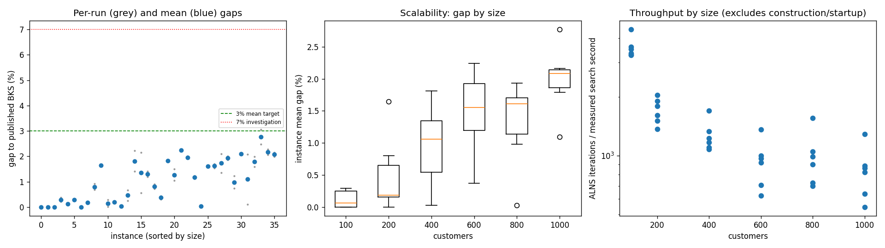
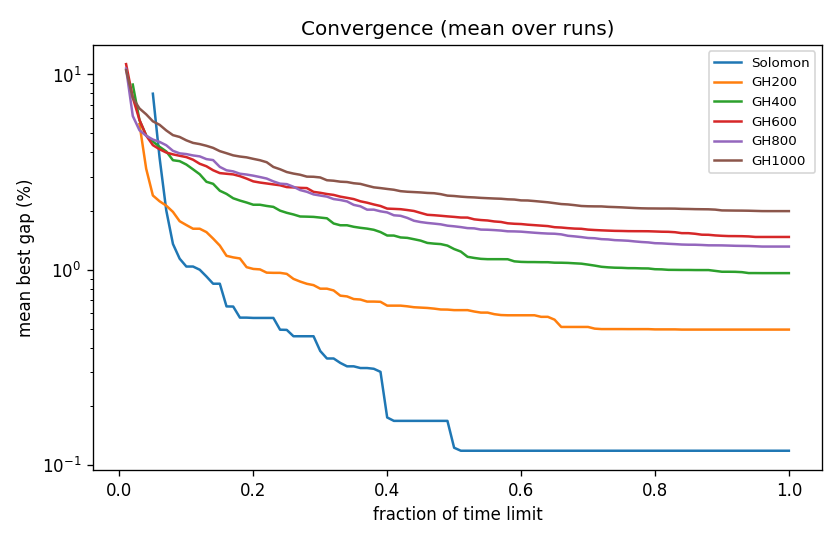

# ALNS + VND campaign `abl-no-route`

Split: **development**; 36 instances x 2 seeds; budget: time_limit = max(10.0, 0.1 * customers) seconds. Gaps are to published BKS (not proven optima), recomputed by the independent evaluator.

Throughput = total iterations / total measured solver search seconds over valid paired runs; construction and worker startup are excluded. Missing/nonpositive times are excluded, not replaced by the time budget. `throughput_runs` records the included run count; zero rates remain in CSV but are omitted from the log-scale throughput plot.

| Metric | Value |
| --- | ---: |
| planned attempts | 72 |
| attempts | 72 |
| feasible attempts | 72 |
| budget respected | 72 |
| mean gap equal weight | 1.060 |
| median instance gap | 1.132 |
| p90 run gap | 2.143 |
| worst run gap | 3.064 |
| best of seeds mean gap | 0.923 |
| mean within instance sd | 0.194 |
| negative gap runs | 0 |

Instances with any run above 7%: none

## By size family

| Family | n | time limit (s) | mean gap % | worst run gap % | mean seed SD | iterations |
| --- | ---: | ---: | ---: | ---: | ---: | ---: |
| Solomon | 6 | 10 | 0.118 | 0.367 | 0.018 | 30219 |
| GH200 | 6 | 20 | 0.494 | 1.645 | 0.067 | 30835 |
| GH400 | 6 | 40 | 0.961 | 2.222 | 0.387 | 47422 |
| GH600 | 6 | 60 | 1.473 | 2.267 | 0.105 | 52774 |
| GH800 | 6 | 80 | 1.315 | 2.098 | 0.191 | 75298 |
| GH1000 | 6 | 100 | 1.997 | 3.064 | 0.394 | 80228 |

## By instance class

| Class | instances | mean gap % | worst run gap % |
| --- | ---: | ---: | ---: |
| C1 | 6 | 0.420 | 2.103 |
| C2 | 6 | 0.860 | 2.085 |
| R1 | 6 | 1.216 | 2.222 |
| R2 | 6 | 1.672 | 3.064 |
| RC1 | 6 | 1.270 | 2.269 |
| RC2 | 6 | 0.920 | 2.148 |

## Per instance

| Instance | n | BKS | best | mean gap % | best % | worst % | SD | feasible | vehicles | iterations | time-to-best s |
| --- | ---: | ---: | ---: | ---: | ---: | ---: | ---: | ---: | ---: | ---: | ---: |
| Solomon/C107.vrp | 100 | 827.3 | 827.3 | 0.000 | 0.000 | 0.000 | 0.000 | 2/2 | 10.0 | 37592 | 0.5 |
| Solomon/C204.vrp | 100 | 588.1 | 588.1 | 0.000 | 0.000 | 0.000 | 0.000 | 2/2 | 3.0 | 28344 | 0.7 |
| Solomon/R102.vrp | 100 | 1466.6 | 1466.6 | 0.000 | 0.000 | 0.000 | 0.000 | 2/2 | 18.0 | 30554 | 2.0 |
| Solomon/R203.vrp | 100 | 870.8 | 872.7 | 0.293 | 0.218 | 0.367 | 0.106 | 2/2 | 6.0 | 27821 | 1.7 |
| Solomon/RC107.vrp | 100 | 1207.8 | 1209.3 | 0.124 | 0.124 | 0.124 | 0.000 | 2/2 | 12.0 | 29478 | 4.0 |
| Solomon/RC204.vrp | 100 | 783.5 | 785.8 | 0.294 | 0.294 | 0.294 | 0.000 | 2/2 | 4.0 | 27523 | 4.3 |
| GH200/C1_2_8.vrp | 200 | 2684.0 | 2684.0 | 0.000 | 0.000 | 0.000 | 0.000 | 2/2 | 20.0 | 36875 | 1.4 |
| GH200/C2_2_8.vrp | 200 | 1813.7 | 1816.9 | 0.176 | 0.176 | 0.176 | 0.000 | 2/2 | 6.0 | 24655 | 6.1 |
| GH200/R1_2_6.vrp | 200 | 3559.1 | 3583.5 | 0.799 | 0.686 | 0.913 | 0.161 | 2/2 | 20.0 | 32400 | 13.3 |
| GH200/R2_2_8.vrp | 200 | 1842.4 | 1872.7 | 1.645 | 1.645 | 1.645 | 0.000 | 2/2 | 5.0 | 29079 | 6.0 |
| GH200/RC1_2_2.vrp | 200 | 3221.6 | 3222.2 | 0.149 | 0.019 | 0.279 | 0.184 | 2/2 | 19.0 | 34624 | 11.9 |
| GH200/RC2_2_8.vrp | 200 | 2151.2 | 2154.5 | 0.195 | 0.153 | 0.237 | 0.059 | 2/2 | 6.5 | 27376 | 11.4 |
| GH400/C1_4_3.vrp | 400 | 6929.9 | 6930.9 | 0.030 | 0.014 | 0.046 | 0.022 | 2/2 | 38.0 | 63678 | 36.4 |
| GH400/C2_4_8.vrp | 400 | 3773.7 | 3782.9 | 0.457 | 0.244 | 0.670 | 0.302 | 2/2 | 12.0 | 43686 | 31.2 |
| GH400/R1_4_10.vrp | 400 | 8077.8 | 8191.3 | 1.814 | 1.405 | 2.222 | 0.578 | 2/2 | 37.0 | 45972 | 35.0 |
| GH400/R2_4_4.vrp | 400 | 4211.2 | 4234.8 | 1.356 | 0.560 | 2.151 | 1.125 | 2/2 | 10.0 | 40350 | 28.2 |
| GH400/RC1_4_8.vrp | 400 | 7757.2 | 7849.4 | 1.301 | 1.189 | 1.414 | 0.160 | 2/2 | 37.0 | 49716 | 31.3 |
| GH400/RC2_4_3.vrp | 400 | 4573.0 | 4605.7 | 0.810 | 0.715 | 0.905 | 0.135 | 2/2 | 12.0 | 41130 | 30.2 |
| GH600/C1_6_9.vrp | 600 | 13664.5 | 13707.1 | 0.371 | 0.312 | 0.430 | 0.083 | 2/2 | 57.0 | 77367 | 49.4 |
| GH600/C2_6_9.vrp | 600 | 7303.2 | 7434.4 | 1.829 | 1.796 | 1.861 | 0.046 | 2/2 | 20.0 | 54998 | 56.4 |
| GH600/R1_6_4.vrp | 600 | 15721.4 | 15884.8 | 1.271 | 1.039 | 1.503 | 0.328 | 2/2 | 55.0 | 52310 | 55.9 |
| GH600/R2_6_10.vrp | 600 | 11837.0 | 12099.4 | 2.242 | 2.217 | 2.267 | 0.035 | 2/2 | 14.0 | 35354 | 53.8 |
| GH600/RC1_6_2.vrp | 600 | 15890.6 | 16194.4 | 1.954 | 1.912 | 1.997 | 0.060 | 2/2 | 56.5 | 56588 | 52.4 |
| GH600/RC2_6_2.vrp | 600 | 10336.9 | 10452.2 | 1.170 | 1.115 | 1.224 | 0.077 | 2/2 | 20.0 | 40028 | 55.6 |
| GH800/C1_8_6.vrp | 800 | 25133.3 | 25135.8 | 0.025 | 0.010 | 0.041 | 0.022 | 2/2 | 80.0 | 119186 | 69.0 |
| GH800/C2_8_10.vrp | 800 | 10946.0 | 11119.2 | 1.605 | 1.582 | 1.628 | 0.032 | 2/2 | 25.0 | 68730 | 70.8 |
| GH800/R1_8_3.vrp | 800 | 29304.5 | 29754.7 | 1.620 | 1.536 | 1.703 | 0.118 | 2/2 | 73.0 | 75361 | 75.6 |
| GH800/R2_8_10.vrp | 800 | 19984.8 | 20256.1 | 1.728 | 1.358 | 2.098 | 0.523 | 2/2 | 18.0 | 53200 | 69.4 |
| GH800/RC1_8_9.vrp | 800 | 28347.1 | 28875.0 | 1.933 | 1.862 | 2.004 | 0.101 | 2/2 | 74.0 | 80057 | 76.0 |
| GH800/RC2_8_1.vrp | 800 | 19201.3 | 19341.7 | 0.979 | 0.731 | 1.227 | 0.351 | 2/2 | 25.5 | 55252 | 74.5 |
| GH1000/C1_10_2.vrp | 1000 | 41337.8 | 42201.3 | 2.096 | 2.089 | 2.103 | 0.010 | 2/2 | 99.0 | 123296 | 88.0 |
| GH1000/C2_10_2.vrp | 1000 | 16462.6 | 16479.9 | 1.095 | 0.105 | 2.085 | 1.400 | 2/2 | 30.5 | 82346 | 93.6 |
| GH1000/R1_10_5.vrp | 1000 | 50406.7 | 51211.2 | 1.791 | 1.596 | 1.987 | 0.276 | 2/2 | 93.0 | 78308 | 90.9 |
| GH1000/R2_10_7.vrp | 1000 | 23102.2 | 23674.4 | 2.770 | 2.477 | 3.064 | 0.415 | 2/2 | 21.5 | 52012 | 84.0 |
| GH1000/RC1_10_5.vrp | 1000 | 45028.1 | 45951.7 | 2.160 | 2.051 | 2.269 | 0.154 | 2/2 | 92.0 | 84575 | 90.5 |
| GH1000/RC2_10_10.vrp | 1000 | 21731.2 | 22164.4 | 2.071 | 1.993 | 2.148 | 0.109 | 2/2 | 19.5 | 60832 | 91.0 |

