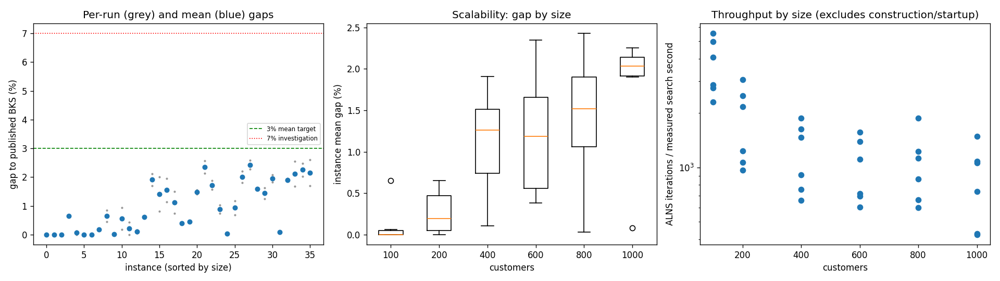
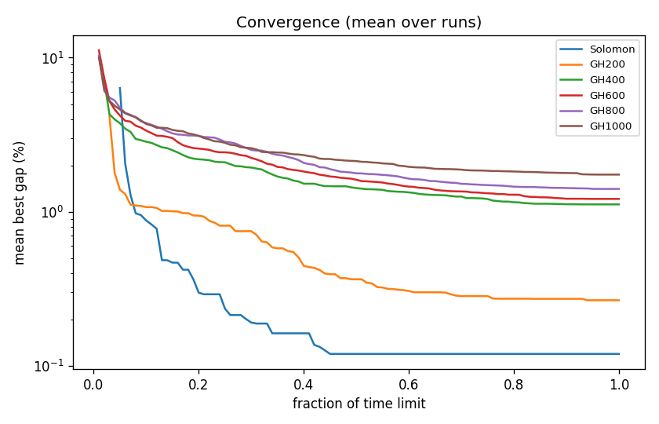

# ALNS + VND campaign `abl-no-shaw`

Split: **development**; 36 instances x 2 seeds; budget: time_limit = max(10.0, 0.1 * customers) seconds. Gaps are to published BKS (not proven optima), recomputed by the independent evaluator.

Throughput = total iterations / total measured solver search seconds over valid paired runs; construction and worker startup are excluded. Missing/nonpositive times are excluded, not replaced by the time budget. `throughput_runs` records the included run count; zero rates remain in CSV but are omitted from the log-scale throughput plot.

| Metric | Value |
| --- | ---: |
| planned attempts | 72 |
| attempts | 72 |
| feasible attempts | 72 |
| budget respected | 72 |
| mean gap equal weight | 0.977 |
| median instance gap | 0.772 |
| p90 run gap | 2.122 |
| worst run gap | 2.607 |
| best of seeds mean gap | 0.831 |
| mean within instance sd | 0.207 |
| negative gap runs | 0 |

Instances with any run above 7%: none

## By size family

| Family | n | time limit (s) | mean gap % | worst run gap % | mean seed SD | iterations |
| --- | ---: | ---: | ---: | ---: | ---: | ---: |
| Solomon | 6 | 10 | 0.119 | 0.655 | 0.015 | 31707 |
| GH200 | 6 | 20 | 0.266 | 0.931 | 0.188 | 33236 |
| GH400 | 6 | 40 | 1.116 | 2.113 | 0.388 | 45606 |
| GH600 | 6 | 60 | 1.212 | 2.570 | 0.151 | 57612 |
| GH800 | 6 | 80 | 1.407 | 2.579 | 0.191 | 80662 |
| GH1000 | 6 | 100 | 1.742 | 2.607 | 0.308 | 83067 |

## By instance class

| Class | instances | mean gap % | worst run gap % |
| --- | ---: | ---: | ---: |
| C1 | 6 | 0.412 | 2.084 |
| C2 | 6 | 0.375 | 1.177 |
| R1 | 6 | 1.326 | 2.202 |
| R2 | 6 | 1.494 | 2.579 |
| RC1 | 6 | 1.288 | 2.474 |
| RC2 | 6 | 0.968 | 2.607 |

## Per instance

| Instance | n | BKS | best | mean gap % | best % | worst % | SD | feasible | vehicles | iterations | time-to-best s |
| --- | ---: | ---: | ---: | ---: | ---: | ---: | ---: | ---: | ---: | ---: | ---: |
| Solomon/C107.vrp | 100 | 827.3 | 827.3 | 0.000 | 0.000 | 0.000 | 0.000 | 2/2 | 10.0 | 46880 | 0.5 |
| Solomon/C204.vrp | 100 | 588.1 | 588.1 | 0.000 | 0.000 | 0.000 | 0.000 | 2/2 | 3.0 | 23332 | 1.8 |
| Solomon/R102.vrp | 100 | 1466.6 | 1466.6 | 0.000 | 0.000 | 0.000 | 0.000 | 2/2 | 18.0 | 41962 | 1.0 |
| Solomon/R203.vrp | 100 | 870.8 | 876.5 | 0.655 | 0.655 | 0.655 | 0.000 | 2/2 | 5.0 | 24191 | 4.4 |
| Solomon/RC107.vrp | 100 | 1207.8 | 1207.8 | 0.062 | 0.000 | 0.124 | 0.088 | 2/2 | 12.0 | 34451 | 3.2 |
| Solomon/RC204.vrp | 100 | 783.5 | 783.5 | 0.000 | 0.000 | 0.000 | 0.000 | 2/2 | 4.0 | 19428 | 1.9 |
| GH200/C1_2_8.vrp | 200 | 2684.0 | 2684.0 | 0.000 | 0.000 | 0.000 | 0.000 | 2/2 | 20.0 | 55524 | 1.3 |
| GH200/C2_2_8.vrp | 200 | 1813.7 | 1816.9 | 0.176 | 0.176 | 0.176 | 0.000 | 2/2 | 6.0 | 22471 | 1.7 |
| GH200/R1_2_6.vrp | 200 | 3559.1 | 3575.3 | 0.652 | 0.455 | 0.849 | 0.278 | 2/2 | 20.0 | 39318 | 17.0 |
| GH200/R2_2_8.vrp | 200 | 1842.4 | 1842.4 | 0.005 | 0.000 | 0.011 | 0.008 | 2/2 | 4.0 | 17500 | 9.6 |
| GH200/RC1_2_2.vrp | 200 | 3221.6 | 3227.1 | 0.551 | 0.171 | 0.931 | 0.538 | 2/2 | 19.0 | 45278 | 12.0 |
| GH200/RC2_2_8.vrp | 200 | 2151.2 | 2151.2 | 0.214 | 0.000 | 0.428 | 0.302 | 2/2 | 6.0 | 19326 | 9.6 |
| GH400/C1_4_3.vrp | 400 | 6929.9 | 6933.1 | 0.103 | 0.046 | 0.160 | 0.081 | 2/2 | 38.0 | 70265 | 33.6 |
| GH400/C2_4_8.vrp | 400 | 3773.7 | 3796.8 | 0.612 | 0.612 | 0.612 | 0.000 | 2/2 | 12.0 | 34177 | 32.0 |
| GH400/R1_4_10.vrp | 400 | 8077.8 | 8215.6 | 1.910 | 1.706 | 2.113 | 0.288 | 2/2 | 37.0 | 54932 | 35.6 |
| GH400/R2_4_4.vrp | 400 | 4211.2 | 4245.5 | 1.413 | 0.814 | 2.011 | 0.846 | 2/2 | 9.0 | 24570 | 35.8 |
| GH400/RC1_4_8.vrp | 400 | 7757.2 | 7845.2 | 1.545 | 1.134 | 1.956 | 0.581 | 2/2 | 37.0 | 61278 | 34.8 |
| GH400/RC2_4_3.vrp | 400 | 4573.0 | 4606.8 | 1.115 | 0.739 | 1.491 | 0.532 | 2/2 | 11.5 | 28412 | 29.4 |
| GH600/C1_6_9.vrp | 600 | 13664.5 | 13712.2 | 0.385 | 0.349 | 0.420 | 0.050 | 2/2 | 57.0 | 89434 | 45.8 |
| GH600/C2_6_9.vrp | 600 | 7303.2 | 7335.5 | 0.448 | 0.442 | 0.455 | 0.009 | 2/2 | 19.0 | 34340 | 43.2 |
| GH600/R1_6_4.vrp | 600 | 15721.4 | 15942.5 | 1.483 | 1.406 | 1.559 | 0.108 | 2/2 | 55.0 | 62855 | 47.7 |
| GH600/R2_6_10.vrp | 600 | 11837.0 | 12088.3 | 2.346 | 2.123 | 2.570 | 0.316 | 2/2 | 14.0 | 39272 | 50.6 |
| GH600/RC1_6_2.vrp | 600 | 15890.6 | 16138.9 | 1.718 | 1.563 | 1.874 | 0.220 | 2/2 | 56.0 | 79164 | 54.2 |
| GH600/RC2_6_2.vrp | 600 | 10336.9 | 10414.0 | 0.889 | 0.746 | 1.032 | 0.202 | 2/2 | 18.0 | 40608 | 56.6 |
| GH800/C1_8_6.vrp | 800 | 25133.3 | 25141.5 | 0.033 | 0.033 | 0.033 | 0.000 | 2/2 | 80.0 | 142654 | 64.8 |
| GH800/C2_8_10.vrp | 800 | 10946.0 | 11021.4 | 0.933 | 0.689 | 1.177 | 0.345 | 2/2 | 24.0 | 50386 | 73.2 |
| GH800/R1_8_3.vrp | 800 | 29304.5 | 29836.2 | 2.008 | 1.814 | 2.202 | 0.274 | 2/2 | 73.0 | 85860 | 75.8 |
| GH800/R2_8_10.vrp | 800 | 19984.8 | 20440.4 | 2.430 | 2.280 | 2.579 | 0.212 | 2/2 | 18.0 | 65896 | 66.2 |
| GH800/RC1_8_9.vrp | 800 | 28347.1 | 28790.0 | 1.597 | 1.562 | 1.632 | 0.049 | 2/2 | 74.0 | 93354 | 76.3 |
| GH800/RC2_8_1.vrp | 800 | 19201.3 | 19441.4 | 1.440 | 1.250 | 1.629 | 0.268 | 2/2 | 23.5 | 45826 | 73.4 |
| GH1000/C1_10_2.vrp | 1000 | 41337.8 | 42090.5 | 1.953 | 1.821 | 2.084 | 0.186 | 2/2 | 99.0 | 141945 | 51.2 |
| GH1000/C2_10_2.vrp | 1000 | 16462.6 | 16473.2 | 0.078 | 0.064 | 0.091 | 0.019 | 2/2 | 30.0 | 70289 | 84.3 |
| GH1000/R1_10_5.vrp | 1000 | 50406.7 | 51342.4 | 1.905 | 1.856 | 1.953 | 0.068 | 2/2 | 93.0 | 103337 | 93.5 |
| GH1000/R2_10_7.vrp | 1000 | 23102.2 | 23489.9 | 2.115 | 1.678 | 2.552 | 0.618 | 2/2 | 21.0 | 40585 | 92.4 |
| GH1000/RC1_10_5.vrp | 1000 | 45028.1 | 45942.3 | 2.252 | 2.030 | 2.474 | 0.314 | 2/2 | 91.5 | 101088 | 94.9 |
| GH1000/RC2_10_10.vrp | 1000 | 21731.2 | 22100.2 | 2.152 | 1.698 | 2.607 | 0.643 | 2/2 | 19.0 | 41159 | 78.8 |

