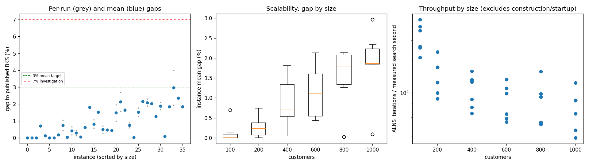
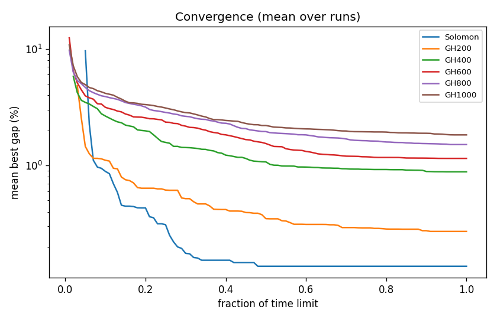

# ALNS + VND campaign `abl-no-string`

Split: **development**; 36 instances x 2 seeds; budget: time_limit = max(10.0, 0.1 * customers) seconds. Gaps are to published BKS (not proven optima), recomputed by the independent evaluator.

Throughput = total iterations / total measured solver search seconds over valid paired runs; construction and worker startup are excluded. Missing/nonpositive times are excluded, not replaced by the time budget. `throughput_runs` records the included run count; zero rates remain in CSV but are omitted from the log-scale throughput plot.

| Metric | Value |
| --- | ---: |
| planned attempts | 72 |
| attempts | 72 |
| feasible attempts | 72 |
| budget respected | 72 |
| mean gap equal weight | 0.963 |
| median instance gap | 0.715 |
| p90 run gap | 2.084 |
| worst run gap | 3.994 |
| best of seeds mean gap | 0.835 |
| mean within instance sd | 0.180 |
| negative gap runs | 0 |

Instances with any run above 7%: none

## By size family

| Family | n | time limit (s) | mean gap % | worst run gap % | mean seed SD | iterations |
| --- | ---: | ---: | ---: | ---: | ---: | ---: |
| Solomon | 6 | 10 | 0.136 | 0.735 | 0.009 | 27495 |
| GH200 | 6 | 20 | 0.271 | 1.054 | 0.173 | 26825 |
| GH400 | 6 | 40 | 0.881 | 1.852 | 0.135 | 40029 |
| GH600 | 6 | 60 | 1.149 | 2.699 | 0.316 | 48973 |
| GH800 | 6 | 80 | 1.510 | 2.297 | 0.121 | 63864 |
| GH1000 | 6 | 100 | 1.828 | 3.994 | 0.327 | 70542 |

## By instance class

| Class | instances | mean gap % | worst run gap % |
| --- | ---: | ---: | ---: |
| C1 | 6 | 0.403 | 2.088 |
| C2 | 6 | 0.473 | 1.772 |
| R1 | 6 | 1.333 | 2.143 |
| R2 | 6 | 1.453 | 3.994 |
| RC1 | 6 | 1.344 | 2.389 |
| RC2 | 6 | 0.770 | 1.913 |

## Per instance

| Instance | n | BKS | best | mean gap % | best % | worst % | SD | feasible | vehicles | iterations | time-to-best s |
| --- | ---: | ---: | ---: | ---: | ---: | ---: | ---: | ---: | ---: | ---: | ---: |
| Solomon/C107.vrp | 100 | 827.3 | 827.3 | 0.000 | 0.000 | 0.000 | 0.000 | 2/2 | 10.0 | 39005 | 0.5 |
| Solomon/C204.vrp | 100 | 588.1 | 588.1 | 0.000 | 0.000 | 0.000 | 0.000 | 2/2 | 3.0 | 22220 | 0.9 |
| Solomon/R102.vrp | 100 | 1466.6 | 1466.6 | 0.000 | 0.000 | 0.000 | 0.000 | 2/2 | 18.0 | 33577 | 2.5 |
| Solomon/R203.vrp | 100 | 870.8 | 876.5 | 0.695 | 0.655 | 0.735 | 0.057 | 2/2 | 5.5 | 21690 | 3.9 |
| Solomon/RC107.vrp | 100 | 1207.8 | 1209.3 | 0.124 | 0.124 | 0.124 | 0.000 | 2/2 | 12.0 | 30854 | 3.0 |
| Solomon/RC204.vrp | 100 | 783.5 | 783.5 | 0.000 | 0.000 | 0.000 | 0.000 | 2/2 | 4.0 | 17624 | 1.3 |
| GH200/C1_2_8.vrp | 200 | 2684.0 | 2684.0 | 0.000 | 0.000 | 0.000 | 0.000 | 2/2 | 20.0 | 42735 | 1.3 |
| GH200/C2_2_8.vrp | 200 | 1813.7 | 1816.9 | 0.176 | 0.176 | 0.176 | 0.000 | 2/2 | 6.0 | 22472 | 2.2 |
| GH200/R1_2_6.vrp | 200 | 3559.1 | 3574.2 | 0.739 | 0.424 | 1.054 | 0.445 | 2/2 | 19.0 | 30919 | 15.1 |
| GH200/R2_2_8.vrp | 200 | 1842.4 | 1842.4 | 0.027 | 0.000 | 0.054 | 0.038 | 2/2 | 4.0 | 16000 | 7.4 |
| GH200/RC1_2_2.vrp | 200 | 3221.6 | 3227.1 | 0.410 | 0.171 | 0.649 | 0.338 | 2/2 | 19.0 | 30787 | 13.3 |
| GH200/RC2_2_8.vrp | 200 | 2151.2 | 2153.9 | 0.277 | 0.126 | 0.428 | 0.214 | 2/2 | 6.0 | 18037 | 10.9 |
| GH400/C1_4_3.vrp | 400 | 6929.9 | 6933.1 | 0.046 | 0.046 | 0.046 | 0.000 | 2/2 | 38.0 | 58853 | 35.8 |
| GH400/C2_4_8.vrp | 400 | 3773.7 | 3796.8 | 0.619 | 0.612 | 0.625 | 0.009 | 2/2 | 12.0 | 32776 | 26.3 |
| GH400/R1_4_10.vrp | 400 | 8077.8 | 8219.8 | 1.805 | 1.758 | 1.852 | 0.067 | 2/2 | 37.0 | 47214 | 32.4 |
| GH400/R2_4_4.vrp | 400 | 4211.2 | 4235.1 | 0.816 | 0.568 | 1.064 | 0.351 | 2/2 | 9.5 | 24434 | 29.4 |
| GH400/RC1_4_8.vrp | 400 | 7757.2 | 7870.0 | 1.510 | 1.454 | 1.566 | 0.079 | 2/2 | 37.0 | 49218 | 31.7 |
| GH400/RC2_4_3.vrp | 400 | 4573.0 | 4585.8 | 0.493 | 0.280 | 0.706 | 0.302 | 2/2 | 12.0 | 27682 | 22.9 |
| GH600/C1_6_9.vrp | 600 | 13664.5 | 13721.7 | 0.473 | 0.419 | 0.528 | 0.077 | 2/2 | 57.0 | 75111 | 54.5 |
| GH600/C2_6_9.vrp | 600 | 7303.2 | 7334.0 | 0.438 | 0.422 | 0.455 | 0.023 | 2/2 | 19.0 | 36406 | 52.9 |
| GH600/R1_6_4.vrp | 600 | 15721.4 | 15876.2 | 1.471 | 0.985 | 1.958 | 0.688 | 2/2 | 55.0 | 55991 | 55.2 |
| GH600/R2_6_10.vrp | 600 | 11837.0 | 12021.9 | 2.131 | 1.562 | 2.699 | 0.804 | 2/2 | 14.0 | 33174 | 44.0 |
| GH600/RC1_6_2.vrp | 600 | 15890.6 | 16139.8 | 1.645 | 1.568 | 1.722 | 0.109 | 2/2 | 56.0 | 62228 | 48.9 |
| GH600/RC2_6_2.vrp | 600 | 10336.9 | 10398.6 | 0.736 | 0.597 | 0.875 | 0.196 | 2/2 | 18.0 | 30926 | 54.0 |
| GH800/C1_8_6.vrp | 800 | 25133.3 | 25134.6 | 0.018 | 0.005 | 0.030 | 0.018 | 2/2 | 80.0 | 118645 | 73.4 |
| GH800/C2_8_10.vrp | 800 | 10946.0 | 11084.2 | 1.517 | 1.263 | 1.772 | 0.360 | 2/2 | 24.5 | 41234 | 73.3 |
| GH800/R1_8_3.vrp | 800 | 29304.5 | 29931.3 | 2.141 | 2.139 | 2.143 | 0.003 | 2/2 | 73.0 | 69838 | 75.4 |
| GH800/R2_8_10.vrp | 800 | 19984.8 | 20359.2 | 2.085 | 1.873 | 2.297 | 0.299 | 2/2 | 17.0 | 39556 | 70.7 |
| GH800/RC1_8_9.vrp | 800 | 28347.1 | 28917.6 | 2.031 | 2.013 | 2.050 | 0.026 | 2/2 | 74.0 | 74638 | 76.6 |
| GH800/RC2_8_1.vrp | 800 | 19201.3 | 19442.0 | 1.266 | 1.254 | 1.278 | 0.017 | 2/2 | 24.0 | 39272 | 68.0 |
| GH1000/C1_10_2.vrp | 1000 | 41337.8 | 42029.1 | 1.880 | 1.672 | 2.088 | 0.294 | 2/2 | 99.0 | 117384 | 91.7 |
| GH1000/C2_10_2.vrp | 1000 | 16462.6 | 16475.9 | 0.090 | 0.081 | 0.098 | 0.012 | 2/2 | 30.0 | 61694 | 75.2 |
| GH1000/R1_10_5.vrp | 1000 | 50406.7 | 51318.6 | 1.842 | 1.809 | 1.874 | 0.046 | 2/2 | 93.0 | 81952 | 81.8 |
| GH1000/R2_10_7.vrp | 1000 | 23102.2 | 23548.7 | 2.963 | 1.933 | 3.994 | 1.458 | 2/2 | 22.0 | 37282 | 93.0 |
| GH1000/RC1_10_5.vrp | 1000 | 45028.1 | 46066.0 | 2.347 | 2.305 | 2.389 | 0.059 | 2/2 | 92.0 | 81214 | 93.5 |
| GH1000/RC2_10_10.vrp | 1000 | 21731.2 | 22117.8 | 1.846 | 1.779 | 1.913 | 0.095 | 2/2 | 19.5 | 43730 | 96.0 |

