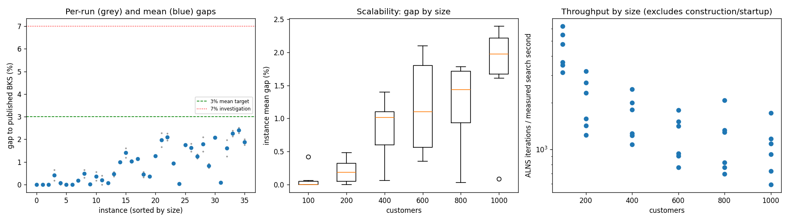
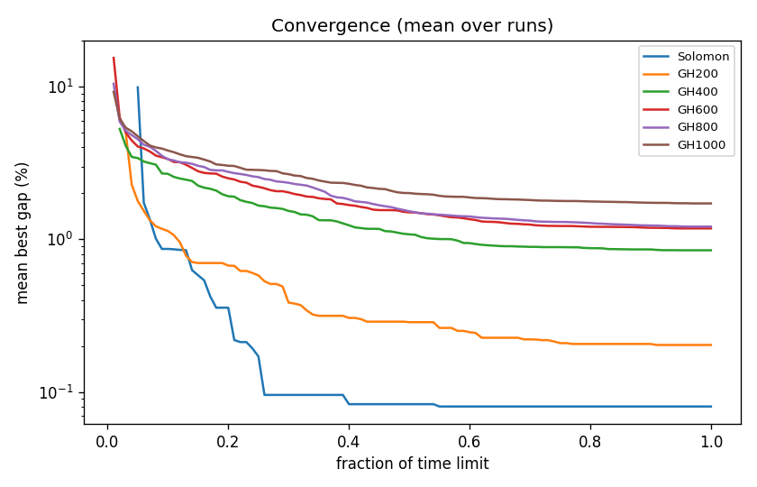

# ALNS + VND campaign `abl-no-swap`

Split: **development**; 36 instances x 2 seeds; budget: time_limit = max(10.0, 0.1 * customers) seconds. Gaps are to published BKS (not proven optima), recomputed by the independent evaluator.

Throughput = total iterations / total measured solver search seconds over valid paired runs; construction and worker startup are excluded. Missing/nonpositive times are excluded, not replaced by the time budget. `throughput_runs` records the included run count; zero rates remain in CSV but are omitted from the log-scale throughput plot.

| Metric | Value |
| --- | ---: |
| planned attempts | 72 |
| attempts | 72 |
| feasible attempts | 72 |
| budget respected | 72 |
| mean gap equal weight | 0.872 |
| median instance gap | 0.656 |
| p90 run gap | 2.080 |
| worst run gap | 2.512 |
| best of seeds mean gap | 0.780 |
| mean within instance sd | 0.131 |
| negative gap runs | 0 |

Instances with any run above 7%: none

## By size family

| Family | n | time limit (s) | mean gap % | worst run gap % | mean seed SD | iterations |
| --- | ---: | ---: | ---: | ---: | ---: | ---: |
| Solomon | 6 | 10 | 0.080 | 0.655 | 0.070 | 37646 |
| GH200 | 6 | 20 | 0.203 | 0.652 | 0.133 | 37521 |
| GH400 | 6 | 40 | 0.847 | 1.603 | 0.090 | 61325 |
| GH600 | 6 | 60 | 1.177 | 2.280 | 0.149 | 69467 |
| GH800 | 6 | 80 | 1.211 | 2.092 | 0.168 | 88566 |
| GH1000 | 6 | 100 | 1.717 | 2.512 | 0.177 | 99127 |

## By instance class

| Class | instances | mean gap % | worst run gap % |
| --- | ---: | ---: | ---: |
| C1 | 6 | 0.436 | 2.080 |
| C2 | 6 | 0.470 | 1.793 |
| R1 | 6 | 0.998 | 1.967 |
| R2 | 6 | 1.217 | 2.385 |
| RC1 | 6 | 1.288 | 2.512 |
| RC2 | 6 | 0.826 | 2.000 |

## Per instance

| Instance | n | BKS | best | mean gap % | best % | worst % | SD | feasible | vehicles | iterations | time-to-best s |
| --- | ---: | ---: | ---: | ---: | ---: | ---: | ---: | ---: | ---: | ---: | ---: |
| Solomon/C107.vrp | 100 | 827.3 | 827.3 | 0.000 | 0.000 | 0.000 | 0.000 | 2/2 | 10.0 | 52492 | 0.5 |
| Solomon/C204.vrp | 100 | 588.1 | 588.1 | 0.000 | 0.000 | 0.000 | 0.000 | 2/2 | 3.0 | 29578 | 1.1 |
| Solomon/R102.vrp | 100 | 1466.6 | 1466.6 | 0.000 | 0.000 | 0.000 | 0.000 | 2/2 | 18.0 | 46337 | 1.0 |
| Solomon/R203.vrp | 100 | 870.8 | 872.4 | 0.419 | 0.184 | 0.655 | 0.333 | 2/2 | 5.5 | 30824 | 3.9 |
| Solomon/RC107.vrp | 100 | 1207.8 | 1207.8 | 0.062 | 0.000 | 0.124 | 0.088 | 2/2 | 12.0 | 40246 | 2.5 |
| Solomon/RC204.vrp | 100 | 783.5 | 783.5 | 0.000 | 0.000 | 0.000 | 0.000 | 2/2 | 4.0 | 26400 | 1.9 |
| GH200/C1_2_8.vrp | 200 | 2684.0 | 2684.0 | 0.000 | 0.000 | 0.000 | 0.000 | 2/2 | 20.0 | 57970 | 1.9 |
| GH200/C2_2_8.vrp | 200 | 1813.7 | 1816.9 | 0.176 | 0.176 | 0.176 | 0.000 | 2/2 | 6.0 | 28634 | 1.2 |
| GH200/R1_2_6.vrp | 200 | 3559.1 | 3570.0 | 0.479 | 0.306 | 0.652 | 0.244 | 2/2 | 19.5 | 41784 | 14.5 |
| GH200/R2_2_8.vrp | 200 | 1842.4 | 1842.4 | 0.005 | 0.000 | 0.011 | 0.008 | 2/2 | 4.0 | 22349 | 8.9 |
| GH200/RC1_2_2.vrp | 200 | 3221.6 | 3227.1 | 0.362 | 0.171 | 0.553 | 0.270 | 2/2 | 19.0 | 48629 | 9.6 |
| GH200/RC2_2_8.vrp | 200 | 2151.2 | 2151.2 | 0.195 | 0.000 | 0.390 | 0.276 | 2/2 | 6.0 | 25762 | 13.2 |
| GH400/C1_4_3.vrp | 400 | 6929.9 | 6933.9 | 0.062 | 0.058 | 0.066 | 0.006 | 2/2 | 38.0 | 91281 | 34.9 |
| GH400/C2_4_8.vrp | 400 | 3773.7 | 3787.5 | 0.462 | 0.366 | 0.559 | 0.137 | 2/2 | 12.0 | 47376 | 32.6 |
| GH400/R1_4_10.vrp | 400 | 8077.8 | 8157.4 | 0.999 | 0.985 | 1.013 | 0.019 | 2/2 | 37.0 | 67546 | 33.6 |
| GH400/R2_4_4.vrp | 400 | 4211.2 | 4261.7 | 1.401 | 1.199 | 1.603 | 0.285 | 2/2 | 10.0 | 46181 | 27.7 |
| GH400/RC1_4_8.vrp | 400 | 7757.2 | 7832.0 | 1.027 | 0.964 | 1.091 | 0.089 | 2/2 | 37.0 | 75156 | 37.1 |
| GH400/RC2_4_3.vrp | 400 | 4573.0 | 4624.6 | 1.129 | 1.128 | 1.131 | 0.002 | 2/2 | 12.0 | 40412 | 35.6 |
| GH600/C1_6_9.vrp | 600 | 13664.5 | 13708.7 | 0.439 | 0.323 | 0.555 | 0.164 | 2/2 | 57.5 | 101828 | 53.5 |
| GH600/C2_6_9.vrp | 600 | 7303.2 | 7328.4 | 0.349 | 0.345 | 0.353 | 0.006 | 2/2 | 19.0 | 53416 | 52.7 |
| GH600/R1_6_4.vrp | 600 | 15721.4 | 15920.4 | 1.270 | 1.266 | 1.275 | 0.006 | 2/2 | 55.0 | 80519 | 54.1 |
| GH600/R2_6_10.vrp | 600 | 11837.0 | 12034.6 | 1.975 | 1.669 | 2.280 | 0.432 | 2/2 | 14.0 | 51742 | 45.9 |
| GH600/RC1_6_2.vrp | 600 | 15890.6 | 16200.6 | 2.101 | 1.951 | 2.251 | 0.212 | 2/2 | 57.0 | 85722 | 55.0 |
| GH600/RC2_6_2.vrp | 600 | 10336.9 | 10427.6 | 0.930 | 0.877 | 0.982 | 0.074 | 2/2 | 17.5 | 43576 | 45.4 |
| GH800/C1_8_6.vrp | 800 | 25133.3 | 25140.9 | 0.031 | 0.030 | 0.033 | 0.002 | 2/2 | 80.0 | 157852 | 75.0 |
| GH800/C2_8_10.vrp | 800 | 10946.0 | 11131.5 | 1.744 | 1.695 | 1.793 | 0.070 | 2/2 | 25.0 | 58328 | 76.5 |
| GH800/R1_8_3.vrp | 800 | 29304.5 | 29733.7 | 1.633 | 1.465 | 1.802 | 0.239 | 2/2 | 73.0 | 101465 | 76.2 |
| GH800/R2_8_10.vrp | 800 | 19984.8 | 20214.3 | 1.242 | 1.148 | 1.335 | 0.132 | 2/2 | 19.0 | 62762 | 70.1 |
| GH800/RC1_8_9.vrp | 800 | 28347.1 | 28763.6 | 1.780 | 1.469 | 2.092 | 0.440 | 2/2 | 73.5 | 98054 | 76.5 |
| GH800/RC2_8_1.vrp | 800 | 19201.3 | 19343.6 | 0.832 | 0.741 | 0.923 | 0.129 | 2/2 | 24.5 | 52933 | 73.6 |
| GH1000/C1_10_2.vrp | 1000 | 41337.8 | 42197.7 | 2.080 | 2.080 | 2.080 | 0.000 | 2/2 | 99.0 | 163781 | 93.1 |
| GH1000/C2_10_2.vrp | 1000 | 16462.6 | 16473.3 | 0.087 | 0.065 | 0.108 | 0.030 | 2/2 | 30.0 | 88880 | 76.6 |
| GH1000/R1_10_5.vrp | 1000 | 50406.7 | 51035.4 | 1.607 | 1.247 | 1.967 | 0.509 | 2/2 | 93.0 | 104220 | 92.1 |
| GH1000/R2_10_7.vrp | 1000 | 23102.2 | 23595.7 | 2.261 | 2.136 | 2.385 | 0.176 | 2/2 | 22.0 | 56724 | 82.6 |
| GH1000/RC1_10_5.vrp | 1000 | 45028.1 | 46054.4 | 2.396 | 2.279 | 2.512 | 0.165 | 2/2 | 92.0 | 111809 | 94.9 |
| GH1000/RC2_10_10.vrp | 1000 | 21731.2 | 22110.1 | 1.872 | 1.744 | 2.000 | 0.181 | 2/2 | 20.0 | 69346 | 91.7 |

