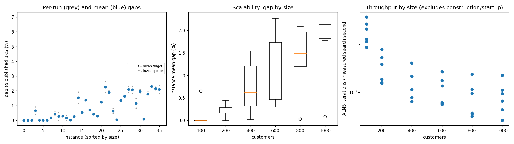
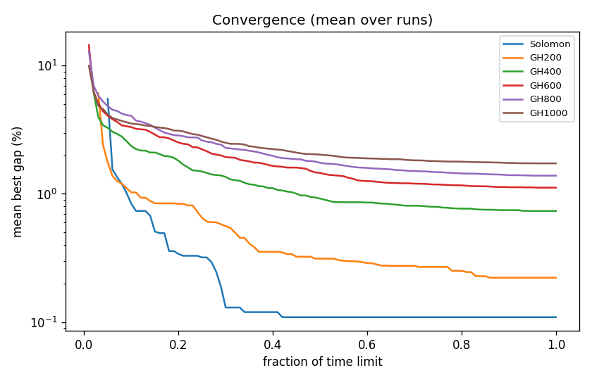

# ALNS + VND campaign `abl-no-twoopt`

Split: **development**; 36 instances x 2 seeds; budget: time_limit = max(10.0, 0.1 * customers) seconds. Gaps are to published BKS (not proven optima), recomputed by the independent evaluator.

Throughput = total iterations / total measured solver search seconds over valid paired runs; construction and worker startup are excluded. Missing/nonpositive times are excluded, not replaced by the time budget. `throughput_runs` records the included run count; zero rates remain in CSV but are omitted from the log-scale throughput plot.

| Metric | Value |
| --- | ---: |
| planned attempts | 72 |
| attempts | 72 |
| feasible attempts | 72 |
| budget respected | 72 |
| mean gap equal weight | 0.883 |
| median instance gap | 0.582 |
| p90 run gap | 2.086 |
| worst run gap | 2.629 |
| best of seeds mean gap | 0.783 |
| mean within instance sd | 0.141 |
| negative gap runs | 0 |

Instances with any run above 7%: none

## By size family

| Family | n | time limit (s) | mean gap % | worst run gap % | mean seed SD | iterations |
| --- | ---: | ---: | ---: | ---: | ---: | ---: |
| Solomon | 6 | 10 | 0.109 | 0.907 | 0.060 | 33896 |
| GH200 | 6 | 20 | 0.222 | 0.568 | 0.134 | 32077 |
| GH400 | 6 | 40 | 0.734 | 1.915 | 0.132 | 47465 |
| GH600 | 6 | 60 | 1.118 | 2.629 | 0.162 | 60564 |
| GH800 | 6 | 80 | 1.387 | 2.319 | 0.183 | 68252 |
| GH1000 | 6 | 100 | 1.729 | 2.373 | 0.176 | 88017 |

## By instance class

| Class | instances | mean gap % | worst run gap % |
| --- | ---: | ---: | ---: |
| C1 | 6 | 0.405 | 2.089 |
| C2 | 6 | 0.358 | 1.378 |
| R1 | 6 | 1.098 | 1.971 |
| R2 | 6 | 1.352 | 2.629 |
| RC1 | 6 | 1.300 | 2.319 |
| RC2 | 6 | 0.786 | 2.346 |

## Per instance

| Instance | n | BKS | best | mean gap % | best % | worst % | SD | feasible | vehicles | iterations | time-to-best s |
| --- | ---: | ---: | ---: | ---: | ---: | ---: | ---: | ---: | ---: | ---: | ---: |
| Solomon/C107.vrp | 100 | 827.3 | 827.3 | 0.000 | 0.000 | 0.000 | 0.000 | 2/2 | 10.0 | 47454 | 0.5 |
| Solomon/C204.vrp | 100 | 588.1 | 588.1 | 0.000 | 0.000 | 0.000 | 0.000 | 2/2 | 3.0 | 27049 | 0.7 |
| Solomon/R102.vrp | 100 | 1466.6 | 1466.6 | 0.000 | 0.000 | 0.000 | 0.000 | 2/2 | 18.0 | 40406 | 0.8 |
| Solomon/R203.vrp | 100 | 870.8 | 874.3 | 0.655 | 0.402 | 0.907 | 0.357 | 2/2 | 5.5 | 28541 | 2.2 |
| Solomon/RC107.vrp | 100 | 1207.8 | 1207.8 | 0.000 | 0.000 | 0.000 | 0.000 | 2/2 | 12.0 | 36140 | 3.8 |
| Solomon/RC204.vrp | 100 | 783.5 | 783.5 | 0.000 | 0.000 | 0.000 | 0.000 | 2/2 | 4.0 | 23784 | 1.8 |
| GH200/C1_2_8.vrp | 200 | 2684.0 | 2684.0 | 0.000 | 0.000 | 0.000 | 0.000 | 2/2 | 20.0 | 48453 | 2.1 |
| GH200/C2_2_8.vrp | 200 | 1813.7 | 1816.9 | 0.176 | 0.176 | 0.176 | 0.000 | 2/2 | 6.0 | 24476 | 3.3 |
| GH200/R1_2_6.vrp | 200 | 3559.1 | 3570.0 | 0.437 | 0.306 | 0.568 | 0.185 | 2/2 | 20.0 | 34466 | 8.6 |
| GH200/R2_2_8.vrp | 200 | 1842.4 | 1842.4 | 0.269 | 0.000 | 0.537 | 0.380 | 2/2 | 4.5 | 22382 | 13.5 |
| GH200/RC1_2_2.vrp | 200 | 3221.6 | 3230.6 | 0.286 | 0.279 | 0.292 | 0.009 | 2/2 | 19.0 | 40043 | 14.5 |
| GH200/RC2_2_8.vrp | 200 | 2151.2 | 2151.2 | 0.163 | 0.000 | 0.325 | 0.230 | 2/2 | 6.0 | 22640 | 13.9 |
| GH400/C1_4_3.vrp | 400 | 6929.9 | 6930.3 | 0.016 | 0.006 | 0.026 | 0.014 | 2/2 | 38.0 | 73462 | 37.6 |
| GH400/C2_4_8.vrp | 400 | 3773.7 | 3780.5 | 0.241 | 0.180 | 0.302 | 0.086 | 2/2 | 12.0 | 39898 | 26.6 |
| GH400/R1_4_10.vrp | 400 | 8077.8 | 8171.7 | 1.539 | 1.162 | 1.915 | 0.532 | 2/2 | 36.5 | 54024 | 33.0 |
| GH400/R2_4_4.vrp | 400 | 4211.2 | 4231.9 | 0.541 | 0.492 | 0.591 | 0.071 | 2/2 | 9.0 | 33104 | 20.3 |
| GH400/RC1_4_8.vrp | 400 | 7757.2 | 7862.1 | 1.373 | 1.352 | 1.394 | 0.029 | 2/2 | 37.0 | 54038 | 31.4 |
| GH400/RC2_4_3.vrp | 400 | 4573.0 | 4602.9 | 0.696 | 0.654 | 0.739 | 0.060 | 2/2 | 12.0 | 30268 | 35.6 |
| GH600/C1_6_9.vrp | 600 | 13664.5 | 13716.3 | 0.406 | 0.379 | 0.433 | 0.038 | 2/2 | 57.0 | 90962 | 52.5 |
| GH600/C2_6_9.vrp | 600 | 7303.2 | 7323.7 | 0.292 | 0.281 | 0.303 | 0.015 | 2/2 | 19.0 | 44851 | 49.7 |
| GH600/R1_6_4.vrp | 600 | 15721.4 | 15912.9 | 1.219 | 1.218 | 1.219 | 0.001 | 2/2 | 55.0 | 66044 | 53.1 |
| GH600/R2_6_10.vrp | 600 | 11837.0 | 12061.2 | 2.262 | 1.894 | 2.629 | 0.520 | 2/2 | 14.0 | 44082 | 47.7 |
| GH600/RC1_6_2.vrp | 600 | 15890.6 | 16175.6 | 1.905 | 1.794 | 2.016 | 0.157 | 2/2 | 57.0 | 74484 | 56.8 |
| GH600/RC2_6_2.vrp | 600 | 10336.9 | 10383.8 | 0.623 | 0.454 | 0.793 | 0.240 | 2/2 | 18.0 | 42958 | 40.1 |
| GH800/C1_8_6.vrp | 800 | 25133.3 | 25140.9 | 0.030 | 0.030 | 0.030 | 0.000 | 2/2 | 80.0 | 115624 | 68.1 |
| GH800/C2_8_10.vrp | 800 | 10946.0 | 11092.6 | 1.358 | 1.339 | 1.378 | 0.027 | 2/2 | 24.0 | 46522 | 67.2 |
| GH800/R1_8_3.vrp | 800 | 29304.5 | 29776.6 | 1.619 | 1.611 | 1.627 | 0.012 | 2/2 | 73.0 | 74632 | 74.9 |
| GH800/R2_8_10.vrp | 800 | 19984.8 | 20364.9 | 2.087 | 1.902 | 2.271 | 0.261 | 2/2 | 17.5 | 47402 | 68.6 |
| GH800/RC1_8_9.vrp | 800 | 28347.1 | 28869.4 | 2.081 | 1.843 | 2.319 | 0.337 | 2/2 | 74.0 | 81342 | 76.6 |
| GH800/RC2_8_1.vrp | 800 | 19201.3 | 19358.8 | 1.146 | 0.820 | 1.471 | 0.460 | 2/2 | 24.0 | 43991 | 75.6 |
| GH1000/C1_10_2.vrp | 1000 | 41337.8 | 42108.9 | 1.977 | 1.865 | 2.089 | 0.158 | 2/2 | 99.0 | 141840 | 48.7 |
| GH1000/C2_10_2.vrp | 1000 | 16462.6 | 16475.3 | 0.081 | 0.077 | 0.084 | 0.005 | 2/2 | 30.0 | 78443 | 76.7 |
| GH1000/R1_10_5.vrp | 1000 | 50406.7 | 51202.9 | 1.775 | 1.580 | 1.971 | 0.277 | 2/2 | 93.0 | 92757 | 88.3 |
| GH1000/R2_10_7.vrp | 1000 | 23102.2 | 23616.1 | 2.299 | 2.224 | 2.373 | 0.105 | 2/2 | 22.0 | 50434 | 94.7 |
| GH1000/RC1_10_5.vrp | 1000 | 45028.1 | 45953.0 | 2.155 | 2.054 | 2.256 | 0.143 | 2/2 | 91.5 | 100397 | 95.9 |
| GH1000/RC2_10_10.vrp | 1000 | 21731.2 | 22128.7 | 2.088 | 1.829 | 2.346 | 0.365 | 2/2 | 20.0 | 64232 | 89.6 |

