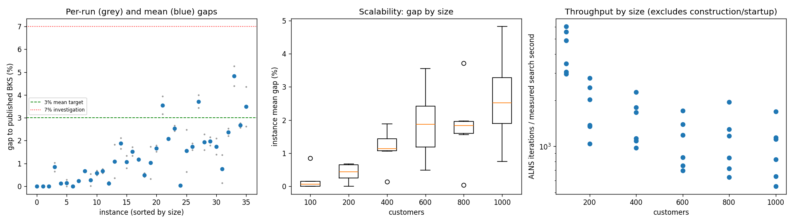
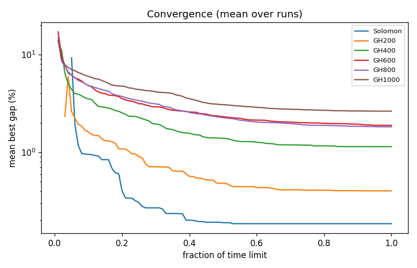

# ALNS + VND campaign `abl-no-twooptstar`

Split: **development**; 36 instances x 2 seeds; budget: time_limit = max(10.0, 0.1 * customers) seconds. Gaps are to published BKS (not proven optima), recomputed by the independent evaluator.

Throughput = total iterations / total measured solver search seconds over valid paired runs; construction and worker startup are excluded. Missing/nonpositive times are excluded, not replaced by the time budget. `throughput_runs` records the included run count; zero rates remain in CSV but are omitted from the log-scale throughput plot.

| Metric | Value |
| --- | ---: |
| planned attempts | 72 |
| attempts | 72 |
| feasible attempts | 72 |
| budget respected | 72 |
| mean gap equal weight | 1.347 |
| median instance gap | 1.076 |
| p90 run gap | 2.755 |
| worst run gap | 5.266 |
| best of seeds mean gap | 1.118 |
| mean within instance sd | 0.324 |
| negative gap runs | 0 |

Instances with any run above 7%: none

## By size family

| Family | n | time limit (s) | mean gap % | worst run gap % | mean seed SD | iterations |
| --- | ---: | ---: | ---: | ---: | ---: | ---: |
| Solomon | 6 | 10 | 0.186 | 1.034 | 0.079 | 36621 |
| GH200 | 6 | 20 | 0.403 | 0.758 | 0.117 | 33020 |
| GH400 | 6 | 40 | 1.142 | 2.117 | 0.368 | 55595 |
| GH600 | 6 | 60 | 1.888 | 3.938 | 0.343 | 62216 |
| GH800 | 6 | 80 | 1.824 | 3.991 | 0.439 | 83736 |
| GH1000 | 6 | 100 | 2.639 | 5.266 | 0.597 | 94732 |

## By instance class

| Class | instances | mean gap % | worst run gap % |
| --- | ---: | ---: | ---: |
| C1 | 6 | 0.399 | 2.088 |
| C2 | 6 | 0.774 | 2.477 |
| R1 | 6 | 1.381 | 2.521 |
| R2 | 6 | 2.379 | 5.266 |
| RC1 | 6 | 1.485 | 2.767 |
| RC2 | 6 | 1.663 | 4.355 |

## Per instance

| Instance | n | BKS | best | mean gap % | best % | worst % | SD | feasible | vehicles | iterations | time-to-best s |
| --- | ---: | ---: | ---: | ---: | ---: | ---: | ---: | ---: | ---: | ---: | ---: |
| Solomon/C107.vrp | 100 | 827.3 | 827.3 | 0.000 | 0.000 | 0.000 | 0.000 | 2/2 | 10.0 | 51124 | 0.5 |
| Solomon/C204.vrp | 100 | 588.1 | 588.1 | 0.000 | 0.000 | 0.000 | 0.000 | 2/2 | 3.0 | 25062 | 1.3 |
| Solomon/R102.vrp | 100 | 1466.6 | 1466.6 | 0.000 | 0.000 | 0.000 | 0.000 | 2/2 | 18.0 | 47078 | 4.4 |
| Solomon/R203.vrp | 100 | 870.8 | 876.5 | 0.844 | 0.655 | 1.034 | 0.268 | 2/2 | 5.0 | 29298 | 3.6 |
| Solomon/RC107.vrp | 100 | 1207.8 | 1209.3 | 0.124 | 0.124 | 0.124 | 0.000 | 2/2 | 12.0 | 41336 | 2.6 |
| Solomon/RC204.vrp | 100 | 783.5 | 783.5 | 0.147 | 0.000 | 0.294 | 0.208 | 2/2 | 4.0 | 25830 | 3.5 |
| GH200/C1_2_8.vrp | 200 | 2684.0 | 2684.0 | 0.000 | 0.000 | 0.000 | 0.000 | 2/2 | 20.0 | 50511 | 1.0 |
| GH200/C2_2_8.vrp | 200 | 1813.7 | 1817.9 | 0.232 | 0.232 | 0.232 | 0.000 | 2/2 | 7.0 | 24938 | 4.0 |
| GH200/R1_2_6.vrp | 200 | 3559.1 | 3581.3 | 0.662 | 0.624 | 0.700 | 0.054 | 2/2 | 20.0 | 36284 | 13.0 |
| GH200/R2_2_8.vrp | 200 | 1842.4 | 1842.5 | 0.271 | 0.005 | 0.537 | 0.376 | 2/2 | 4.5 | 18704 | 7.5 |
| GH200/RC1_2_2.vrp | 200 | 3221.6 | 3237.0 | 0.584 | 0.478 | 0.689 | 0.149 | 2/2 | 19.0 | 43318 | 14.3 |
| GH200/RC2_2_8.vrp | 200 | 2151.2 | 2163.7 | 0.669 | 0.581 | 0.758 | 0.125 | 2/2 | 6.0 | 24366 | 5.0 |
| GH400/C1_4_3.vrp | 400 | 6929.9 | 6934.0 | 0.129 | 0.059 | 0.199 | 0.099 | 2/2 | 38.0 | 84746 | 24.1 |
| GH400/C2_4_8.vrp | 400 | 3773.7 | 3787.0 | 1.088 | 0.352 | 1.823 | 1.040 | 2/2 | 12.0 | 40815 | 19.6 |
| GH400/R1_4_10.vrp | 400 | 8077.8 | 8210.7 | 1.881 | 1.645 | 2.117 | 0.334 | 2/2 | 37.0 | 62166 | 32.9 |
| GH400/R2_4_4.vrp | 400 | 4211.2 | 4244.4 | 1.064 | 0.788 | 1.339 | 0.390 | 2/2 | 9.0 | 36649 | 30.6 |
| GH400/RC1_4_8.vrp | 400 | 7757.2 | 7860.6 | 1.524 | 1.333 | 1.715 | 0.270 | 2/2 | 37.0 | 67136 | 32.0 |
| GH400/RC2_4_3.vrp | 400 | 4573.0 | 4623.9 | 1.169 | 1.113 | 1.225 | 0.079 | 2/2 | 12.5 | 42059 | 33.3 |
| GH600/C1_6_9.vrp | 600 | 13664.5 | 13721.0 | 0.490 | 0.413 | 0.566 | 0.108 | 2/2 | 57.5 | 97126 | 52.1 |
| GH600/C2_6_9.vrp | 600 | 7303.2 | 7326.3 | 1.021 | 0.316 | 1.727 | 0.997 | 2/2 | 19.0 | 48153 | 55.8 |
| GH600/R1_6_4.vrp | 600 | 15721.4 | 15958.7 | 1.653 | 1.509 | 1.796 | 0.203 | 2/2 | 55.0 | 67300 | 57.0 |
| GH600/R2_6_10.vrp | 600 | 11837.0 | 12211.6 | 3.552 | 3.165 | 3.938 | 0.547 | 2/2 | 13.5 | 39515 | 55.1 |
| GH600/RC1_6_2.vrp | 600 | 15890.6 | 16215.8 | 2.076 | 2.046 | 2.105 | 0.041 | 2/2 | 56.0 | 78727 | 55.4 |
| GH600/RC2_6_2.vrp | 600 | 10336.9 | 10587.2 | 2.536 | 2.421 | 2.650 | 0.161 | 2/2 | 18.0 | 42476 | 51.4 |
| GH800/C1_8_6.vrp | 800 | 25133.3 | 25141.5 | 0.033 | 0.033 | 0.033 | 0.000 | 2/2 | 80.0 | 147932 | 67.8 |
| GH800/C2_8_10.vrp | 800 | 10946.0 | 11015.2 | 1.554 | 0.632 | 2.477 | 1.304 | 2/2 | 24.5 | 64178 | 62.2 |
| GH800/R1_8_3.vrp | 800 | 29304.5 | 29768.5 | 1.734 | 1.583 | 1.885 | 0.213 | 2/2 | 72.5 | 89116 | 76.6 |
| GH800/R2_8_10.vrp | 800 | 19984.8 | 20672.3 | 3.716 | 3.440 | 3.991 | 0.390 | 2/2 | 17.0 | 48062 | 61.2 |
| GH800/RC1_8_9.vrp | 800 | 28347.1 | 28799.7 | 1.937 | 1.597 | 2.276 | 0.481 | 2/2 | 74.0 | 98310 | 76.6 |
| GH800/RC2_8_1.vrp | 800 | 19201.3 | 19545.9 | 1.970 | 1.795 | 2.145 | 0.247 | 2/2 | 24.0 | 54816 | 76.1 |
| GH1000/C1_10_2.vrp | 1000 | 41337.8 | 41913.8 | 1.741 | 1.393 | 2.088 | 0.491 | 2/2 | 98.5 | 161440 | 90.3 |
| GH1000/C2_10_2.vrp | 1000 | 16462.6 | 16484.4 | 0.751 | 0.132 | 1.370 | 0.875 | 2/2 | 30.5 | 78365 | 84.8 |
| GH1000/R1_10_5.vrp | 1000 | 50406.7 | 51513.7 | 2.359 | 2.196 | 2.521 | 0.230 | 2/2 | 93.0 | 106166 | 90.6 |
| GH1000/R2_10_7.vrp | 1000 | 23102.2 | 24115.6 | 4.826 | 4.387 | 5.266 | 0.622 | 2/2 | 21.0 | 52626 | 95.2 |
| GH1000/RC1_10_5.vrp | 1000 | 45028.1 | 46185.2 | 2.668 | 2.570 | 2.767 | 0.140 | 2/2 | 91.5 | 108957 | 93.7 |
| GH1000/RC2_10_10.vrp | 1000 | 21731.2 | 22301.0 | 3.489 | 2.622 | 4.355 | 1.225 | 2/2 | 19.5 | 60835 | 90.0 |

