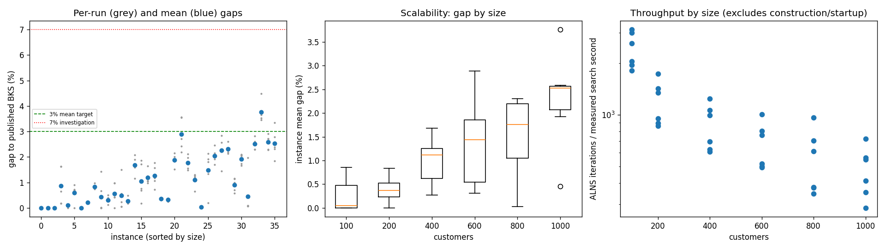
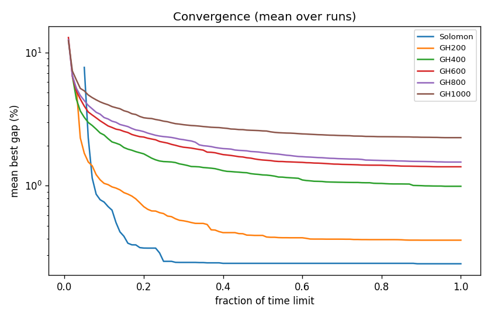

# ALNS + VND campaign `conf-baseline`

Split: **development**; 36 instances x 5 seeds; budget: time_limit = max(10.0, 0.1 * customers) seconds. Gaps are to published BKS (not proven optima), recomputed by the independent evaluator.

Throughput = total iterations / total measured solver search seconds over valid paired runs; construction and worker startup are excluded. Missing/nonpositive times are excluded, not replaced by the time budget. `throughput_runs` records the included run count; zero rates remain in CSV but are omitted from the log-scale throughput plot.

| Metric | Value |
| --- | ---: |
| planned attempts | 180 |
| attempts | 180 |
| feasible attempts | 180 |
| budget respected | 180 |
| mean gap equal weight | 1.136 |
| median instance gap | 0.883 |
| p90 run gap | 2.529 |
| worst run gap | 4.481 |
| best of seeds mean gap | 0.793 |
| mean within instance sd | 0.306 |
| negative gap runs | 0 |

Instances with any run above 7%: none

## By size family

| Family | n | time limit (s) | mean gap % | worst run gap % | mean seed SD | iterations |
| --- | ---: | ---: | ---: | ---: | ---: | ---: |
| Solomon | 6 | 10 | 0.258 | 1.631 | 0.189 | 20537 |
| GH200 | 6 | 20 | 0.389 | 1.427 | 0.220 | 21797 |
| GH400 | 6 | 40 | 0.988 | 2.072 | 0.415 | 32699 |
| GH600 | 6 | 60 | 1.385 | 3.569 | 0.251 | 38642 |
| GH800 | 6 | 80 | 1.503 | 2.838 | 0.338 | 42852 |
| GH1000 | 6 | 100 | 2.293 | 4.481 | 0.423 | 45912 |

## By instance class

| Class | instances | mean gap % | worst run gap % |
| --- | ---: | ---: | ---: |
| C1 | 6 | 0.465 | 2.091 |
| C2 | 6 | 0.453 | 2.136 |
| R1 | 6 | 1.491 | 2.815 |
| R2 | 6 | 1.869 | 4.481 |
| RC1 | 6 | 1.377 | 2.910 |
| RC2 | 6 | 1.162 | 3.352 |

## Per instance

| Instance | n | BKS | best | mean gap % | best % | worst % | SD | feasible | vehicles | iterations | time-to-best s |
| --- | ---: | ---: | ---: | ---: | ---: | ---: | ---: | ---: | ---: | ---: | ---: |
| Solomon/C107.vrp | 100 | 827.3 | 827.3 | 0.000 | 0.000 | 0.000 | 0.000 | 5/5 | 10.0 | 26558 | 0.5 |
| Solomon/C204.vrp | 100 | 588.1 | 588.1 | 0.000 | 0.000 | 0.000 | 0.000 | 5/5 | 3.0 | 16423 | 0.6 |
| Solomon/R102.vrp | 100 | 1466.6 | 1466.6 | 0.000 | 0.000 | 0.000 | 0.000 | 5/5 | 18.0 | 25515 | 1.0 |
| Solomon/R203.vrp | 100 | 870.8 | 872.4 | 0.857 | 0.184 | 1.631 | 0.732 | 5/5 | 5.4 | 17360 | 4.1 |
| Solomon/RC107.vrp | 100 | 1207.8 | 1207.8 | 0.099 | 0.000 | 0.124 | 0.056 | 5/5 | 12.0 | 22020 | 1.3 |
| Solomon/RC204.vrp | 100 | 783.5 | 783.5 | 0.595 | 0.000 | 0.893 | 0.344 | 5/5 | 4.0 | 15343 | 1.1 |
| GH200/C1_2_8.vrp | 200 | 2684.0 | 2684.0 | 0.000 | 0.000 | 0.000 | 0.000 | 5/5 | 20.0 | 31438 | 0.9 |
| GH200/C2_2_8.vrp | 200 | 1813.7 | 1816.9 | 0.210 | 0.176 | 0.232 | 0.030 | 5/5 | 6.6 | 17271 | 2.1 |
| GH200/R1_2_6.vrp | 200 | 3559.1 | 3585.5 | 0.833 | 0.742 | 0.978 | 0.095 | 5/5 | 20.0 | 24475 | 10.9 |
| GH200/R2_2_8.vrp | 200 | 1842.4 | 1842.4 | 0.421 | 0.000 | 1.427 | 0.632 | 5/5 | 4.4 | 16212 | 7.5 |
| GH200/RC1_2_2.vrp | 200 | 3221.6 | 3225.6 | 0.309 | 0.124 | 0.506 | 0.144 | 5/5 | 19.0 | 25795 | 15.1 |
| GH200/RC2_2_8.vrp | 200 | 2151.2 | 2151.2 | 0.560 | 0.000 | 0.976 | 0.418 | 5/5 | 6.0 | 15592 | 6.1 |
| GH400/C1_4_3.vrp | 400 | 6929.9 | 6933.1 | 0.477 | 0.046 | 1.502 | 0.609 | 5/5 | 38.2 | 46670 | 35.3 |
| GH400/C2_4_8.vrp | 400 | 3773.7 | 3780.5 | 0.266 | 0.180 | 0.485 | 0.126 | 5/5 | 12.0 | 26205 | 23.3 |
| GH400/R1_4_10.vrp | 400 | 8077.8 | 8171.2 | 1.684 | 1.156 | 2.072 | 0.348 | 5/5 | 37.0 | 37180 | 29.6 |
| GH400/R2_4_4.vrp | 400 | 4211.2 | 4218.8 | 1.040 | 0.180 | 1.859 | 0.720 | 5/5 | 9.2 | 22881 | 24.1 |
| GH400/RC1_4_8.vrp | 400 | 7757.2 | 7833.0 | 1.198 | 0.977 | 1.649 | 0.271 | 5/5 | 37.0 | 39739 | 34.2 |
| GH400/RC2_4_3.vrp | 400 | 4573.0 | 4606.2 | 1.264 | 0.726 | 1.776 | 0.417 | 5/5 | 11.8 | 23521 | 30.5 |
| GH600/C1_6_9.vrp | 600 | 13664.5 | 13706.5 | 0.358 | 0.307 | 0.389 | 0.032 | 5/5 | 57.0 | 57125 | 48.7 |
| GH600/C2_6_9.vrp | 600 | 7303.2 | 7321.3 | 0.313 | 0.248 | 0.382 | 0.062 | 5/5 | 19.0 | 29425 | 43.2 |
| GH600/R1_6_4.vrp | 600 | 15721.4 | 15959.3 | 1.881 | 1.513 | 2.152 | 0.238 | 5/5 | 55.2 | 43267 | 52.1 |
| GH600/R2_6_10.vrp | 600 | 11837.0 | 12096.6 | 2.885 | 2.193 | 3.569 | 0.636 | 5/5 | 13.6 | 27980 | 53.2 |
| GH600/RC1_6_2.vrp | 600 | 15890.6 | 16126.3 | 1.766 | 1.483 | 2.116 | 0.271 | 5/5 | 56.2 | 45683 | 53.9 |
| GH600/RC2_6_2.vrp | 600 | 10336.9 | 10403.1 | 1.108 | 0.640 | 1.295 | 0.268 | 5/5 | 18.4 | 28373 | 52.2 |
| GH800/C1_8_6.vrp | 800 | 25133.3 | 25140.9 | 0.030 | 0.030 | 0.030 | 0.000 | 5/5 | 80.0 | 73050 | 64.9 |
| GH800/C2_8_10.vrp | 800 | 10946.0 | 10967.9 | 1.479 | 0.200 | 2.136 | 0.773 | 5/5 | 24.4 | 28562 | 73.0 |
| GH800/R1_8_3.vrp | 800 | 29304.5 | 29801.9 | 2.041 | 1.697 | 2.454 | 0.284 | 5/5 | 73.0 | 46615 | 72.9 |
| GH800/R2_8_10.vrp | 800 | 19984.8 | 20274.4 | 2.252 | 1.449 | 2.838 | 0.521 | 5/5 | 17.8 | 26362 | 66.0 |
| GH800/RC1_8_9.vrp | 800 | 28347.1 | 28953.4 | 2.308 | 2.139 | 2.608 | 0.186 | 5/5 | 74.0 | 53791 | 73.9 |
| GH800/RC2_8_1.vrp | 800 | 19201.3 | 19310.5 | 0.909 | 0.569 | 1.154 | 0.264 | 5/5 | 24.6 | 28731 | 72.1 |
| GH1000/C1_10_2.vrp | 1000 | 41337.8 | 42024.6 | 1.922 | 1.661 | 2.091 | 0.206 | 5/5 | 99.0 | 69132 | 88.4 |
| GH1000/C2_10_2.vrp | 1000 | 16462.6 | 16472.6 | 0.453 | 0.061 | 1.975 | 0.851 | 5/5 | 30.2 | 39417 | 76.4 |
| GH1000/R1_10_5.vrp | 1000 | 50406.7 | 51561.5 | 2.508 | 2.291 | 2.815 | 0.221 | 5/5 | 93.2 | 53652 | 90.7 |
| GH1000/R2_10_7.vrp | 1000 | 23102.2 | 23902.0 | 3.761 | 3.462 | 4.481 | 0.414 | 5/5 | 21.8 | 27304 | 93.1 |
| GH1000/RC1_10_5.vrp | 1000 | 45028.1 | 46054.1 | 2.580 | 2.279 | 2.910 | 0.277 | 5/5 | 92.0 | 52334 | 95.0 |
| GH1000/RC2_10_10.vrp | 1000 | 21731.2 | 22131.2 | 2.536 | 1.841 | 3.352 | 0.567 | 5/5 | 20.0 | 33632 | 86.5 |

