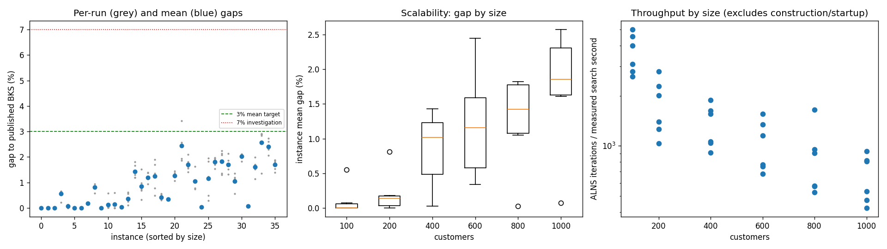
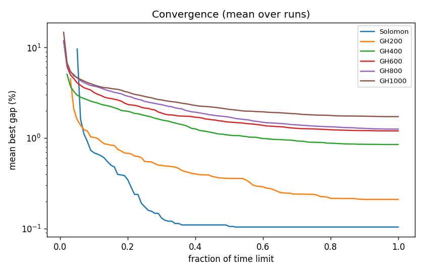

# ALNS + VND campaign `conf-final`

Split: **development**; 36 instances x 5 seeds; budget: time_limit = max(10.0, 0.1 * customers) seconds. Gaps are to published BKS (not proven optima), recomputed by the independent evaluator.

Throughput = total iterations / total measured solver search seconds over valid paired runs; construction and worker startup are excluded. Missing/nonpositive times are excluded, not replaced by the time budget. `throughput_runs` records the included run count; zero rates remain in CSV but are omitted from the log-scale throughput plot.

| Metric | Value |
| --- | ---: |
| planned attempts | 180 |
| attempts | 180 |
| feasible attempts | 180 |
| budget respected | 180 |
| mean gap equal weight | 0.893 |
| median instance gap | 0.829 |
| p90 run gap | 2.084 |
| worst run gap | 3.409 |
| best of seeds mean gap | 0.625 |
| mean within instance sd | 0.217 |
| negative gap runs | 0 |

Instances with any run above 7%: none

## By size family

| Family | n | time limit (s) | mean gap % | worst run gap % | mean seed SD | iterations |
| --- | ---: | ---: | ---: | ---: | ---: | ---: |
| Solomon | 6 | 10 | 0.104 | 0.655 | 0.043 | 30947 |
| GH200 | 6 | 20 | 0.210 | 0.941 | 0.107 | 32552 |
| GH400 | 6 | 40 | 0.850 | 1.900 | 0.293 | 50506 |
| GH600 | 6 | 60 | 1.203 | 3.409 | 0.254 | 59168 |
| GH800 | 6 | 80 | 1.259 | 2.234 | 0.336 | 65862 |
| GH1000 | 6 | 100 | 1.728 | 2.905 | 0.271 | 63306 |

## By instance class

| Class | instances | mean gap % | worst run gap % |
| --- | ---: | ---: | ---: |
| C1 | 6 | 0.415 | 2.107 |
| C2 | 6 | 0.350 | 1.943 |
| R1 | 6 | 1.153 | 1.993 |
| R2 | 6 | 1.374 | 3.409 |
| RC1 | 6 | 1.199 | 2.731 |
| RC2 | 6 | 0.863 | 1.900 |

## Per instance

| Instance | n | BKS | best | mean gap % | best % | worst % | SD | feasible | vehicles | iterations | time-to-best s |
| --- | ---: | ---: | ---: | ---: | ---: | ---: | ---: | ---: | ---: | ---: | ---: |
| Solomon/C107.vrp | 100 | 827.3 | 827.3 | 0.000 | 0.000 | 0.000 | 0.000 | 5/5 | 10.0 | 42098 | 0.5 |
| Solomon/C204.vrp | 100 | 588.1 | 588.1 | 0.000 | 0.000 | 0.000 | 0.000 | 5/5 | 3.0 | 23598 | 0.8 |
| Solomon/R102.vrp | 100 | 1466.6 | 1466.6 | 0.000 | 0.000 | 0.000 | 0.000 | 5/5 | 18.0 | 38233 | 1.0 |
| Solomon/R203.vrp | 100 | 870.8 | 872.7 | 0.551 | 0.218 | 0.655 | 0.189 | 5/5 | 5.2 | 26125 | 3.3 |
| Solomon/RC107.vrp | 100 | 1207.8 | 1207.8 | 0.075 | 0.000 | 0.124 | 0.068 | 5/5 | 12.0 | 33646 | 2.8 |
| Solomon/RC204.vrp | 100 | 783.5 | 783.5 | 0.000 | 0.000 | 0.000 | 0.000 | 5/5 | 4.0 | 21980 | 1.3 |
| GH200/C1_2_8.vrp | 200 | 2684.0 | 2684.0 | 0.000 | 0.000 | 0.000 | 0.000 | 5/5 | 20.0 | 50522 | 1.3 |
| GH200/C2_2_8.vrp | 200 | 1813.7 | 1816.9 | 0.176 | 0.176 | 0.176 | 0.000 | 5/5 | 6.0 | 25267 | 2.2 |
| GH200/R1_2_6.vrp | 200 | 3559.1 | 3579.7 | 0.812 | 0.579 | 0.941 | 0.137 | 5/5 | 20.0 | 36361 | 12.5 |
| GH200/R2_2_8.vrp | 200 | 1842.4 | 1842.4 | 0.002 | 0.000 | 0.005 | 0.003 | 5/5 | 4.0 | 18819 | 7.4 |
| GH200/RC1_2_2.vrp | 200 | 3221.6 | 3222.1 | 0.129 | 0.016 | 0.574 | 0.249 | 5/5 | 19.0 | 41447 | 14.6 |
| GH200/RC2_2_8.vrp | 200 | 2151.2 | 2151.2 | 0.143 | 0.000 | 0.590 | 0.256 | 5/5 | 6.0 | 22896 | 12.2 |
| GH400/C1_4_3.vrp | 400 | 6929.9 | 6930.3 | 0.027 | 0.006 | 0.046 | 0.020 | 5/5 | 38.0 | 70626 | 35.3 |
| GH400/C2_4_8.vrp | 400 | 3773.7 | 3777.3 | 0.364 | 0.095 | 0.612 | 0.217 | 5/5 | 12.0 | 39915 | 27.2 |
| GH400/R1_4_10.vrp | 400 | 8077.8 | 8174.1 | 1.431 | 1.192 | 1.814 | 0.285 | 5/5 | 37.0 | 58240 | 33.5 |
| GH400/R2_4_4.vrp | 400 | 4211.2 | 4224.5 | 0.847 | 0.316 | 1.515 | 0.443 | 5/5 | 9.2 | 39004 | 33.7 |
| GH400/RC1_4_8.vrp | 400 | 7757.2 | 7829.5 | 1.190 | 0.932 | 1.392 | 0.190 | 5/5 | 37.0 | 60974 | 36.1 |
| GH400/RC2_4_3.vrp | 400 | 4573.0 | 4594.8 | 1.243 | 0.477 | 1.900 | 0.603 | 5/5 | 11.6 | 34274 | 23.9 |
| GH600/C1_6_9.vrp | 600 | 13664.5 | 13705.9 | 0.419 | 0.303 | 0.553 | 0.110 | 5/5 | 57.2 | 88398 | 42.4 |
| GH600/C2_6_9.vrp | 600 | 7303.2 | 7326.9 | 0.338 | 0.325 | 0.372 | 0.020 | 5/5 | 19.0 | 42678 | 51.1 |
| GH600/R1_6_4.vrp | 600 | 15721.4 | 15887.7 | 1.268 | 1.058 | 1.450 | 0.152 | 5/5 | 55.0 | 65353 | 51.5 |
| GH600/R2_6_10.vrp | 600 | 11837.0 | 12056.5 | 2.449 | 1.854 | 3.409 | 0.625 | 5/5 | 13.2 | 43747 | 45.2 |
| GH600/RC1_6_2.vrp | 600 | 15890.6 | 16115.3 | 1.694 | 1.414 | 2.091 | 0.263 | 5/5 | 56.4 | 76266 | 52.3 |
| GH600/RC2_6_2.vrp | 600 | 10336.9 | 10413.1 | 1.048 | 0.737 | 1.628 | 0.356 | 5/5 | 18.4 | 38566 | 51.0 |
| GH800/C1_8_6.vrp | 800 | 25133.3 | 25136.4 | 0.028 | 0.012 | 0.033 | 0.009 | 5/5 | 80.0 | 125672 | 64.9 |
| GH800/C2_8_10.vrp | 800 | 10946.0 | 10976.3 | 1.150 | 0.277 | 1.943 | 0.757 | 5/5 | 24.4 | 43592 | 71.2 |
| GH800/R1_8_3.vrp | 800 | 29304.5 | 29755.0 | 1.800 | 1.537 | 1.964 | 0.180 | 5/5 | 73.0 | 69112 | 75.1 |
| GH800/R2_8_10.vrp | 800 | 19984.8 | 20245.3 | 1.823 | 1.303 | 2.234 | 0.452 | 5/5 | 18.0 | 40216 | 73.4 |
| GH800/RC1_8_9.vrp | 800 | 28347.1 | 28718.5 | 1.702 | 1.310 | 2.133 | 0.314 | 5/5 | 74.0 | 72640 | 75.6 |
| GH800/RC2_8_1.vrp | 800 | 19201.3 | 19307.2 | 1.053 | 0.552 | 1.353 | 0.303 | 5/5 | 24.6 | 43941 | 73.1 |
| GH1000/C1_10_2.vrp | 1000 | 41337.8 | 42089.6 | 2.018 | 1.819 | 2.107 | 0.125 | 5/5 | 99.0 | 88352 | 57.7 |
| GH1000/C2_10_2.vrp | 1000 | 16462.6 | 16471.4 | 0.072 | 0.053 | 0.112 | 0.024 | 5/5 | 30.0 | 50799 | 92.6 |
| GH1000/R1_10_5.vrp | 1000 | 50406.7 | 50983.0 | 1.609 | 1.143 | 1.993 | 0.311 | 5/5 | 93.4 | 77074 | 93.4 |
| GH1000/R2_10_7.vrp | 1000 | 23102.2 | 23413.8 | 2.574 | 1.349 | 2.905 | 0.686 | 5/5 | 21.6 | 40547 | 85.0 |
| GH1000/RC1_10_5.vrp | 1000 | 45028.1 | 45959.1 | 2.406 | 2.068 | 2.731 | 0.261 | 5/5 | 92.0 | 78028 | 95.2 |
| GH1000/RC2_10_10.vrp | 1000 | 21731.2 | 22032.3 | 1.690 | 1.386 | 1.872 | 0.220 | 5/5 | 19.6 | 45038 | 85.5 |

