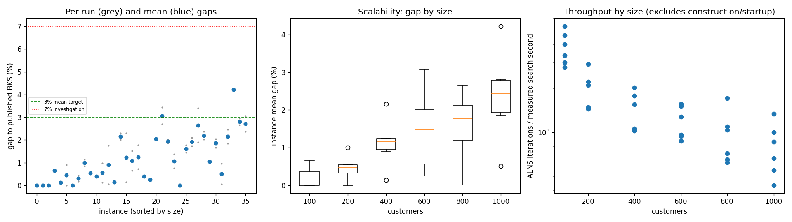
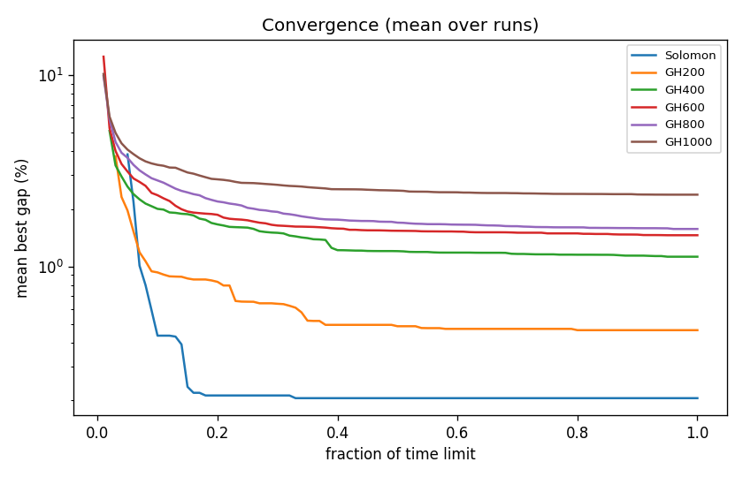

# ALNS + VND campaign `temp-0p25`

Split: **development**; 36 instances x 2 seeds; budget: time_limit = max(10.0, 0.1 * customers) seconds. Gaps are to published BKS (not proven optima), recomputed by the independent evaluator.

Throughput = total iterations / total measured solver search seconds over valid paired runs; construction and worker startup are excluded. Missing/nonpositive times are excluded, not replaced by the time budget. `throughput_runs` records the included run count; zero rates remain in CSV but are omitted from the log-scale throughput plot.

| Metric | Value |
| --- | ---: |
| planned attempts | 72 |
| attempts | 72 |
| feasible attempts | 72 |
| budget respected | 72 |
| mean gap equal weight | 1.199 |
| median instance gap | 1.022 |
| p90 run gap | 2.636 |
| worst run gap | 4.261 |
| best of seeds mean gap | 0.980 |
| mean within instance sd | 0.310 |
| negative gap runs | 0 |

Instances with any run above 7%: none

## By size family

| Family | n | time limit (s) | mean gap % | worst run gap % | mean seed SD | iterations |
| --- | ---: | ---: | ---: | ---: | ---: | ---: |
| Solomon | 6 | 10 | 0.204 | 0.893 | 0.105 | 32486 |
| GH200 | 6 | 20 | 0.464 | 1.141 | 0.171 | 35138 |
| GH400 | 6 | 40 | 1.124 | 2.299 | 0.726 | 52927 |
| GH600 | 6 | 60 | 1.456 | 3.437 | 0.193 | 67405 |
| GH800 | 6 | 80 | 1.570 | 3.397 | 0.309 | 74021 |
| GH1000 | 6 | 100 | 2.375 | 4.261 | 0.355 | 76946 |

## By instance class

| Class | instances | mean gap % | worst run gap % |
| --- | ---: | ---: | ---: |
| C1 | 6 | 0.527 | 2.050 |
| C2 | 6 | 0.468 | 1.775 |
| R1 | 6 | 1.544 | 2.466 |
| R2 | 6 | 2.056 | 4.261 |
| RC1 | 6 | 1.419 | 2.955 |
| RC2 | 6 | 1.180 | 3.059 |

## Per instance

| Instance | n | BKS | best | mean gap % | best % | worst % | SD | feasible | vehicles | iterations | time-to-best s |
| --- | ---: | ---: | ---: | ---: | ---: | ---: | ---: | ---: | ---: | ---: | ---: |
| Solomon/C107.vrp | 100 | 827.3 | 827.3 | 0.000 | 0.000 | 0.000 | 0.000 | 2/2 | 10.0 | 44977 | 0.5 |
| Solomon/C204.vrp | 100 | 588.1 | 588.1 | 0.000 | 0.000 | 0.000 | 0.000 | 2/2 | 3.0 | 25473 | 0.6 |
| Solomon/R102.vrp | 100 | 1466.6 | 1466.6 | 0.000 | 0.000 | 0.000 | 0.000 | 2/2 | 18.0 | 38988 | 0.7 |
| Solomon/R203.vrp | 100 | 870.8 | 876.5 | 0.655 | 0.655 | 0.655 | 0.000 | 2/2 | 5.0 | 28310 | 2.4 |
| Solomon/RC107.vrp | 100 | 1207.8 | 1209.3 | 0.124 | 0.124 | 0.124 | 0.000 | 2/2 | 12.0 | 33696 | 1.3 |
| Solomon/RC204.vrp | 100 | 783.5 | 783.5 | 0.447 | 0.000 | 0.893 | 0.632 | 2/2 | 4.0 | 23474 | 1.4 |
| GH200/C1_2_8.vrp | 200 | 2684.0 | 2684.0 | 0.000 | 0.000 | 0.000 | 0.000 | 2/2 | 20.0 | 52969 | 0.6 |
| GH200/C2_2_8.vrp | 200 | 1813.7 | 1816.9 | 0.306 | 0.176 | 0.436 | 0.183 | 2/2 | 6.0 | 26302 | 1.4 |
| GH200/R1_2_6.vrp | 200 | 3559.1 | 3589.3 | 0.995 | 0.849 | 1.141 | 0.207 | 2/2 | 19.5 | 38255 | 9.2 |
| GH200/R2_2_8.vrp | 200 | 1842.4 | 1852.3 | 0.537 | 0.537 | 0.537 | 0.000 | 2/2 | 5.0 | 26202 | 9.9 |
| GH200/RC1_2_2.vrp | 200 | 3221.6 | 3233.5 | 0.393 | 0.369 | 0.416 | 0.033 | 2/2 | 19.0 | 40148 | 6.2 |
| GH200/RC2_2_8.vrp | 200 | 2151.2 | 2153.9 | 0.551 | 0.126 | 0.976 | 0.602 | 2/2 | 6.0 | 26953 | 9.2 |
| GH400/C1_4_3.vrp | 400 | 6929.9 | 6933.1 | 0.903 | 0.046 | 1.760 | 1.212 | 2/2 | 38.5 | 75866 | 15.1 |
| GH400/C2_4_8.vrp | 400 | 3773.7 | 3777.3 | 0.138 | 0.095 | 0.180 | 0.060 | 2/2 | 12.0 | 39786 | 31.2 |
| GH400/R1_4_10.vrp | 400 | 8077.8 | 8240.2 | 2.155 | 2.010 | 2.299 | 0.204 | 2/2 | 37.0 | 58278 | 35.9 |
| GH400/R2_4_4.vrp | 400 | 4211.2 | 4217.4 | 1.223 | 0.147 | 2.299 | 1.521 | 2/2 | 9.0 | 38686 | 27.8 |
| GH400/RC1_4_8.vrp | 400 | 7757.2 | 7806.8 | 1.074 | 0.639 | 1.508 | 0.614 | 2/2 | 36.5 | 66492 | 19.7 |
| GH400/RC2_4_3.vrp | 400 | 4573.0 | 4606.2 | 1.251 | 0.726 | 1.776 | 0.742 | 2/2 | 12.0 | 38458 | 14.9 |
| GH600/C1_6_9.vrp | 600 | 13664.5 | 13716.4 | 0.402 | 0.380 | 0.424 | 0.032 | 2/2 | 57.0 | 88587 | 34.5 |
| GH600/C2_6_9.vrp | 600 | 7303.2 | 7320.8 | 0.244 | 0.241 | 0.248 | 0.005 | 2/2 | 18.5 | 49543 | 52.6 |
| GH600/R1_6_4.vrp | 600 | 15721.4 | 16037.0 | 2.040 | 2.007 | 2.072 | 0.045 | 2/2 | 55.0 | 72736 | 54.3 |
| GH600/R2_6_10.vrp | 600 | 11837.0 | 12154.9 | 3.061 | 2.686 | 3.437 | 0.531 | 2/2 | 13.5 | 53380 | 37.4 |
| GH600/RC1_6_2.vrp | 600 | 15890.6 | 16185.0 | 1.924 | 1.853 | 1.996 | 0.101 | 2/2 | 56.0 | 85733 | 56.0 |
| GH600/RC2_6_2.vrp | 600 | 10336.9 | 10414.8 | 1.066 | 0.754 | 1.378 | 0.441 | 2/2 | 19.0 | 54452 | 52.4 |
| GH800/C1_8_6.vrp | 800 | 25133.3 | 25134.0 | 0.003 | 0.003 | 0.003 | 0.000 | 2/2 | 80.0 | 130070 | 51.2 |
| GH800/C2_8_10.vrp | 800 | 10946.0 | 11104.2 | 1.610 | 1.445 | 1.775 | 0.233 | 2/2 | 24.0 | 54808 | 55.7 |
| GH800/R1_8_3.vrp | 800 | 29304.5 | 29814.8 | 1.918 | 1.741 | 2.096 | 0.250 | 2/2 | 73.0 | 78834 | 68.0 |
| GH800/R2_8_10.vrp | 800 | 19984.8 | 20364.0 | 2.647 | 1.897 | 3.397 | 1.060 | 2/2 | 17.5 | 47374 | 49.7 |
| GH800/RC1_8_9.vrp | 800 | 28347.1 | 28921.7 | 2.194 | 2.027 | 2.361 | 0.236 | 2/2 | 73.5 | 83438 | 76.7 |
| GH800/RC2_8_1.vrp | 800 | 19201.3 | 19392.7 | 1.050 | 0.997 | 1.104 | 0.075 | 2/2 | 24.5 | 49601 | 70.5 |
| GH1000/C1_10_2.vrp | 1000 | 41337.8 | 42021.5 | 1.852 | 1.654 | 2.050 | 0.280 | 2/2 | 99.0 | 127506 | 92.9 |
| GH1000/C2_10_2.vrp | 1000 | 16462.6 | 16471.4 | 0.507 | 0.053 | 0.961 | 0.642 | 2/2 | 30.5 | 63316 | 73.2 |
| GH1000/R1_10_5.vrp | 1000 | 50406.7 | 51335.0 | 2.154 | 1.842 | 2.466 | 0.441 | 2/2 | 93.5 | 81754 | 93.6 |
| GH1000/R2_10_7.vrp | 1000 | 23102.2 | 24065.0 | 4.214 | 4.168 | 4.261 | 0.066 | 2/2 | 21.0 | 41366 | 89.7 |
| GH1000/RC1_10_5.vrp | 1000 | 45028.1 | 46223.5 | 2.805 | 2.655 | 2.955 | 0.212 | 2/2 | 91.5 | 95233 | 82.4 |
| GH1000/RC2_10_10.vrp | 1000 | 21731.2 | 22246.6 | 2.715 | 2.372 | 3.059 | 0.486 | 2/2 | 19.5 | 52502 | 66.7 |

