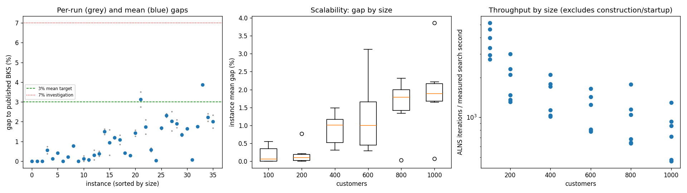
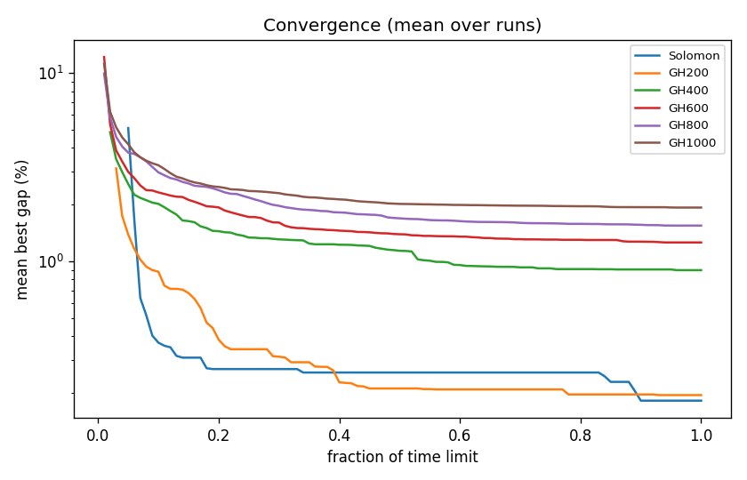

# ALNS + VND campaign `temp-0p5`

Split: **development**; 36 instances x 2 seeds; budget: time_limit = max(10.0, 0.1 * customers) seconds. Gaps are to published BKS (not proven optima), recomputed by the independent evaluator.

Throughput = total iterations / total measured solver search seconds over valid paired runs; construction and worker startup are excluded. Missing/nonpositive times are excluded, not replaced by the time budget. `throughput_runs` records the included run count; zero rates remain in CSV but are omitted from the log-scale throughput plot.

| Metric | Value |
| --- | ---: |
| planned attempts | 72 |
| attempts | 72 |
| feasible attempts | 72 |
| budget respected | 72 |
| mean gap equal weight | 1.000 |
| median instance gap | 0.673 |
| p90 run gap | 2.318 |
| worst run gap | 3.869 |
| best of seeds mean gap | 0.878 |
| mean within instance sd | 0.173 |
| negative gap runs | 0 |

Instances with any run above 7%: none

## By size family

| Family | n | time limit (s) | mean gap % | worst run gap % | mean seed SD | iterations |
| --- | ---: | ---: | ---: | ---: | ---: | ---: |
| Solomon | 6 | 10 | 0.182 | 0.735 | 0.048 | 32209 |
| GH200 | 6 | 20 | 0.194 | 0.812 | 0.062 | 35001 |
| GH400 | 6 | 40 | 0.896 | 1.625 | 0.340 | 54801 |
| GH600 | 6 | 60 | 1.257 | 3.501 | 0.247 | 63623 |
| GH800 | 6 | 80 | 1.546 | 2.518 | 0.217 | 75299 |
| GH1000 | 6 | 100 | 1.927 | 3.869 | 0.126 | 75456 |

## By instance class

| Class | instances | mean gap % | worst run gap % |
| --- | ---: | ---: | ---: |
| C1 | 6 | 0.400 | 1.658 |
| C2 | 6 | 0.433 | 1.733 |
| R1 | 6 | 1.292 | 2.405 |
| R2 | 6 | 1.750 | 3.869 |
| RC1 | 6 | 1.215 | 2.406 |
| RC2 | 6 | 0.912 | 2.328 |

## Per instance

| Instance | n | BKS | best | mean gap % | best % | worst % | SD | feasible | vehicles | iterations | time-to-best s |
| --- | ---: | ---: | ---: | ---: | ---: | ---: | ---: | ---: | ---: | ---: | ---: |
| Solomon/C107.vrp | 100 | 827.3 | 827.3 | 0.000 | 0.000 | 0.000 | 0.000 | 2/2 | 10.0 | 43806 | 0.5 |
| Solomon/C204.vrp | 100 | 588.1 | 588.1 | 0.000 | 0.000 | 0.000 | 0.000 | 2/2 | 3.0 | 24920 | 0.6 |
| Solomon/R102.vrp | 100 | 1466.6 | 1466.6 | 0.000 | 0.000 | 0.000 | 0.000 | 2/2 | 18.0 | 39184 | 0.8 |
| Solomon/R203.vrp | 100 | 870.8 | 874.0 | 0.551 | 0.367 | 0.735 | 0.260 | 2/2 | 6.0 | 28414 | 4.8 |
| Solomon/RC107.vrp | 100 | 1207.8 | 1209.3 | 0.124 | 0.124 | 0.124 | 0.000 | 2/2 | 12.0 | 33696 | 2.2 |
| Solomon/RC204.vrp | 100 | 783.5 | 786.6 | 0.415 | 0.396 | 0.434 | 0.027 | 2/2 | 4.0 | 23232 | 0.9 |
| GH200/C1_2_8.vrp | 200 | 2684.0 | 2684.0 | 0.000 | 0.000 | 0.000 | 0.000 | 2/2 | 20.0 | 54624 | 1.1 |
| GH200/C2_2_8.vrp | 200 | 1813.7 | 1816.9 | 0.204 | 0.176 | 0.232 | 0.039 | 2/2 | 6.5 | 26820 | 1.8 |
| GH200/R1_2_6.vrp | 200 | 3559.1 | 3585.0 | 0.770 | 0.728 | 0.812 | 0.060 | 2/2 | 20.0 | 38055 | 6.1 |
| GH200/R2_2_8.vrp | 200 | 1842.4 | 1842.4 | 0.000 | 0.000 | 0.000 | 0.000 | 2/2 | 4.0 | 24603 | 9.7 |
| GH200/RC1_2_2.vrp | 200 | 3221.6 | 3221.6 | 0.130 | 0.000 | 0.261 | 0.184 | 2/2 | 19.0 | 42184 | 14.6 |
| GH200/RC2_2_8.vrp | 200 | 2151.2 | 2151.2 | 0.063 | 0.000 | 0.126 | 0.089 | 2/2 | 6.0 | 23722 | 12.1 |
| GH400/C1_4_3.vrp | 400 | 6929.9 | 6934.2 | 0.308 | 0.062 | 0.554 | 0.348 | 2/2 | 38.0 | 78556 | 30.8 |
| GH400/C2_4_8.vrp | 400 | 3773.7 | 3782.9 | 0.374 | 0.244 | 0.503 | 0.184 | 2/2 | 12.0 | 42444 | 18.4 |
| GH400/R1_4_10.vrp | 400 | 8077.8 | 8187.3 | 1.491 | 1.356 | 1.625 | 0.191 | 2/2 | 37.0 | 63935 | 26.8 |
| GH400/R2_4_4.vrp | 400 | 4211.2 | 4223.7 | 0.939 | 0.297 | 1.581 | 0.908 | 2/2 | 9.0 | 38134 | 27.1 |
| GH400/RC1_4_8.vrp | 400 | 7757.2 | 7845.4 | 1.191 | 1.137 | 1.245 | 0.077 | 2/2 | 37.0 | 67058 | 31.7 |
| GH400/RC2_4_3.vrp | 400 | 4573.0 | 4611.3 | 1.074 | 0.838 | 1.310 | 0.334 | 2/2 | 12.0 | 38682 | 29.0 |
| GH600/C1_6_9.vrp | 600 | 13664.5 | 13718.7 | 0.411 | 0.397 | 0.424 | 0.020 | 2/2 | 57.0 | 93642 | 41.5 |
| GH600/C2_6_9.vrp | 600 | 7303.2 | 7321.3 | 0.286 | 0.248 | 0.325 | 0.054 | 2/2 | 19.0 | 44276 | 50.6 |
| GH600/R1_6_4.vrp | 600 | 15721.4 | 15919.8 | 1.419 | 1.262 | 1.577 | 0.223 | 2/2 | 55.0 | 70946 | 49.2 |
| GH600/R2_6_10.vrp | 600 | 11837.0 | 12162.2 | 3.124 | 2.747 | 3.501 | 0.533 | 2/2 | 13.0 | 45416 | 41.3 |
| GH600/RC1_6_2.vrp | 600 | 15890.6 | 16107.1 | 1.729 | 1.362 | 2.096 | 0.518 | 2/2 | 56.5 | 81256 | 51.3 |
| GH600/RC2_6_2.vrp | 600 | 10336.9 | 10386.5 | 0.576 | 0.480 | 0.671 | 0.135 | 2/2 | 18.5 | 46199 | 54.4 |
| GH800/C1_8_6.vrp | 800 | 25133.3 | 25139.8 | 0.029 | 0.026 | 0.033 | 0.005 | 2/2 | 80.0 | 135583 | 42.7 |
| GH800/C2_8_10.vrp | 800 | 10946.0 | 11122.2 | 1.671 | 1.610 | 1.733 | 0.087 | 2/2 | 25.0 | 52044 | 64.2 |
| GH800/R1_8_3.vrp | 800 | 29304.5 | 29955.8 | 2.314 | 2.223 | 2.405 | 0.129 | 2/2 | 73.0 | 79550 | 76.8 |
| GH800/R2_8_10.vrp | 800 | 19984.8 | 20289.8 | 2.022 | 1.526 | 2.518 | 0.702 | 2/2 | 18.0 | 48288 | 53.4 |
| GH800/RC1_8_9.vrp | 800 | 28347.1 | 28830.3 | 1.900 | 1.705 | 2.096 | 0.277 | 2/2 | 74.0 | 87296 | 74.4 |
| GH800/RC2_8_1.vrp | 800 | 19201.3 | 19443.9 | 1.336 | 1.263 | 1.409 | 0.103 | 2/2 | 24.0 | 49032 | 71.8 |
| GH1000/C1_10_2.vrp | 1000 | 41337.8 | 42017.0 | 1.650 | 1.643 | 1.658 | 0.010 | 2/2 | 99.0 | 123200 | 92.6 |
| GH1000/C2_10_2.vrp | 1000 | 16462.6 | 16473.1 | 0.065 | 0.064 | 0.067 | 0.002 | 2/2 | 30.0 | 68202 | 70.2 |
| GH1000/R1_10_5.vrp | 1000 | 50406.7 | 51289.0 | 1.760 | 1.750 | 1.769 | 0.013 | 2/2 | 94.0 | 82318 | 90.2 |
| GH1000/R2_10_7.vrp | 1000 | 23102.2 | 23992.9 | 3.862 | 3.855 | 3.869 | 0.010 | 2/2 | 20.5 | 45690 | 87.3 |
| GH1000/RC1_10_5.vrp | 1000 | 45028.1 | 45941.5 | 2.217 | 2.029 | 2.406 | 0.267 | 2/2 | 91.5 | 88802 | 93.1 |
| GH1000/RC2_10_10.vrp | 1000 | 21731.2 | 22097.0 | 2.006 | 1.683 | 2.328 | 0.456 | 2/2 | 19.0 | 44524 | 85.9 |

