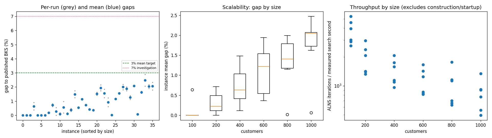
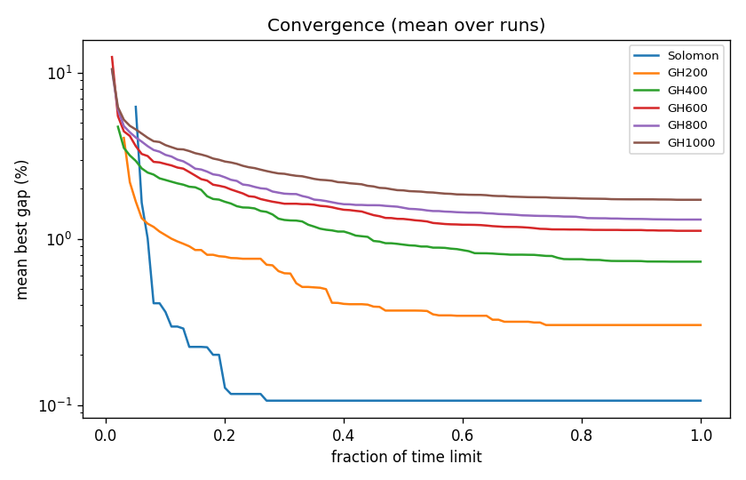

# ALNS + VND campaign `temp-1`

Split: **development**; 36 instances x 2 seeds; budget: time_limit = max(10.0, 0.1 * customers) seconds. Gaps are to published BKS (not proven optima), recomputed by the independent evaluator.

Throughput = total iterations / total measured solver search seconds over valid paired runs; construction and worker startup are excluded. Missing/nonpositive times are excluded, not replaced by the time budget. `throughput_runs` records the included run count; zero rates remain in CSV but are omitted from the log-scale throughput plot.

| Metric | Value |
| --- | ---: |
| planned attempts | 72 |
| attempts | 72 |
| feasible attempts | 72 |
| budget respected | 72 |
| mean gap equal weight | 0.881 |
| median instance gap | 0.676 |
| p90 run gap | 2.055 |
| worst run gap | 2.885 |
| best of seeds mean gap | 0.768 |
| mean within instance sd | 0.159 |
| negative gap runs | 0 |

Instances with any run above 7%: none

## By size family

| Family | n | time limit (s) | mean gap % | worst run gap % | mean seed SD | iterations |
| --- | ---: | ---: | ---: | ---: | ---: | ---: |
| Solomon | 6 | 10 | 0.106 | 0.907 | 0.064 | 31544 |
| GH200 | 6 | 20 | 0.303 | 0.976 | 0.201 | 35028 |
| GH400 | 6 | 40 | 0.729 | 1.728 | 0.118 | 53892 |
| GH600 | 6 | 60 | 1.119 | 2.142 | 0.224 | 64921 |
| GH800 | 6 | 80 | 1.307 | 2.190 | 0.134 | 76702 |
| GH1000 | 6 | 100 | 1.720 | 2.885 | 0.215 | 79430 |

## By instance class

| Class | instances | mean gap % | worst run gap % |
| --- | ---: | ---: | ---: |
| C1 | 6 | 0.437 | 2.082 |
| C2 | 6 | 0.354 | 1.195 |
| R1 | 6 | 1.148 | 1.728 |
| R2 | 6 | 1.310 | 2.885 |
| RC1 | 6 | 1.114 | 2.174 |
| RC2 | 6 | 0.921 | 2.326 |

## Per instance

| Instance | n | BKS | best | mean gap % | best % | worst % | SD | feasible | vehicles | iterations | time-to-best s |
| --- | ---: | ---: | ---: | ---: | ---: | ---: | ---: | ---: | ---: | ---: | ---: |
| Solomon/C107.vrp | 100 | 827.3 | 827.3 | 0.000 | 0.000 | 0.000 | 0.000 | 2/2 | 10.0 | 44899 | 0.5 |
| Solomon/C204.vrp | 100 | 588.1 | 588.1 | 0.000 | 0.000 | 0.000 | 0.000 | 2/2 | 3.0 | 24570 | 0.9 |
| Solomon/R102.vrp | 100 | 1466.6 | 1466.6 | 0.000 | 0.000 | 0.000 | 0.000 | 2/2 | 18.0 | 38678 | 1.4 |
| Solomon/R203.vrp | 100 | 870.8 | 874.0 | 0.637 | 0.367 | 0.907 | 0.382 | 2/2 | 5.5 | 25517 | 1.6 |
| Solomon/RC107.vrp | 100 | 1207.8 | 1207.8 | 0.000 | 0.000 | 0.000 | 0.000 | 2/2 | 12.0 | 33390 | 2.4 |
| Solomon/RC204.vrp | 100 | 783.5 | 783.5 | 0.000 | 0.000 | 0.000 | 0.000 | 2/2 | 4.0 | 22210 | 0.9 |
| GH200/C1_2_8.vrp | 200 | 2684.0 | 2684.0 | 0.000 | 0.000 | 0.000 | 0.000 | 2/2 | 20.0 | 53800 | 0.7 |
| GH200/C2_2_8.vrp | 200 | 1813.7 | 1816.9 | 0.176 | 0.176 | 0.176 | 0.000 | 2/2 | 6.0 | 25777 | 1.7 |
| GH200/R1_2_6.vrp | 200 | 3559.1 | 3581.0 | 0.714 | 0.615 | 0.812 | 0.139 | 2/2 | 20.0 | 37670 | 13.8 |
| GH200/R2_2_8.vrp | 200 | 1842.4 | 1842.4 | 0.269 | 0.000 | 0.537 | 0.380 | 2/2 | 4.5 | 24082 | 12.7 |
| GH200/RC1_2_2.vrp | 200 | 3221.6 | 3222.2 | 0.095 | 0.019 | 0.171 | 0.108 | 2/2 | 19.0 | 43366 | 11.7 |
| GH200/RC2_2_8.vrp | 200 | 2151.2 | 2154.5 | 0.565 | 0.153 | 0.976 | 0.582 | 2/2 | 6.0 | 25477 | 7.7 |
| GH400/C1_4_3.vrp | 400 | 6929.9 | 6933.1 | 0.110 | 0.046 | 0.175 | 0.091 | 2/2 | 38.0 | 77844 | 36.8 |
| GH400/C2_4_8.vrp | 400 | 3773.7 | 3783.6 | 0.374 | 0.262 | 0.485 | 0.157 | 2/2 | 12.0 | 42836 | 24.8 |
| GH400/R1_4_10.vrp | 400 | 8077.8 | 8178.2 | 1.486 | 1.243 | 1.728 | 0.343 | 2/2 | 37.0 | 59589 | 31.6 |
| GH400/R2_4_4.vrp | 400 | 4211.2 | 4231.8 | 0.541 | 0.489 | 0.594 | 0.074 | 2/2 | 9.5 | 41214 | 24.8 |
| GH400/RC1_4_8.vrp | 400 | 7757.2 | 7843.1 | 1.138 | 1.107 | 1.169 | 0.044 | 2/2 | 37.0 | 65676 | 37.9 |
| GH400/RC2_4_3.vrp | 400 | 4573.0 | 4606.2 | 0.726 | 0.726 | 0.726 | 0.000 | 2/2 | 12.0 | 36193 | 28.4 |
| GH600/C1_6_9.vrp | 600 | 13664.5 | 13719.8 | 0.416 | 0.405 | 0.427 | 0.016 | 2/2 | 57.0 | 94637 | 45.5 |
| GH600/C2_6_9.vrp | 600 | 7303.2 | 7328.4 | 0.364 | 0.345 | 0.382 | 0.026 | 2/2 | 19.0 | 47322 | 52.5 |
| GH600/R1_6_4.vrp | 600 | 15721.4 | 15943.0 | 1.520 | 1.410 | 1.630 | 0.156 | 2/2 | 55.0 | 71022 | 55.2 |
| GH600/R2_6_10.vrp | 600 | 11837.0 | 12043.1 | 1.941 | 1.741 | 2.142 | 0.283 | 2/2 | 14.0 | 49115 | 47.2 |
| GH600/RC1_6_2.vrp | 600 | 15890.6 | 16089.5 | 1.549 | 1.252 | 1.846 | 0.421 | 2/2 | 56.0 | 81020 | 52.9 |
| GH600/RC2_6_2.vrp | 600 | 10336.9 | 10399.9 | 0.922 | 0.609 | 1.235 | 0.443 | 2/2 | 18.5 | 46414 | 46.4 |
| GH800/C1_8_6.vrp | 800 | 25133.3 | 25134.6 | 0.019 | 0.005 | 0.033 | 0.019 | 2/2 | 80.0 | 134893 | 61.7 |
| GH800/C2_8_10.vrp | 800 | 10946.0 | 11067.4 | 1.152 | 1.109 | 1.195 | 0.061 | 2/2 | 24.0 | 53266 | 67.1 |
| GH800/R1_8_3.vrp | 800 | 29304.5 | 29745.5 | 1.549 | 1.505 | 1.592 | 0.062 | 2/2 | 73.0 | 85850 | 75.5 |
| GH800/R2_8_10.vrp | 800 | 19984.8 | 20345.2 | 1.997 | 1.803 | 2.190 | 0.274 | 2/2 | 17.5 | 50321 | 56.5 |
| GH800/RC1_8_9.vrp | 800 | 28347.1 | 28840.1 | 1.871 | 1.739 | 2.002 | 0.186 | 2/2 | 74.0 | 87981 | 76.7 |
| GH800/RC2_8_1.vrp | 800 | 19201.3 | 19415.4 | 1.257 | 1.115 | 1.398 | 0.200 | 2/2 | 24.0 | 47902 | 70.4 |
| GH1000/C1_10_2.vrp | 1000 | 41337.8 | 42192.1 | 2.074 | 2.067 | 2.082 | 0.011 | 2/2 | 99.0 | 128456 | 94.9 |
| GH1000/C2_10_2.vrp | 1000 | 16462.6 | 16470.8 | 0.059 | 0.050 | 0.069 | 0.013 | 2/2 | 30.0 | 73477 | 91.9 |
| GH1000/R1_10_5.vrp | 1000 | 50406.7 | 51185.2 | 1.621 | 1.544 | 1.697 | 0.108 | 2/2 | 93.0 | 87606 | 90.8 |
| GH1000/R2_10_7.vrp | 1000 | 23102.2 | 23578.4 | 2.473 | 2.061 | 2.885 | 0.583 | 2/2 | 22.0 | 47135 | 90.8 |
| GH1000/RC1_10_5.vrp | 1000 | 45028.1 | 45880.7 | 2.034 | 1.893 | 2.174 | 0.199 | 2/2 | 91.5 | 86620 | 94.4 |
| GH1000/RC2_10_10.vrp | 1000 | 21731.2 | 22120.0 | 2.057 | 1.789 | 2.326 | 0.379 | 2/2 | 20.0 | 53286 | 85.9 |

