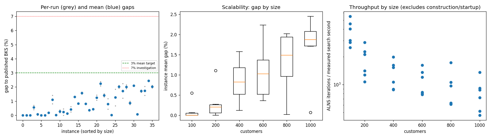
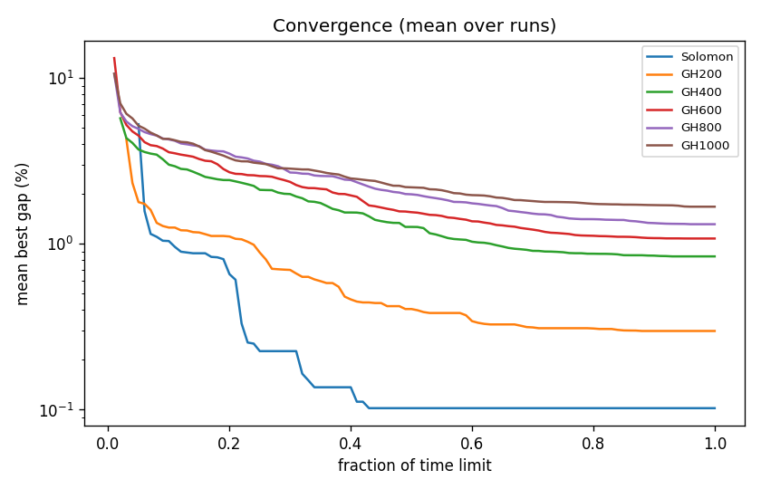

# ALNS + VND campaign `temp-2p5`

Split: **development**; 36 instances x 2 seeds; budget: time_limit = max(10.0, 0.1 * customers) seconds. Gaps are to published BKS (not proven optima), recomputed by the independent evaluator.

Throughput = total iterations / total measured solver search seconds over valid paired runs; construction and worker startup are excluded. Missing/nonpositive times are excluded, not replaced by the time budget. `throughput_runs` records the included run count; zero rates remain in CSV but are omitted from the log-scale throughput plot.

| Metric | Value |
| --- | ---: |
| planned attempts | 72 |
| attempts | 72 |
| feasible attempts | 72 |
| budget respected | 72 |
| mean gap equal weight | 0.885 |
| median instance gap | 0.803 |
| p90 run gap | 2.093 |
| worst run gap | 2.474 |
| best of seeds mean gap | 0.773 |
| mean within instance sd | 0.159 |
| negative gap runs | 0 |

Instances with any run above 7%: none

## By size family

| Family | n | time limit (s) | mean gap % | worst run gap % | mean seed SD | iterations |
| --- | ---: | ---: | ---: | ---: | ---: | ---: |
| Solomon | 6 | 10 | 0.102 | 0.701 | 0.050 | 31738 |
| GH200 | 6 | 20 | 0.299 | 1.405 | 0.146 | 33432 |
| GH400 | 6 | 40 | 0.841 | 1.646 | 0.086 | 50046 |
| GH600 | 6 | 60 | 1.078 | 2.384 | 0.203 | 62623 |
| GH800 | 6 | 80 | 1.314 | 2.243 | 0.346 | 71562 |
| GH1000 | 6 | 100 | 1.676 | 2.474 | 0.123 | 77373 |

## By instance class

| Class | instances | mean gap % | worst run gap % |
| --- | ---: | ---: | ---: |
| C1 | 6 | 0.430 | 2.093 |
| C2 | 6 | 0.390 | 1.847 |
| R1 | 6 | 1.228 | 2.106 |
| R2 | 6 | 1.180 | 2.384 |
| RC1 | 6 | 1.296 | 2.474 |
| RC2 | 6 | 0.786 | 2.112 |

## Per instance

| Instance | n | BKS | best | mean gap % | best % | worst % | SD | feasible | vehicles | iterations | time-to-best s |
| --- | ---: | ---: | ---: | ---: | ---: | ---: | ---: | ---: | ---: | ---: | ---: |
| Solomon/C107.vrp | 100 | 827.3 | 827.3 | 0.000 | 0.000 | 0.000 | 0.000 | 2/2 | 10.0 | 46558 | 0.5 |
| Solomon/C204.vrp | 100 | 588.1 | 588.1 | 0.000 | 0.000 | 0.000 | 0.000 | 2/2 | 3.0 | 24366 | 0.7 |
| Solomon/R102.vrp | 100 | 1466.6 | 1466.6 | 0.000 | 0.000 | 0.000 | 0.000 | 2/2 | 18.0 | 38572 | 2.0 |
| Solomon/R203.vrp | 100 | 870.8 | 874.3 | 0.551 | 0.402 | 0.701 | 0.211 | 2/2 | 5.5 | 25502 | 1.5 |
| Solomon/RC107.vrp | 100 | 1207.8 | 1207.8 | 0.062 | 0.000 | 0.124 | 0.088 | 2/2 | 12.0 | 34008 | 3.7 |
| Solomon/RC204.vrp | 100 | 783.5 | 783.5 | 0.000 | 0.000 | 0.000 | 0.000 | 2/2 | 4.0 | 21422 | 2.9 |
| GH200/C1_2_8.vrp | 200 | 2684.0 | 2684.0 | 0.000 | 0.000 | 0.000 | 0.000 | 2/2 | 20.0 | 52206 | 1.0 |
| GH200/C2_2_8.vrp | 200 | 1813.7 | 1816.9 | 0.176 | 0.176 | 0.176 | 0.000 | 2/2 | 6.0 | 25704 | 5.2 |
| GH200/R1_2_6.vrp | 200 | 3559.1 | 3588.0 | 1.108 | 0.812 | 1.405 | 0.419 | 2/2 | 20.0 | 38566 | 11.4 |
| GH200/R2_2_8.vrp | 200 | 1842.4 | 1842.6 | 0.011 | 0.011 | 0.011 | 0.000 | 2/2 | 4.0 | 19574 | 6.3 |
| GH200/RC1_2_2.vrp | 200 | 3221.6 | 3227.1 | 0.270 | 0.171 | 0.369 | 0.140 | 2/2 | 19.0 | 41397 | 15.4 |
| GH200/RC2_2_8.vrp | 200 | 2151.2 | 2151.2 | 0.225 | 0.000 | 0.451 | 0.319 | 2/2 | 6.0 | 23147 | 10.0 |
| GH400/C1_4_3.vrp | 400 | 6929.9 | 6935.0 | 0.115 | 0.074 | 0.157 | 0.059 | 2/2 | 38.0 | 74830 | 35.3 |
| GH400/C2_4_8.vrp | 400 | 3773.7 | 3782.3 | 0.420 | 0.228 | 0.612 | 0.272 | 2/2 | 12.0 | 40172 | 27.8 |
| GH400/R1_4_10.vrp | 400 | 8077.8 | 8180.7 | 1.291 | 1.274 | 1.307 | 0.024 | 2/2 | 37.0 | 57582 | 31.3 |
| GH400/R2_4_4.vrp | 400 | 4211.2 | 4245.3 | 0.837 | 0.810 | 0.864 | 0.039 | 2/2 | 9.5 | 33200 | 31.2 |
| GH400/RC1_4_8.vrp | 400 | 7757.2 | 7874.1 | 1.577 | 1.507 | 1.646 | 0.098 | 2/2 | 37.0 | 60873 | 37.0 |
| GH400/RC2_4_3.vrp | 400 | 4573.0 | 4609.1 | 0.806 | 0.789 | 0.822 | 0.023 | 2/2 | 11.5 | 33621 | 34.3 |
| GH600/C1_6_9.vrp | 600 | 13664.5 | 13705.7 | 0.358 | 0.302 | 0.414 | 0.080 | 2/2 | 57.0 | 92561 | 48.1 |
| GH600/C2_6_9.vrp | 600 | 7303.2 | 7333.5 | 0.422 | 0.415 | 0.429 | 0.010 | 2/2 | 19.0 | 45650 | 35.1 |
| GH600/R1_6_4.vrp | 600 | 15721.4 | 15888.9 | 1.246 | 1.065 | 1.426 | 0.255 | 2/2 | 55.0 | 68430 | 53.2 |
| GH600/R2_6_10.vrp | 600 | 11837.0 | 12083.4 | 2.233 | 2.082 | 2.384 | 0.214 | 2/2 | 14.5 | 47186 | 47.0 |
| GH600/RC1_6_2.vrp | 600 | 15890.6 | 16097.8 | 1.408 | 1.304 | 1.513 | 0.148 | 2/2 | 56.0 | 77573 | 53.7 |
| GH600/RC2_6_2.vrp | 600 | 10336.9 | 10382.1 | 0.801 | 0.437 | 1.164 | 0.514 | 2/2 | 18.5 | 44338 | 51.6 |
| GH800/C1_8_6.vrp | 800 | 25133.3 | 25134.6 | 0.019 | 0.005 | 0.033 | 0.019 | 2/2 | 80.0 | 132030 | 75.4 |
| GH800/C2_8_10.vrp | 800 | 10946.0 | 11018.4 | 1.254 | 0.661 | 1.847 | 0.839 | 2/2 | 24.5 | 47412 | 71.8 |
| GH800/R1_8_3.vrp | 800 | 29304.5 | 29868.0 | 2.015 | 1.923 | 2.106 | 0.130 | 2/2 | 73.0 | 73858 | 75.9 |
| GH800/R2_8_10.vrp | 800 | 19984.8 | 20225.0 | 1.722 | 1.202 | 2.243 | 0.736 | 2/2 | 18.5 | 48322 | 70.8 |
| GH800/RC1_8_9.vrp | 800 | 28347.1 | 28879.4 | 2.010 | 1.878 | 2.143 | 0.187 | 2/2 | 74.0 | 81017 | 73.6 |
| GH800/RC2_8_1.vrp | 800 | 19201.3 | 19345.0 | 0.867 | 0.748 | 0.985 | 0.167 | 2/2 | 24.5 | 46733 | 75.3 |
| GH1000/C1_10_2.vrp | 1000 | 41337.8 | 42201.0 | 2.091 | 2.088 | 2.093 | 0.003 | 2/2 | 99.0 | 130300 | 93.7 |
| GH1000/C2_10_2.vrp | 1000 | 16462.6 | 16473.5 | 0.067 | 0.066 | 0.067 | 0.001 | 2/2 | 30.0 | 69268 | 88.8 |
| GH1000/R1_10_5.vrp | 1000 | 50406.7 | 51228.3 | 1.710 | 1.630 | 1.791 | 0.114 | 2/2 | 93.0 | 83514 | 91.7 |
| GH1000/R2_10_7.vrp | 1000 | 23102.2 | 23427.7 | 1.725 | 1.409 | 2.041 | 0.447 | 2/2 | 21.0 | 44578 | 94.7 |
| GH1000/RC1_10_5.vrp | 1000 | 45028.1 | 46118.1 | 2.447 | 2.421 | 2.474 | 0.038 | 2/2 | 92.0 | 87270 | 95.7 |
| GH1000/RC2_10_10.vrp | 1000 | 21731.2 | 22149.4 | 2.018 | 1.924 | 2.112 | 0.133 | 2/2 | 20.0 | 49311 | 94.9 |

