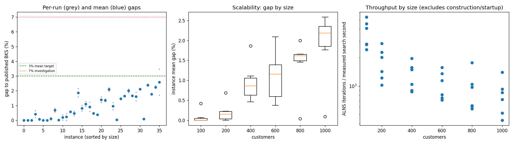
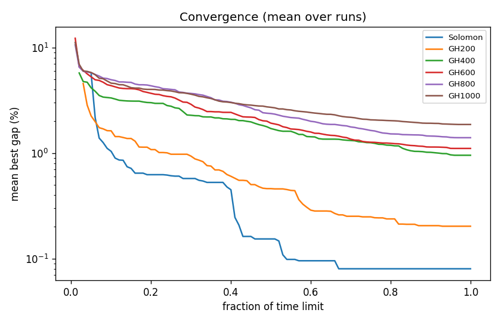

# ALNS + VND campaign `temp-4`

Split: **development**; 36 instances x 2 seeds; budget: time_limit = max(10.0, 0.1 * customers) seconds. Gaps are to published BKS (not proven optima), recomputed by the independent evaluator.

Throughput = total iterations / total measured solver search seconds over valid paired runs; construction and worker startup are excluded. Missing/nonpositive times are excluded, not replaced by the time budget. `throughput_runs` records the included run count; zero rates remain in CSV but are omitted from the log-scale throughput plot.

| Metric | Value |
| --- | ---: |
| planned attempts | 72 |
| attempts | 72 |
| feasible attempts | 72 |
| budget respected | 72 |
| mean gap equal weight | 0.934 |
| median instance gap | 0.752 |
| p90 run gap | 2.129 |
| worst run gap | 3.473 |
| best of seeds mean gap | 0.813 |
| mean within instance sd | 0.171 |
| negative gap runs | 0 |

Instances with any run above 7%: none

## By size family

| Family | n | time limit (s) | mean gap % | worst run gap % | mean seed SD | iterations |
| --- | ---: | ---: | ---: | ---: | ---: | ---: |
| Solomon | 6 | 10 | 0.080 | 0.655 | 0.070 | 31033 |
| GH200 | 6 | 20 | 0.203 | 0.812 | 0.145 | 32643 |
| GH400 | 6 | 40 | 0.953 | 2.147 | 0.266 | 48998 |
| GH600 | 6 | 60 | 1.106 | 2.203 | 0.164 | 60169 |
| GH800 | 6 | 80 | 1.397 | 2.109 | 0.126 | 71041 |
| GH1000 | 6 | 100 | 1.864 | 3.473 | 0.257 | 77281 |

## By instance class

| Class | instances | mean gap % | worst run gap % |
| --- | ---: | ---: | ---: |
| C1 | 6 | 0.532 | 2.131 |
| C2 | 6 | 0.412 | 1.517 |
| R1 | 6 | 1.327 | 2.458 |
| R2 | 6 | 1.059 | 2.109 |
| RC1 | 6 | 1.227 | 2.324 |
| RC2 | 6 | 1.045 | 3.473 |

## Per instance

| Instance | n | BKS | best | mean gap % | best % | worst % | SD | feasible | vehicles | iterations | time-to-best s |
| --- | ---: | ---: | ---: | ---: | ---: | ---: | ---: | ---: | ---: | ---: | ---: |
| Solomon/C107.vrp | 100 | 827.3 | 827.3 | 0.000 | 0.000 | 0.000 | 0.000 | 2/2 | 10.0 | 45410 | 0.5 |
| Solomon/C204.vrp | 100 | 588.1 | 588.1 | 0.000 | 0.000 | 0.000 | 0.000 | 2/2 | 3.0 | 23576 | 0.8 |
| Solomon/R102.vrp | 100 | 1466.6 | 1466.6 | 0.000 | 0.000 | 0.000 | 0.000 | 2/2 | 18.0 | 38773 | 1.6 |
| Solomon/R203.vrp | 100 | 870.8 | 872.4 | 0.419 | 0.184 | 0.655 | 0.333 | 2/2 | 5.5 | 23271 | 5.9 |
| Solomon/RC107.vrp | 100 | 1207.8 | 1207.8 | 0.062 | 0.000 | 0.124 | 0.088 | 2/2 | 12.0 | 34662 | 4.8 |
| Solomon/RC204.vrp | 100 | 783.5 | 783.5 | 0.000 | 0.000 | 0.000 | 0.000 | 2/2 | 4.0 | 20502 | 1.8 |
| GH200/C1_2_8.vrp | 200 | 2684.0 | 2684.0 | 0.000 | 0.000 | 0.000 | 0.000 | 2/2 | 20.0 | 51288 | 4.1 |
| GH200/C2_2_8.vrp | 200 | 1813.7 | 1814.1 | 0.099 | 0.022 | 0.176 | 0.109 | 2/2 | 6.0 | 25850 | 4.4 |
| GH200/R1_2_6.vrp | 200 | 3559.1 | 3579.0 | 0.686 | 0.559 | 0.812 | 0.179 | 2/2 | 20.0 | 36694 | 14.9 |
| GH200/R2_2_8.vrp | 200 | 1842.4 | 1842.4 | 0.005 | 0.000 | 0.011 | 0.008 | 2/2 | 4.0 | 18564 | 11.8 |
| GH200/RC1_2_2.vrp | 200 | 3221.6 | 3222.2 | 0.199 | 0.019 | 0.379 | 0.255 | 2/2 | 19.0 | 41278 | 15.9 |
| GH200/RC2_2_8.vrp | 200 | 2151.2 | 2151.2 | 0.228 | 0.000 | 0.456 | 0.322 | 2/2 | 6.0 | 22182 | 11.1 |
| GH400/C1_4_3.vrp | 400 | 6929.9 | 6968.3 | 0.566 | 0.554 | 0.577 | 0.016 | 2/2 | 38.0 | 73640 | 37.7 |
| GH400/C2_4_8.vrp | 400 | 3773.7 | 3785.1 | 0.457 | 0.302 | 0.612 | 0.219 | 2/2 | 12.0 | 39154 | 32.0 |
| GH400/R1_4_10.vrp | 400 | 8077.8 | 8205.8 | 1.866 | 1.585 | 2.147 | 0.397 | 2/2 | 37.0 | 55993 | 33.0 |
| GH400/R2_4_4.vrp | 400 | 4211.2 | 4237.8 | 0.818 | 0.632 | 1.004 | 0.264 | 2/2 | 9.0 | 33666 | 35.4 |
| GH400/RC1_4_8.vrp | 400 | 7757.2 | 7829.2 | 1.106 | 0.928 | 1.284 | 0.252 | 2/2 | 37.0 | 58910 | 38.0 |
| GH400/RC2_4_3.vrp | 400 | 4573.0 | 4599.9 | 0.904 | 0.588 | 1.220 | 0.447 | 2/2 | 11.0 | 32624 | 30.3 |
| GH600/C1_6_9.vrp | 600 | 13664.5 | 13721.8 | 0.472 | 0.419 | 0.525 | 0.075 | 2/2 | 57.0 | 89717 | 43.6 |
| GH600/C2_6_9.vrp | 600 | 7303.2 | 7329.6 | 0.372 | 0.361 | 0.382 | 0.015 | 2/2 | 19.0 | 46164 | 53.2 |
| GH600/R1_6_4.vrp | 600 | 15721.4 | 15911.1 | 1.397 | 1.207 | 1.588 | 0.269 | 2/2 | 55.0 | 64963 | 53.6 |
| GH600/R2_6_10.vrp | 600 | 11837.0 | 11985.9 | 1.353 | 1.258 | 1.449 | 0.135 | 2/2 | 14.5 | 42660 | 54.1 |
| GH600/RC1_6_2.vrp | 600 | 15890.6 | 16204.6 | 2.090 | 1.976 | 2.203 | 0.161 | 2/2 | 56.0 | 77038 | 55.0 |
| GH600/RC2_6_2.vrp | 600 | 10336.9 | 10411.2 | 0.950 | 0.719 | 1.181 | 0.327 | 2/2 | 18.5 | 40470 | 55.9 |
| GH800/C1_8_6.vrp | 800 | 25133.3 | 25143.3 | 0.040 | 0.040 | 0.040 | 0.000 | 2/2 | 80.0 | 134794 | 76.0 |
| GH800/C2_8_10.vrp | 800 | 10946.0 | 11098.2 | 1.453 | 1.390 | 1.517 | 0.089 | 2/2 | 25.0 | 46238 | 76.3 |
| GH800/R1_8_3.vrp | 800 | 29304.5 | 29779.9 | 1.635 | 1.622 | 1.647 | 0.018 | 2/2 | 73.0 | 74320 | 76.1 |
| GH800/R2_8_10.vrp | 800 | 19984.8 | 20361.4 | 1.997 | 1.884 | 2.109 | 0.159 | 2/2 | 18.5 | 47478 | 74.9 |
| GH800/RC1_8_9.vrp | 800 | 28347.1 | 28801.3 | 1.657 | 1.602 | 1.712 | 0.077 | 2/2 | 73.5 | 79526 | 76.4 |
| GH800/RC2_8_1.vrp | 800 | 19201.3 | 19453.3 | 1.603 | 1.312 | 1.893 | 0.411 | 2/2 | 24.0 | 43888 | 76.4 |
| GH1000/C1_10_2.vrp | 1000 | 41337.8 | 42205.2 | 2.115 | 2.098 | 2.131 | 0.023 | 2/2 | 99.0 | 134042 | 82.2 |
| GH1000/C2_10_2.vrp | 1000 | 16462.6 | 16475.3 | 0.091 | 0.077 | 0.104 | 0.019 | 2/2 | 30.0 | 68912 | 87.5 |
| GH1000/R1_10_5.vrp | 1000 | 50406.7 | 51568.2 | 2.381 | 2.304 | 2.458 | 0.108 | 2/2 | 93.0 | 81319 | 95.7 |
| GH1000/R2_10_7.vrp | 1000 | 23102.2 | 23504.9 | 1.762 | 1.743 | 1.780 | 0.026 | 2/2 | 21.5 | 41562 | 93.9 |
| GH1000/RC1_10_5.vrp | 1000 | 45028.1 | 46007.1 | 2.249 | 2.174 | 2.324 | 0.106 | 2/2 | 92.0 | 88478 | 95.2 |
| GH1000/RC2_10_10.vrp | 1000 | 21731.2 | 22099.7 | 2.584 | 1.696 | 3.473 | 1.257 | 2/2 | 20.0 | 49370 | 94.8 |

